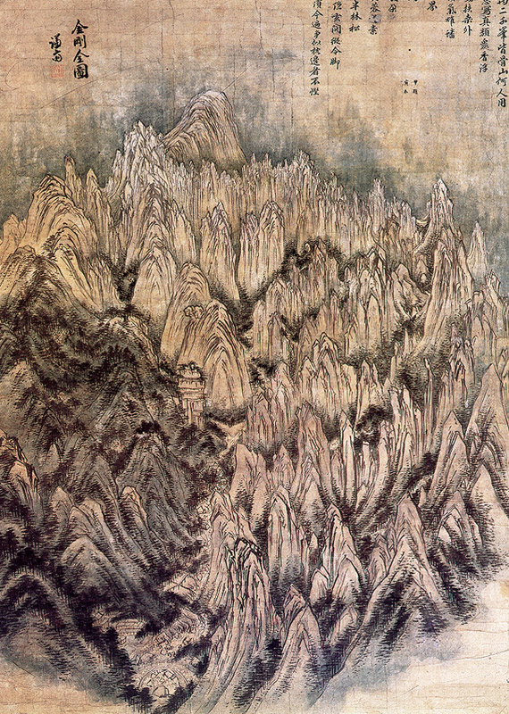
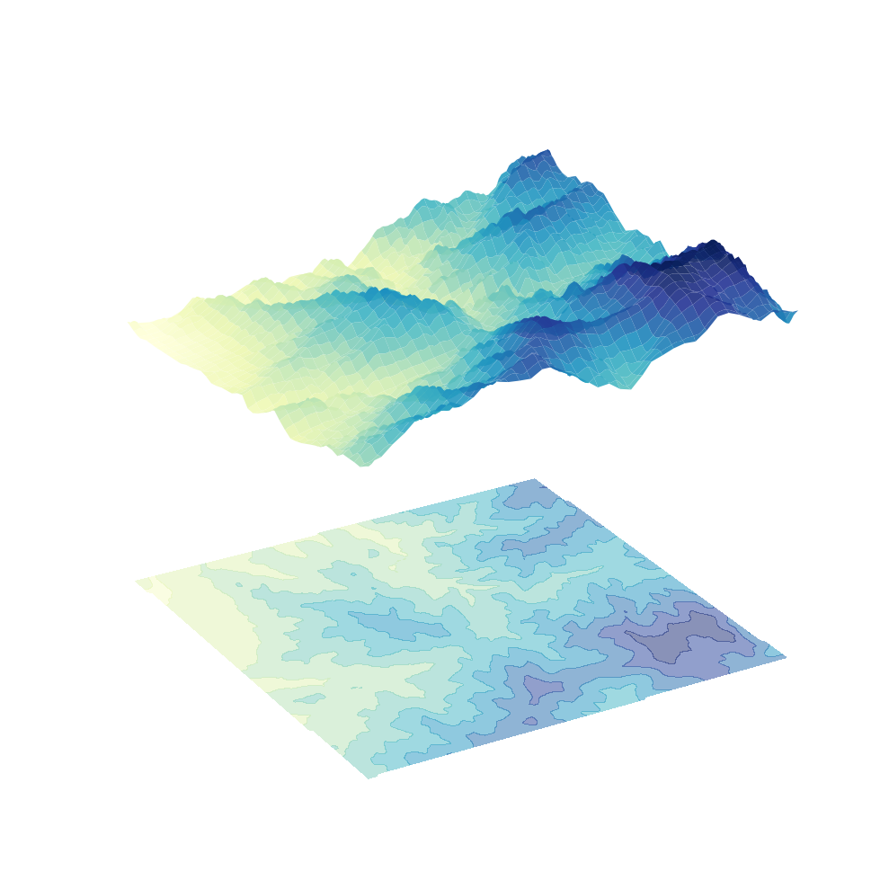

# Datascape: The Algorithm of "True View" (眞景山水) and Robotic Fabrication

  
  
  
  
  

> **"From 18th-century realism to 21st-century data: Redefining 'True View' (眞景) through procedural ink logic and robotic fabrication."**

  
   
  <b>Fig 1. Datascape 6-Axis Simulation Dashboard:</b> 
  (1) <b>Object Map</b>: Semantic segmentation of terrain features, 
  (2) <b>Junbeop Map</b>: Mapping traditional stroke classes, 
  (3) <b>Ink Score</b>: Continuous density mapping (Depth/Altitude/TPI), 
  (4) <b>Plotter Phase</b>: Multi-stage execution layers, 
  (5) <b>Vector Flow</b>: Terrain-aspect-driven stroke direction, 
  (6) <b>Final Output</b>: Stochastic layered simulation.

## 1. Philosophy: Evolution of "True View" (眞景山水畵)

### **The Comparison of Realism**
| 18th Century: Physical Realism | 21st Century: Digital Realism |
| :--- | :--- |
|  |  |
| *Geumgang jeondo (眞景山水畵) by Jeong Seon* | *Algorithmic Terrain Analysis (SRTM Data)* |

**Historical Shift of "Truth"**
* **The 18th Century:** Masters like Jeong Seon captured Mt. Kumgang through direct observation. "True View" (眞景) meant the landscape one could physically experience.
* **The 21st Century:** High-resolution satellite and LiDAR data provide a precise digital twin of the Earth. This quantified data is the most authentic **"True View" (眞景)** of our era.

---

## 2. Technical Implementation: 6-Axis Analysis
Datascape decomposes the landscape into a machine-readable "Ink Logic" through six diagnostic layers:

1. **Object Semantic Map**: Categorizes land into classes (TPine, Rock, UrbanBox, etc.) using NDVI and Slope data.
2. **Junbeop Texture Map**: Assigns traditional brushstroke algorithms (e.g., *Pima-jun* for ridges, *Bubyeok-jun* for cliffs).
3. **Ink Score (Nongdam)**: Calculates continuous grayscale values (1-10 levels) based on atmospheric perspective and local prominence (TPI).
4. **Plotter Execution Phase**: Segregates strokes into robotic phases (Phase 1: Base, Phase 2: Structure, Phase 3: Detail) for systematic fabrication.
5. **Stroke Vector Flow**: Generates a 360° aspect-driven vector field to guide the "grain" of the brushwork.
6. **Final Stochastic Output**: Simulates **"Jeok-muk" (積墨)**—the traditional technique of layering dry ink—through a stochastic overlapping algorithm.

---

## 3. Project Pipeline
1. **Data Extraction (GEE):** Global DEM harvesting via **Google Earth Engine (JavaScript)**.
2. **Topographic Analysis:** **Python-based** feature extraction (TPI/Slope) for peak/ridge identification.
3. **Stochastic Rendering:** Procedural mapping of features to 10+ brushstroke classes with random jittering for organic depth.
4. **Kinetic Realization:** Translating simulated vectors into **G-code** for the **Arduino-based robotic plotter**.

---

## 4. Attribution & Copyright
* **Historical Image:** *Geumgang jeondo* (Complete View of Mt. Kumgang) by Jeong Seon (1676–1759). Public Domain.
* **Satellite Data:** NASA SRTM 30m, Sentinel-2 L2A, Dynamic World V1 via **Google Earth Engine**.
* **Copyright:** Algorithmic logic and robotic system design ©2026 Seong Geon Lee.
