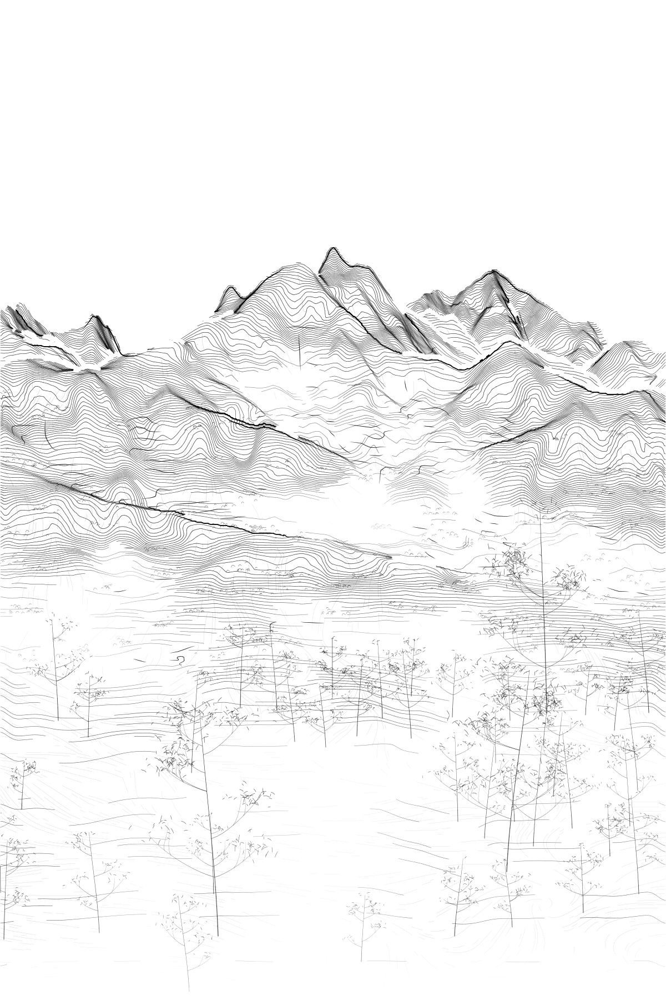
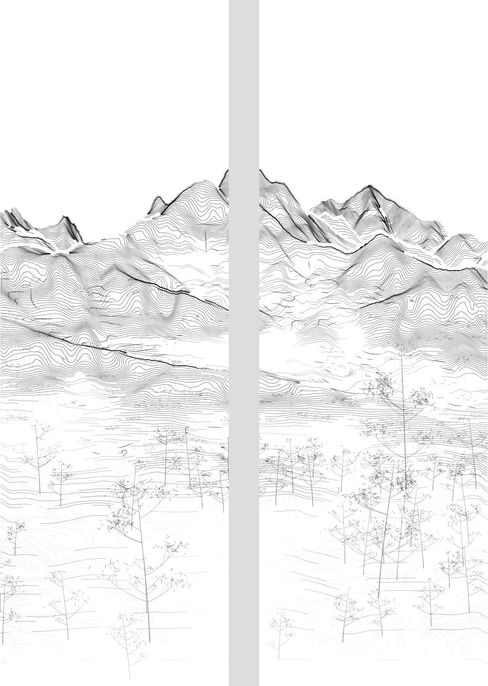

# Spring F2-C provisional baseline: near A = 0.25

The artist provisionally selected **foreground `target_strength = 0.25`** on 2026-10-16. This closes the current A-density selection stage. It does not reopen composition, optimize density further or develop the pictorial catalog in this Work.

## Exact starting point for the next Work

| Item | Pinned reference |
| --- | --- |
| Baseline ID | `spring-f2c-a025-provisional-v01` |
| **Canonical baseline artifact/code commit** | [`fdae976d3c3414f50c23054ad0f9cfa6e2945bca`](https://github.com/ggooonn/Datascape/commit/fdae976d3c3414f50c23054ad0f9cfa6e2945bca) |
| Branch carrying this baseline and handoff | `feat/spring-provisional-baseline-025` |
| Selected configuration | [`configs/scenes/seoul_spring_provisional_baseline_v01.json`](https://github.com/ggooonn/Datascape/blob/fdae976d3c3414f50c23054ad0f9cfa6e2945bca/configs/scenes/seoul_spring_provisional_baseline_v01.json) |
| Configuration SHA-256 | `e35f6156165b9588bd93ff11c98e87cc4a21e5b90225163bec3181b72f1e6e3c` |
| Mountain A reference | PR #14 Candidate 1, commit `812270655ad37606f49ff3eeeba53e7502e5d6a8` |
| Foreground method reference | PR #15, commit `ba379acf68b82759055fc2f201fb78d84298b4be` |
| Foreground target strength / inherited stroke seed | `0.25` / `20261015` |

The artifact commit above contains the configuration, reproducer, canonical vectors, both previews and validation record. This handoff is added afterward so it can point to that immutable commit without a self-referential commit hash. Use the pinned artifact commit, not the current `main`, to continue: the study PRs remain unmerged.

```bash
git fetch origin feat/spring-provisional-baseline-025
git switch -c feat/next-study fdae976d3c3414f50c23054ad0f9cfa6e2945bca
```

## Canonical result

- [Actual stroke records](https://github.com/ggooonn/Datascape/blob/fdae976d3c3414f50c23054ad0f9cfa6e2945bca/docs/baselines/spring_f2c_a025_v01/baseline_strokes.json.gz)
- [Production-style full composition](https://github.com/ggooonn/Datascape/blob/fdae976d3c3414f50c23054ad0f9cfa6e2945bca/docs/baselines/spring_f2c_a025_v01/production.png)
- [Physical two-panel preview](https://github.com/ggooonn/Datascape/blob/fdae976d3c3414f50c23054ad0f9cfa6e2945bca/docs/baselines/spring_f2c_a025_v01/physical_pair.png)
- [Input hashes, settings, output hashes and validation](https://github.com/ggooonn/Datascape/blob/fdae976d3c3414f50c23054ad0f9cfa6e2945bca/docs/baselines/spring_f2c_a025_v01/record.json)





The continuous painting remains 600 × 900 mm, split at x = 300 mm into two 300 × 900 mm panels. The physical preview inserts a 40 mm interval, for a total displayed width of 640 mm. No painting content is deleted to make that interval.

A has **1,091 finalized paths / 76.012 m**. Of these, 200 paths with mean source depth below 1,600 m total 11.353 m. The latter is the full length of those classified paths, not only their portions inside the near-depth region.

For subsequent studies, load `baseline_strokes.json.gz` as the fixed scene input. Its shared stroke geometry remains the source for digital previews and future output backends; this selection adds no G-code.

## What is fixed

- Selected F2-C source terrain, camera, projection and 600 × 900 mm composition.
- Original MASTER DEM and VEG/NDVI inputs; source XYZ and float64 retained fields match PR #15.
- Existing foreground retention: 70% legacy + 30% selective.
- Existing top reserve, near/middle/far omission fields, mist transfer and bottom 2 mm absolute omission with its irregular transition.
- Exact PR #14 Candidate 1 middle/far A records, all B/C/D/V extraction, placement, vertex profiles and production styling.
- Palette and FluidNC/tool-coordinate YAML values, historical artwork sources and all previous results.

The only selected change is the foreground phase-target coefficient. The existing target is evaluated once, then `phase1 + 0.25 * (full_foreground_target - phase1)` goes through the existing local monotone solve, extraction, foreground keep and mist transfer. This is **not** 25% of Candidate 2's finished paths, opacity or final visibility. The foreground solve retains the 0.05 directional floor, smoothness 6, six-cycle displacement bound and two-mm fixed boundary collar.

## Known path-ID-dependent omission

Preserve PR #15's raw `A-mass-…` candidate identity, `v4n-…` final near identity policy and seed. Do not silently normalize IDs.

PR #15's zero-phase audit found 65 identical near candidate paths in the legacy and new pipelines, but `A-rhythm-…` versus `A-mass-…` IDs changed the unchanged mist algorithm's hash-based omission decisions. Renaming only that raw ID prefix restored the legacy final records exactly. See [the preserved diagnosis](https://github.com/ggooonn/Datascape/blob/ba379acf68b82759055fc2f201fb78d84298b4be/docs/experiments/spring_foreground_interpolation_v01/README.md) and the `zero_identity_control` entry in its record.

The phase request can vary smoothly while contour events, spline acceptance, minimum-length cuts and ID-keyed omission change final visible segments discretely. Treat this 0.25 result as its own regenerated canonical dataset, **not a purely linear interpolation of final stroke visibility**. This selection documents the issue; it does not change the identity or mist algorithms.

## Archived alternatives

The following alternatives remain unchanged at PR #15 commit `ba379acf68b82759055fc2f201fb78d84298b4be`:

- [0.20 canonical vectors](https://github.com/ggooonn/Datascape/blob/ba379acf68b82759055fc2f201fb78d84298b4be/docs/experiments/spring_foreground_interpolation_v01/strength_0_20_strokes.json.gz)
- [0.35 canonical vectors](https://github.com/ggooonn/Datascape/blob/ba379acf68b82759055fc2f201fb78d84298b4be/docs/experiments/spring_foreground_interpolation_v01/strength_0_35_strokes.json.gz)
- [Their comparison report](https://github.com/ggooonn/Datascape/blob/ba379acf68b82759055fc2f201fb78d84298b4be/docs/experiments/spring_foreground_interpolation_v01/README.md)

## Reproduce without overwriting the archive

The original GeoTIFFs are external inputs. Their exact SHA-256 values are recorded in the configuration chain and baseline record; the loader rejects a different or incomplete file.

```bash
python -m pip install -e '.[research,dev]'
python -m datascape.rendering.spring_baseline \
  /path/to/SeoulNorth_v02_MASTER_30m.tif \
  /path/to/SeoulNorth_v02_VEG_10m.tif \
  --config configs/scenes/seoul_spring_provisional_baseline_v01.json \
  --output output/spring-provisional-a025
```

The same `run` function can be called from Jupyter. Read the saved canonical vectors when regeneration is unnecessary. Generation uses float64; the record pins dependency versions and implementation/configuration hashes.

Both phase solves converged, no checked directional derivative is nonpositive, frozen layer records match exactly, omission cores and the bottom 2 mm footprint remain empty, and the existing 118 tests pass. Output SHA-256 values are in `record.json`.

## Scope for continuation

The next Work should begin with this fixed baseline and a separate branch. A pictorial grammar catalog can be discussed and developed there as a separate task; no catalog or new vegetation, rock, path, color or G-code generator is included here. Do not restart viewpoint, camera, terrain selection or A-density optimization as part of loading the baseline. Keep public documentation/comments/commits/PRs in English and user discussion in Korean. Do not merge any study PR into main without the artist's approval.

