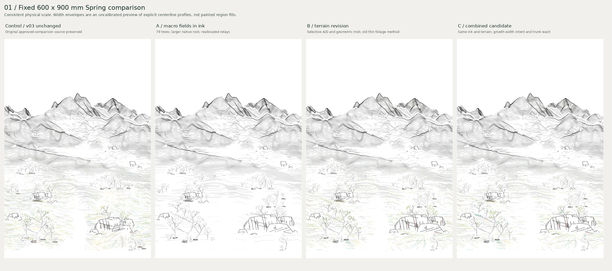

# Spring integration v04: preservation checkpoint

**Draft; unapproved scene; no refinement and no merge.** This freezes the current
exploration so a separate Work can develop mid/far pictorial grammar.

Read [the next-Work handoff](HANDOFF.md), [reproduction](REPRODUCE.md),
[validation](VALIDATION.md) and [temporary placements](placement_inventory.csv).
The later `START_HERE.md` pointer and Draft PR pin the exact artifact commit.

## Essential comparisons

| Review | File |
| --- | --- |
| Whole scene: v03 / v04 ink / B / C | [Sheet 01](artifacts/sheet01_full_comparison.png) |
| Macro-field map, nonplotting | [Map extracted from original sheet 02](artifacts/macro_map.png) |
| D-related far color and actual mist omission | [Sheet 03](artifacts/sheet03_far_D_mist.png) |
| Same-ink thin vs gesture foliage / trunk | [Sheet 04](artifacts/sheet04_vegetation_brush.png) |
| Actual scene contact and occlusion crops | [Sheet 05](artifacts/sheet05_integrated_detail.png) |
| Integrated C diagnostic / color alone | [Scene](artifacts/caseC_diagnostic.png) / [Color supports](artifacts/color_only_diagnostic.png) |

The five original reference images and original sheet 02's reference thumbnails
remain in the private `Datascape_Spring_v04_Package.zip` archive. This PR includes
only the exact nonplotting map crop and textual [reference-to-rule mapping](reference_rules.json).
Their silhouettes/textures are not copied. Original source commit, archive SHA,
all excluded output hashes and private reference hashes remain recorded, so the
full original review can be identified without publishing third-party images.

## File classification

| Class | Included / excluded |
| --- | --- |
| Current implementation and dependencies | v02/v03/v04 integration modules, renderer dependencies, three scene configs and relevant tests; all restored study bytes preserved. |
| Current reproducible saved state | One ink archive; seven primitive color channels including hard-only diagnostic; source/feather/visibility ledgers, sites, support boundaries, metrics and provenance. |
| Immediate control | v03 ink plus A/C/material color primitives, one full preview and record. |
| Concise review | Four complementary sheets, exact macro map, integrated C diagnostic and color-only diagnostic. |
| Documentation | Handoff, replay/regeneration commands, validation, explicit temporary-site inventory and hashes. |
| Derived duplication excluded | Combined terrain/B/C arrays and large SVGs: recreated from the exact ordered primitive channels. Full-size A/B/restrained images can be replayed. |
| Intermediate/private material excluded, not deleted | Earlier local PNG/SVG/HTML/ZIP exports, caches, original reference images, reference montage, TIFFs and redundant study outputs. The archived package remains untouched. |
| Existing repository history | All inherited PR #20 and earlier files remain byte-identical; no previous experiment or baseline is removed. |

`archive_manifest.json` preserves original local-only commit IDs and output
signatures. `checkpoint_manifest.json` describes this compact published set.
Original generation assertions in `artifacts/record.json` are historical evidence;
saved-vector replay does not repeat their DEM/source-field computation.

No approval is implied by the 79/22/18 counts, occupied-core clipping, native
catalog dimensions, D color increase or source-arc checks. Distribution/scale,
clusters, mid/far vegetation and A color deployment, weak C/color density,
mist transitions, depth rhythm, woody wash and temporary placement all remain
open as detailed in the handoff.
