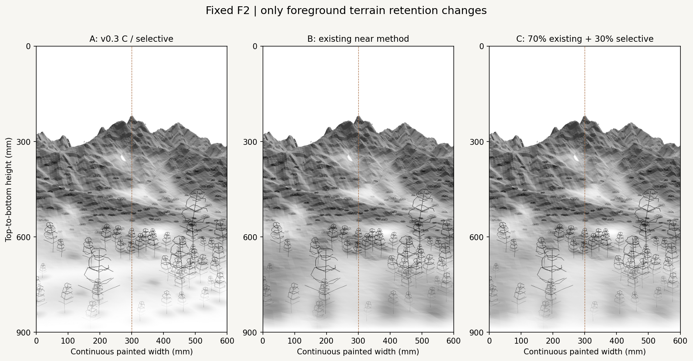
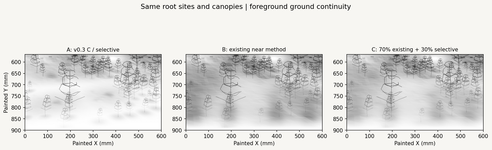
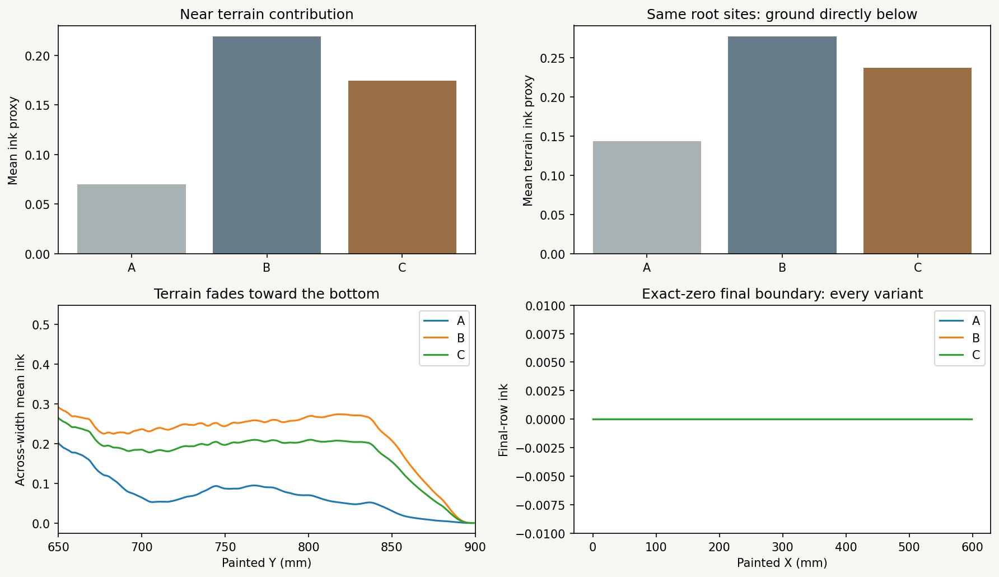
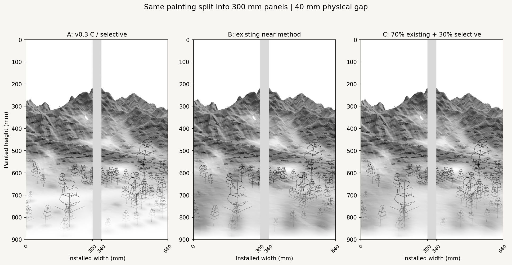

# F2 foreground continuity: final small comparison

One controlled comparison of existing near-terrain retention rules. F2 geometry, raw DEM, v0.3 far omission, the global bottom transition/2 mm guard, and all vegetation remain fixed. No new field generator or projection system is introduced.



| Variant | Near terrain rule | Reading |
| --- | --- | --- |
| A | Current v0.3 C, reproduced pixel for pixel | Most open paper, but low-ground patches and some roots feel separated. |
| B | Existing near-preservation method with v0.3 far/boundary settings | Strongest continuous ground; roots sit on a readable surface, with a heavier lower tone. |
| C | 70% existing + 30% selective retention | Restores a continuous surface and root connection while remaining lighter than B. |

**C is the proposed snapshot for the next vector-stroke comparison.** It connects near ground to the valley and distant mountains without returning to a solid lower baseline. B is useful if the subsequent actual lines prove too sparse. This comparison completes the composition/whitespace study; further mask variants are not needed before testing strokes.

## What changes, exactly

The two existing local retention arrays already contain the same middle/far factors. The sole combination is:

`R_local_C = 0.70 R_local_existing + 0.30 R_local_selective`

Then multiply the **unchanged v0.3 global retention once**, and apply it to raw terrain ink coverage. Values that already match are preserved bit for bit. Every sample outside the existing source-depth near role remains identical for A/B/C. There is no DEM, camera or image warp, no new positive-form selection rule and no additional transition-strength adjustment.

The rendered **vegetation coverage itself is shared**, not merely the placement seed. All 42 near, 105 middle and 65 far small-mark geometries and the three v0.3 representatives are reused. Positions, heights, branch/crown grammar, source root metadata, depth behavior and omission stay fixed. Only the terrain below them changes. This isolates the foreground question and avoids confounding it with new planting or darker trees.

The mix is recorded in [`seoul_f2_foreground_continuity_v04.json`](../../../configs/scenes/seoul_f2_foreground_continuity_v04.json). No new randomness is introduced; v0.3 settings and archived mark geometry are reused.

## Ground continuity and root support



| Preview measure | A | B | C |
| --- | ---: | ---: | ---: |
| Mean near-zone terrain ink | 0.0697 | 0.2191 | 0.1743 |
| Mean terrain ink directly below the same roots | 0.1439 | 0.2774 | 0.2373 |
| Near-terrain image components ≥200 pixels at ink >0.05 | 9 | 1 | 1 |

Near-zone statistics use the existing near role >0.7. Root support samples a small 7 mm neighborhood below **42 unique near-root sites**; representative roots are deduplicated because they share small-mark parent sites. The image-component diagnostic uses eight-neighbor adjacency on the thresholded ink preview. It is evidence of the rendered ground's visual connection, not a claim about actual landform topology, roads or walkability. No metric is treated as a quota.

C restores more ground underneath the existing trees and keeps the smaller mounds as part of a continuous surface. Its tone is about 20% lighter than B on the near-zone measure. The ground still fades into paper before the bottom edge. Fine structural reading should now be established with actual curves/structure strokes, rather than optimizing shade patches further.



## Fixed boundary, far terrain and vegetation

For every variant, the final painted two rows have maximum **terrain, vegetation and combined ink contribution exactly 0** before PNG quantization. The analytic v0.3 boundary at y = 900 mm also returns exactly 0. The configured hard guard remains 2 mm, with its 18 mm collar and irregular 5–15% transition unchanged. Mixing the local near rules cannot bypass the global gate.

The v0.3 far-retention and global-retention arrays are reused without edits. Non-near terrain pixels are preserved, and the shared vegetation means the upper mountain/sky scene is also unchanged. No new top reserve or altered representative tree is introduced.

## Physical pair



The painting is one **600 × 900 mm** continuous image. Each panel remains **300 × 900 mm**. Only the installation preview inserts the **40 mm physical gap**, giving a 640 × 900 mm display. The gray gap is unpainted installation space. C keeps the trunks away from the seam and allows the restored ground to continue across the two panels before fading below. Individual panel and installation PNGs are included for A/B/C.

## Reproduce and freeze the selected snapshot

```bash
python -m pip install -e ".[research,dev]"
python -m datascape.rendering.foreground_continuity \
  /path/to/SeoulNorth_v02_MASTER_30m.tif \
  /path/to/SeoulNorth_v02_VEG_10m.tif \
  --config configs/scenes/seoul_f2_foreground_continuity_v04.json \
  --output outputs/f2_foreground_continuity_v04
python -m pytest tests -q
```

[`09_f2_foreground_continuity.ipynb`](../../../notebooks/09_f2_foreground_continuity.ipynb) reads `DATASCAPE_DATA_DIR`; select the installed project environment in VSCode/Jupyter. Outputs go to a new folder. Previous v0.1/v0.2/v0.3 sources and artifacts are preserved.

[`retention_snapshots.npz`](retention_snapshots.npz) stores only the three **derived combinations of existing terrain retention** (float16), the unchanged categorical boundary and occupied-terrain mask. Arrays are [top-to-bottom row, left-to-right column] at 600 × 900 pixels. They are diagnostic snapshots; recompute the combination in float64 for actual stroke sampling. Original source XYZ/depth remain in the unchanged [v0.1 archive](../f2_painterly_layers_v01/fields.npz).

[`record.json`](record.json) stores input/config/archive hashes, all previous artifact hashes, mix/invariants and diagnostics. Source TIFF hashes are checked before/after rendering. The [v0.3 representatives](../f2_painterly_composition_v03/representative_trees.json) and [v0.2 small marks](../f2_multidepth_whitespace_v02/marks.json) remain the authoritative common vegetation sources. Vegetation omission remains the **v0.3 C snapshot**, independently of the selected terrain combination; this is intentional in this terrain-only comparison.

Validation: **60 tests passed**, including blend bounds/immutable inputs, common far/boundary values, fixed vegetation composition and duplicate-root handling. Three notebook code cells were validated and replayed in one Python namespace; **18 generated artifacts match the CLI run byte for byte**, including decoded snapshot arrays. This does not claim a launched Jupyter kernel. All PNGs, decoded archive arrays, JSON, source hashes and previous snapshots are verified before publication.

After visual selection, freeze the chosen terrain combination, common vegetation snapshot and exact boundary rule. Compare Taebaek horizontal curves, terrain structure lines and direction-field vector strokes on that same scene. Apply omission/splitting/density to actual segments. Digital rendering and later G-code should use the same retained vector data; neither a stroke engine nor G-code/color implementation is added by this small comparison.
