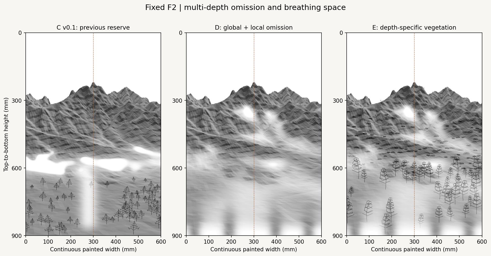
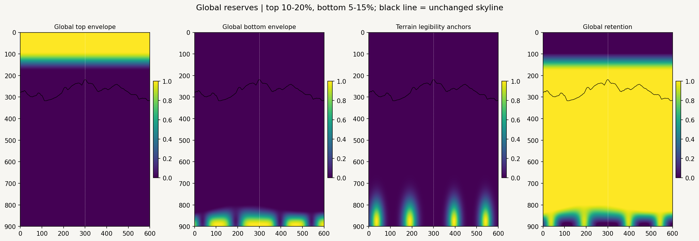
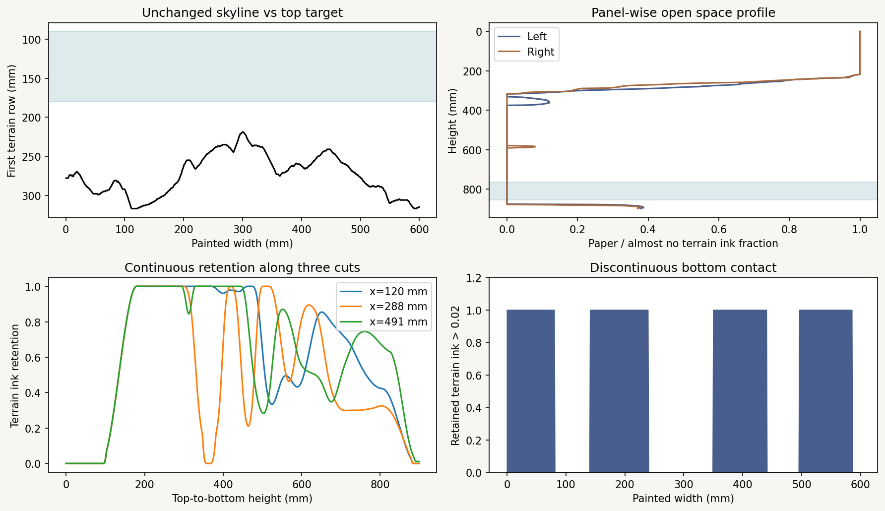
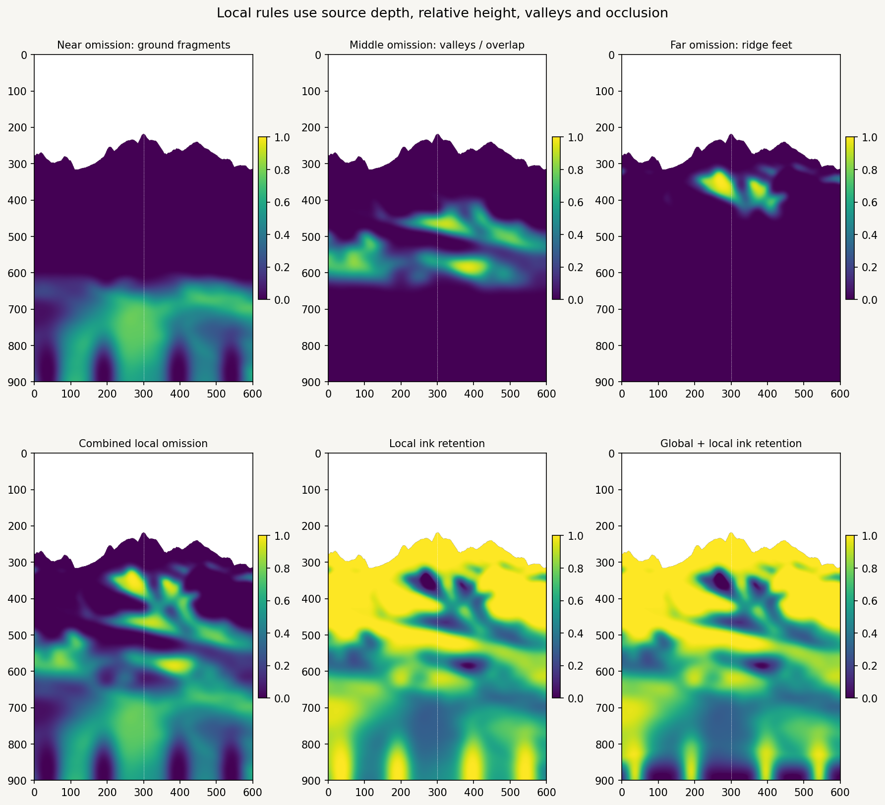
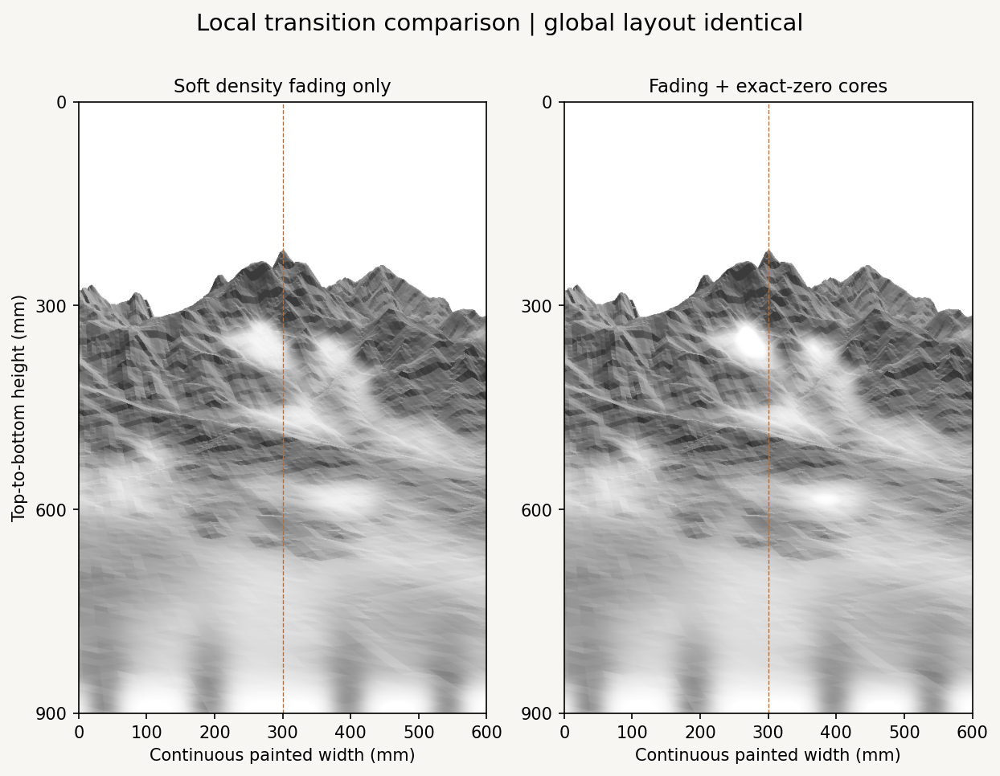
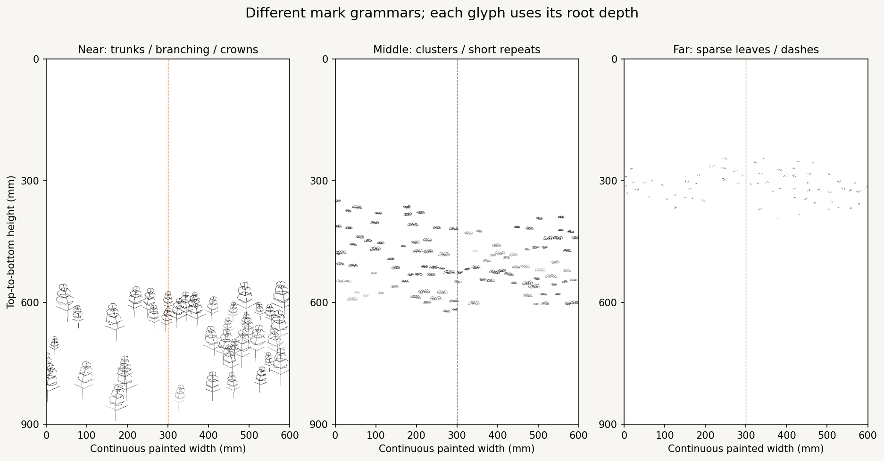
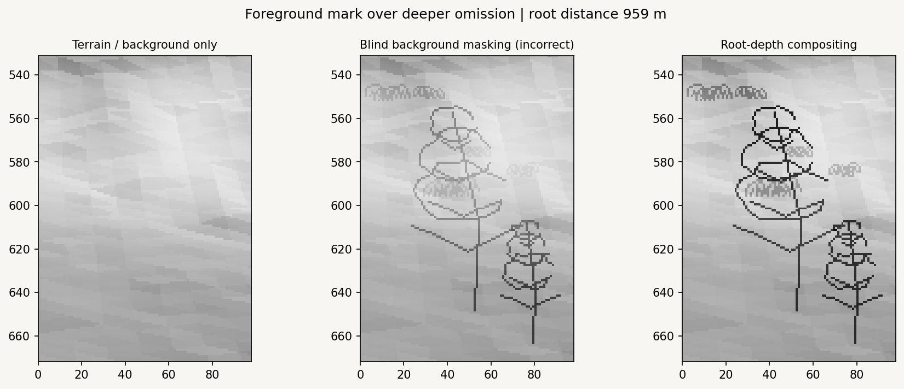

# F2 multi-depth whitespace refinement v0.2

Separate **global composition reserves** from **local near/middle/far omission**, while preserving the F2 camera, projection, DEM and previous A/B/C files. Mist is a painterly rule for reducing contributions and revealing paper. There is no weather simulation or white-paint pass.



| Study | Purpose | Reading of the result |
| --- | --- | --- |
| C v0.1 | Preserved comparison | Strong foreground/mountain separation, concentrated in a broad middle belt. |
| D | New global + local terrain omission | Several valley/overlap pockets replace the belt. Broad gradual fading carries most of the change, with small exact-zero cores. Bottom contact breaks into terrain patches. |
| E | D + three vegetation grammars | Near branching/crowns, middle clumps/repeats and far leaf dashes provide different distance cues. Near branches can remain visible against omission belonging to deeper terrain. |

D is the clearest view for judging the reserve structure; E tests depth interaction. E is not a finished tree or vegetation treatment. Middle clump spacing remains fairly regular, and the two strongest far-foot openings can still attract attention. Review their strength and the foreground group rhythm before generating final strokes.

## Global composition: top and bottom



The black line is the **unchanged F2 terrain skyline**. Bright envelope values mean stronger reserve; bright retention values mean more retained contribution. The global template covers the full frame, including paper where no terrain exists.

**Top:** the configured envelope is fully open through 10% of screen height and fades away by 20%. Inscription reserve is a separate, disabled-by-default option. The current F2 already has **24.33% full-width blank sky**: first terrain appears at 219 mm, with column-wise p10/median/p90 of about 238 / 273 / 309 mm. The 10–20% envelope does not intersect this terrain, so the top is diagnosed rather than artificially tightened. Fixed geometry and placement cannot reduce existing blank paper without adding content, cropping or moving the composition. None of those actions is taken here. Final E retains the same 24.33% full-width opening.

**Bottom:** a variable transition extent uses the configured **5–15%** height range. Its local depth is `0.05 + 0.10 × (0.65 × native_noise + 0.35 × small_valley)`. A smoothstep fade begins at that irregular boundary, over 90% of the local extent. This is a global layout control, not the boundary of a source-depth class.

Four legibility anchors are selected from **actual visible DEM coordinates**, below 120 m, at source forward distance <450 m, slope ≤12° and screen v >0.95. Mound proxy, gentleness, native variation and loose screen balance guide selection. Their footprint width varies with native variation; anchors suppress the bottom envelope locally. The selected patches are not identified as real rocks, roads or trees. Exact coordinates, heights, slopes and footprint dimensions are in [`record.json`](record.json).

The resulting bottom edge has terrain coverage above the diagnostic ink threshold 0.02 over **60.17%** of its width: 60.00% left, 60.33% right, versus 100% before. The bottom 15% retains **51.61%** of its original terrain ink proxy. This breaks the continuous baseline while preserving low ground. It does not make the entire lower strip blank, and the remaining contact is still fairly broad.



The profile reports the two painted panels separately. The shaded 5–15% interval is a target extent reference, not a claim that every column has the same margin. The envelope and local near omission overlap without moving the source surface.

## Local omission: depth and terrain, not row bands



Let `S(t) = clamp(t,0,1)^2 × (3 − 2 clamp(t,0,1))`. Source forward distance q determines smoothly overlapping roles:

- Near = `1 − S((q − 600) / 1000)`.
- Far = `S((q − 2200) / 1200)`.
- Middle = `1 − near − far`.

A pixel's screen row is not used to assign a local role. Valleys and projected overlap can therefore bring a component into irregular portions of the screen. Global top/bottom envelopes intentionally use layout coordinates; they are a different level.

Feature surfaces are computed on the original native MASTER grid and sampled at the visible mapped triangle's source coordinates:

| Feature | Rule and role |
| --- | --- |
| Small/medium/large valley proxies | Mask-aware Gaussian DEMs, sigma 120/360/900 m. Positive `blur_z − raw_z` is mapped with `S((difference − 2)/33)`. |
| Mound proxy | Positive raw elevation above the 120 m blur; helps preserve readable ground patches. It does not identify a boulder or mound as an observed object. |
| Main ridge protection | Positive raw elevation above the 360 m blur, mapped from 8 to 65 m relief. |
| Far-foot proxy | Position between the local native DEM minimum and maximum within a 600 m square half-width. Lower portions of that local relief receive stronger foot weight; there is no absolute-height veto that would exclude high mountain feet. |
| Overlap/occlusion cue | Positive q jumps on the farther side of neighboring visible terrain pixels, mapped from 150 to 700 m, expanded one pixel and feathered at 5 mm. Its strongest value is normalized to 1 within this study. This is a projected overlap proxy, not a hydrological feature. |
| Silhouette protection | The first 18 mm below each terrain skyline column is protected with a smooth falloff. Protection is reapplied after field feathering. |
| Irregularity | Seeded native-grid Gaussian noise at sigma 160 m, sampled geographically. It changes composition weights, not terrain height. |

The relative-foot proxy uses `h = (z − local_min) / max(local_max − local_min,10)` and `foot = 1 − S((h − 0.15)/0.5)`. Main ridge protection and the upper silhouette preserve peaks while allowing lower portions of far ridges to fade.

| Component | Score before feathering |
| --- | --- |
| Near | Near role × `(0.32 small_valley + 0.28 medium_valley + 0.25 noise + 0.15 low_ground)` × anchor protection. Low-ground weight fades between 80 and 240 m. |
| Middle | Middle role × `(0.50 medium_valley + 0.28 large_valley + 0.22 overlap)` × irregularity × ridge/silhouette protection. |
| Far | Far role × `(0.40 foot + 0.32 medium_valley + 0.20 overlap + 0.08 large_valley)` × irregularity × ridge/silhouette protection. |

Scores are mask-aware feathered at 12/14/9 mm, then mapped through broad transitions: near [0.10, 0.55], middle [0.08, 0.62], far [0.04, 0.42]. Irregularity weights range from 0.65 to 1; ridge protection strength is 0.65. These are explicit artistic parameters in [`seoul_f2_multidepth_whitespace_v02.json`](../../../configs/scenes/seoul_f2_multidepth_whitespace_v02.json), not physical laws.

Local omission combines as `L = 1 − (1 − L_near)(1 − L_middle)(1 − L_far)`. It does not stack three white layers.

## Gradual fading and exact-zero cores



The soft local variant retains `1 − 0.92L`. The core variant additionally multiplies by a smooth core gate: the gate starts at L = 0.90 and reaches zero retention at L = 0.975. Global reserve uses the same rule with soft strength 0.99, core start 0.94 and full omission at 0.985. Global and local retention multiply; coverage contributions are attenuated before compositing against paper.

The final study has **762 local exact-zero terrain pixels** and **2,117 global exact-zero terrain pixels**, compared with the much larger 15,362-pixel hard reserve in v0.1 C. Near and middle are mostly gradual; exact-zero local cores occur in the strongest combined/far pockets. No per-distance quota is imposed. The soft/core preview difference is deliberately subtle because the zero cores are small.

Local cores guarantee zero **terrain contribution at that source depth**. A genuinely nearer symbolic branch can still cross their paper background. Global cores are unconditional layout reserves and have **zero final ink contribution**, including all vegetation. Both contracts are verified; they must not be conflated.

A future stroke layer can use retention as a seeded inclusion probability, spacing or layer-density control, with core masks splitting/omitting segments. Future color layers can share the omission contract while keeping per-layer density and order separate. Current gray coverage is a composition preview, not calibrated pigment dilution or brush pressure. No terrain stroke engine, final pine treatment, texture style, color field or G-code is generated here.

## Three vegetation grammars and depth ordering



Native seasonal VEG is sampled with its own affine transform; the 20 m origin offset is preserved. Bilinear observation values are effective support, not native integer counts. Placement requires valid spring NDVI, N ≥6 and finite terrain slope. Confidence reaches full support at N =12; NDVI rises from 0.10 to 0.65. Summer/winter evidence modulates seasonality. Slope, elevation, weak declared aspect preference, source-depth role, side balance and omission retention modify the density. These are measured proxies plus painterly placement rules, not a tree inventory.

| Role | Grammar | Preview count / spacing |
| --- | --- | --- |
| Near | Trunks, branching polylines and irregular crown arcs, 42–92 mm high | 42 roots / minimum 27 mm |
| Middle | Shared clump arcs and short repeated strokes, without long individual trunks | 105 roots / minimum 18 mm |
| Far | Sparse leaf dots and short dashes near protected ridges/silhouette | 65 roots / minimum 19 mm |

The density fields are shown in [`vegetation_fields.png`](vegetation_fields.png); each role uses its own display maximum for visibility. Root candidates are weighted by local retention, so vegetation avoids incompatible paper reserves. All roots record source XYZ, source depth, NDVI, effective observation support, slope, stable IDs and exploratory polylines in [`marks.json`](marks.json).

Each glyph is an artistic billboard at its **root's constant forward depth**, not a reconstructed tree volume. Terrain over 80 m nearer than that depth occludes it. Otherwise, local omission is matched by a Gaussian of the background/object depth difference (sigma 220 m). A reserve belonging to substantially deeper terrain therefore leaves a foreground branch visible. Global reserves still apply to all objects.



The middle diagnostic reapplies the background mask to the correctly composited mark ink to illustrate the unwanted fading. The right view keeps root-depth compositing. This scene contains **309 surviving mark-pixel contributions (summed across glyphs)** over significantly deeper, locally faded terrain. No mark pixels happened to require nearer-terrain rejection in this final configuration; that occlusion case is independently tested.

## Separate records and reproduction

The fixed F2 source configuration and previous A/B/C files remain unchanged. `load_features` and the original quality loader are reused; no duplicate projection is introduced. Source coordinate recovery uses the final mapped triangle's barycentric interpolation. The full native source hashes are checked before and after rendering.

The painting remains one **600 × 900 mm** continuous image, split into **300 × 900 mm** panels. Only [`physical_pair.png`](physical_pair.png) inserts the **40 mm installation gap**. [`panel_1.png`](panel_1.png) and [`panel_2.png`](panel_2.png) have no painted seam or rescaling.

Run from the repository root:

```bash
python -m pip install -e ".[research,dev]"
python -m datascape.rendering.multidepth_whitespace \
  /path/to/SeoulNorth_v02_MASTER_30m.tif \
  /path/to/SeoulNorth_v02_VEG_10m.tif \
  --config configs/scenes/seoul_f2_multidepth_whitespace_v02.json \
  --output outputs/f2_multidepth_whitespace_v02
python -m pytest tests -q
```

[`07_f2_multidepth_whitespace.ipynb`](../../../notebooks/07_f2_multidepth_whitespace.ipynb) uses `DATASCAPE_DATA_DIR` and the selected Python environment in VSCode/Jupyter. Copy a JSON configuration and write to a new output directory when varying a rule. Keep the fixed F2 JSON, source TIFFs and v0.1 results untouched.

Seed **20261015** uses separate streams: 401 for native irregularity, 501 plus role index for placement, 502 plus role index for grammar. [`record.json`](record.json) stores source/config/archive hashes, all previous artifact hashes, exact parameters, anchor coordinates, per-panel diagnostics and depth-crossing examples.

[`fields.npz`](fields.npz) stores the scalar reserve/retention/vegetation fields as float16, usually within 0.0005 absolute quantization. Arrays use `[top-to-bottom row, left-to-right column]` at 600 × 900 pixels; one preview pixel equals one painted millimeter. Boolean core masks preserve exact-zero semantics and should be used for categorical omission instead of inferring cores from rounded scalar values. Local masks apply only on `occupied` terrain. Original raw source XYZ/depth remain in the unchanged [v0.1 archive](../f2_painterly_layers_v01/fields.npz); processing uses float64 coordinates. Native DEM feature surfaces are used for weights only.

Validation: **53 tests passed**, including separate global/local semantics, source-distance partitioning, different grammars, foreground survival, nearer-terrain occlusion, missing-evidence rejection, protected silhouettes, immutable geometry and verified archive writes. Five notebook code cells were validated and replayed in a shared Python namespace; all **20 generated artifacts matched the CLI run byte for byte**, including decoded field arrays. This does not claim a launched Jupyter kernel. Validation used NumPy 2.3.5, SciPy 1.17.0, Rasterio 1.5.2, Matplotlib 3.10.8 and Pillow 12.3.0; cross-version byte identity is not assumed. Field archives and JSON are flushed, fully decoded and checked before atomic publication; every PNG is fully decoded. Existing branch blobs are retained when constructing the PR tree.
