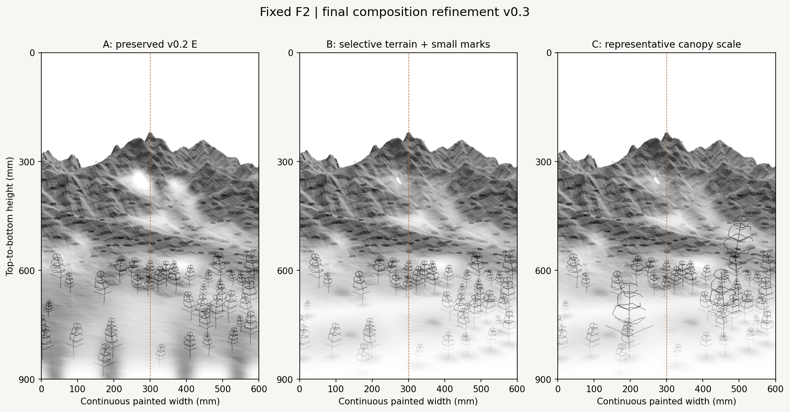
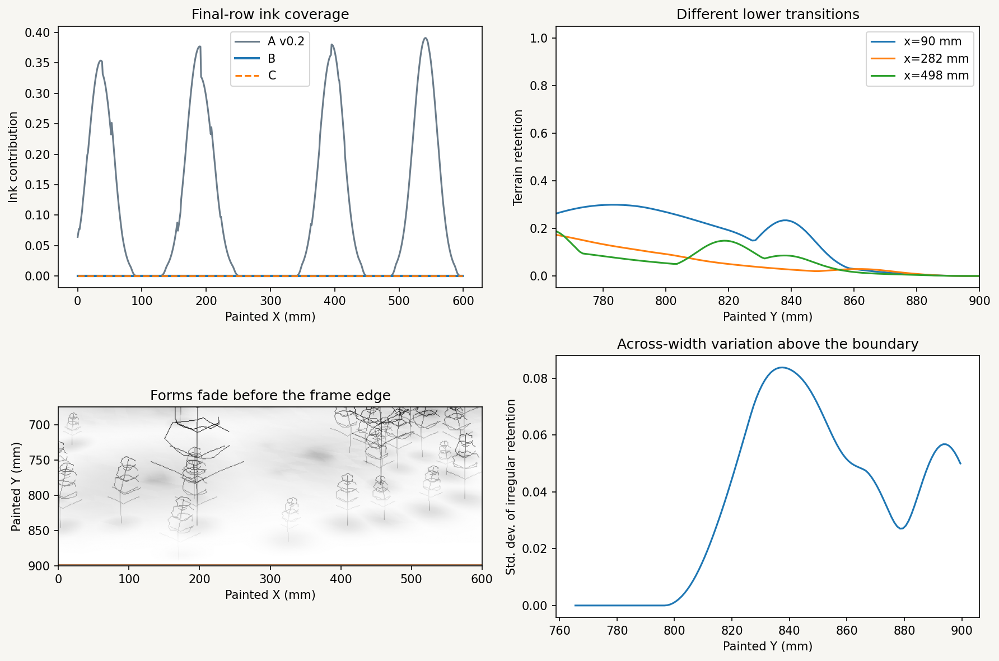
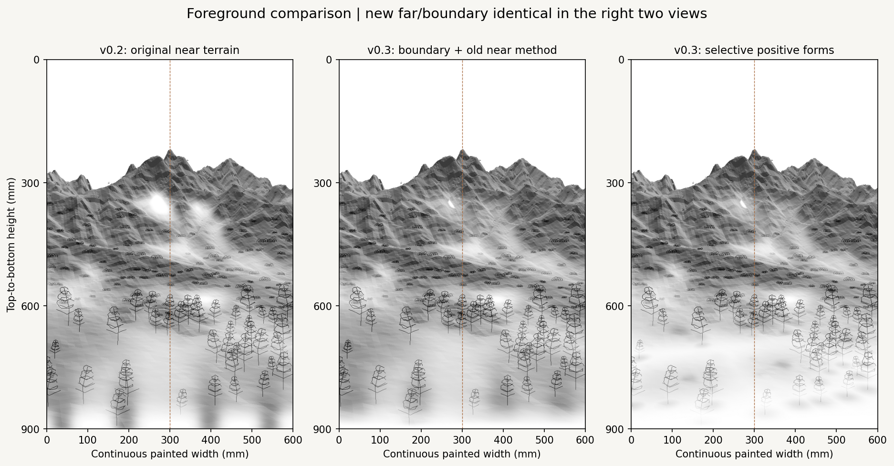
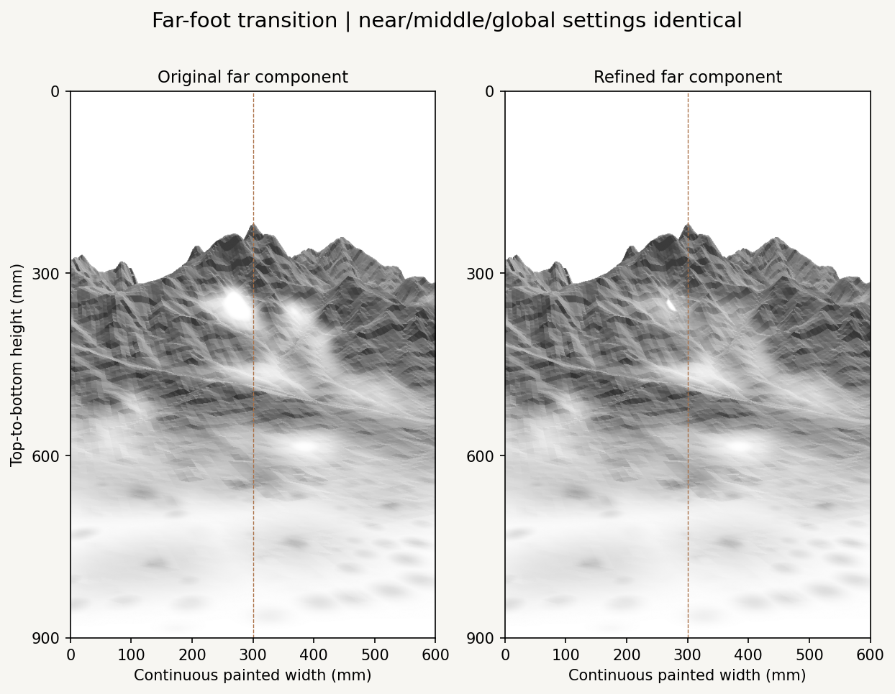
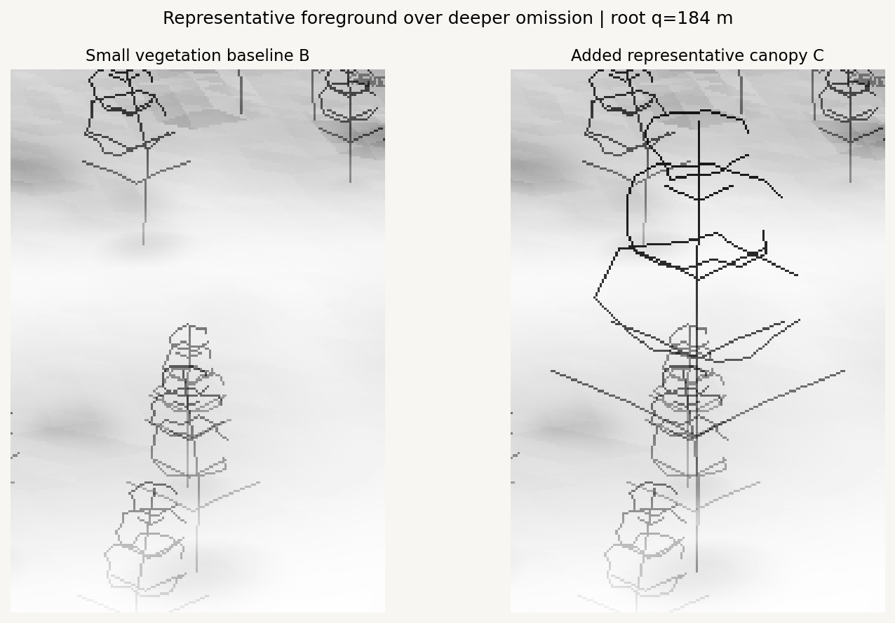
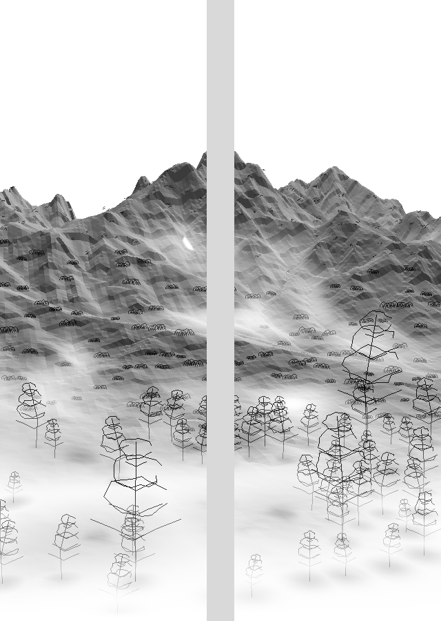

# F2 painterly composition v0.3

Final small composition refinement before vector-stroke studies. F2 geometry, camera, raw DEM and v0.1/v0.2 files remain unchanged. An unconditional bottom boundary is separated from an irregular transition, selective foreground terrain and softer far-foot fading.



| Variant | Content | Composition reading |
| --- | --- | --- |
| A | Preserved v0.2 E, reproduced pixel for pixel | Reference for the original ground coverage and bright far pockets. |
| B | Absolute bottom gate + selective positive terrain + refined far omission; all original small/middle/far marks | More paper through the near ground, with selected terrain patches and small root supports. Far mountains retain more continuous structure. |
| C | B plus three larger representative canopies | Stronger near scale cues and side groups; a central passage remains open. Representatives avoid placing their main trunks at the panel seam. |

C is the proposed baseline for the next stroke comparison; B remains its scale control. The representative crowns are deliberately generic. Selective terrain currently reads as tonal patches: the next vector study should express the source surface's structure through actual lines, rather than trying to finish its appearance with more shade masks.

## Unconditional global boundary



Coordinates are painted millimeters, increasing downward. Every terrain, vegetation, ink and future color contribution receives the **same final gate**. Positive forms, roots, camera depth and layer order cannot exempt anything from it.

For `S(t) = clamp(t,0,1)^2 × (3 − 2 clamp(t,0,1))`, the gate is:

`R_boundary(y) = S((H − guard − y) / collar)`

and is exactly zero for `y ≥ H − guard`. Current values are H = **900 mm**, guard = **2 mm**, collar = **18 mm**. Thus the narrow 898–900 mm guard is fully omitted, with a continuous universal collar above it. Guard and collar are independently configurable and separate from the much wider irregular transition. Setting guard to zero still gives exactly zero at y = 900 mm.

Raster preview coverage evaluates each pixel's **lower edge**, conservatively including the exact canvas bottom in the final row. The last row of B and C has maximum terrain, vegetation and total ink coverage **exactly 0** before PNG quantization. The continuous rule at y = 900 mm also returns exactly 0; this is not a light-gray threshold.

The reusable APIs are [`boundary_retention`](../../../src/datascape/composition/refinement.py) and `apply_boundary`. The latter accepts scalar coverage or multiple channels:

```python
from datascape.composition.refinement import boundary_retention, apply_boundary

# A vector sample at the exact bottom always has zero retention.
r = boundary_retention(y_mm, canvas_height_mm=900,
                       hard_bottom_guard_mm=2, collar_mm=18)
# The same gate can attenuate future color/ink channels.
gated_channels = apply_boundary(channels, y_mm,
                                canvas_height_mm=900,
                                hard_bottom_guard_mm=2, collar_mm=18)
```

Later vector consumers should clip/split segments at the configured hard limit, sample continuous retention for density/layer inclusion, and apply the gate after all preservation preferences. No vector engine, color field or G-code is built here.

## Irregular lower transition and selected positive forms

The wider transition uses the configured **5–15%** extent range, independently of the hard edge. Its realized terrain-supported extent is **45.0–132.14 mm** in this scene. Native correlated variation and small-valley features vary the boundary; selected positive forms soften omission locally. These preferences multiply the unconditional boundary gate and cannot extend to the final edge.

The transition extent is `900 × (0.05 + 0.10 × (0.65 noise + 0.35 small_valley))`. Its smooth omission field is weighted by `1 − 0.82 positive_support`, with strength 0.95. The bottom diagnostic shows nonzero variation across the width and different retention curves, rather than a uniform 5–15% blank strip. Only the deliberately narrow hard guard is uniform.



The middle view uses the previous near-ground omission method with the new far and boundary rules. The right view changes only the near-ground preservation method. This separates selective terrain from the boundary/far edits.

Five positive terrain forms are selected **globally from evidence**, without prescribed X bins:

- Source forward distance 120–1150 m, screen v 0.68–0.93 and slope ≤16° define the eligible foreground domain.
- The score combines relative height above the native 120 m Gaussian DEM (mound proxy), gentle slope and local relief. A minimum mound/score threshold prevents arbitrary empty-ground selections.
- Greedy selection with at least 85 mm screen spacing rewards uncovered locations for composition balance. It does not search around fixed X targets.
- Footprints use actual source XY distances, with 120/150 m radii, modulated by measured mound/slope features and feathered at 4 mm. They select which surface contribution remains; they never move the source surface or add relief.
- Small root supports use the existing 42 near-mark source sites, a 28 m footprint and strength 0.30. This separate legibility preference helps retain a ground connection below the existing plants.

The near retention has a paper floor of 0.025 and adds the selected support. It is blended by the unchanged source-depth near role, preserving middle/far roles. The original v0.2 **near and middle omission fields themselves remain identical**; their final application is recorded separately. The old four X-guided bottom anchors do not control the new global reserve or override the boundary.

Mean near-zone terrain ink proxy falls from **0.2333 to 0.0697**. These are composition-preview values, not calibrated pigment dilution. The source coordinates, relative relief, slopes and selection scores are recorded in [`record.json`](record.json). A selected form is not an identified rock, path, foothold or tree inventory.

## Far mountains: broad fading with small local cores



The two views hold near/middle/global settings constant. The far edit uses:

- A wider, anisotropic expansion of the old far candidate field, sigma **24 mm horizontally / 8 mm vertically**.
- Actual source-depth far role, local relative-foot rank and medium-valley structure, weighted 0.48 / 0.32 / 0.20.
- Reapplied main-ridge and upper-silhouette protection. No additional top reserve or projection change is made.
- Soft attenuation strength **0.70**, so the surrounding terrain fades without being forced to bare paper.
- Only the deepest old far cores survive: an interior distance gate begins after **6 mm** of erosion and reaches full omission after a further **4 mm**. This keeps tiny local paper cores within broader, gentler transitions.

The directional foot cue depends on relative source height; a mountain's upper crest and lower foot therefore need not have symmetric transitions. Original near/middle field generation and native data are reused.

Far-zone exact-zero terrain pixels fall from **762 to 52**. Far terrain pixels with ink contribution below 0.03 fall from **1,403 to 91**. The two large bright pockets lose most of their hole-like appearance while the major skyline remains intact. One small local core remains visibly bright; it is intentionally retained as a paper reserve, not painted white.

## Representative canopy scale and depth

The same v0.2 small-mark geometry is retained: **42 near**, **105 middle** and **65 far** candidates. Their contribution fades according to the new fields, including the unconditional boundary. Middle clumps/repeats and far leaf/dash grammar are unchanged.

C adds **three** representatives to selected existing near-root sites. Candidate scoring combines measured NDVI, root retention, positive support, nearby small-mark cluster membership and an opportunity to show the canopy against deeper omission. No tree root is moved. Heights/count are configurable; current heights are about **184.8 / 181.5 / 202.3 mm on paper**, not measured physical tree heights.

Representative trunks require at least **45 mm** from the 300 mm panel seam and **30 mm** from the outer painted edges. Root separation is at least 135 mm. These are composition exclusions, not prescribed tree locations. Branches/crowns may flow across the continuous painting; important trunks are kept away from the installation gap.



The unchanged v0.2 root-depth compositor preserves foreground branches over omission belonging to substantially deeper terrain, while allowing nearer terrain to occlude a farther glyph. All depths still receive the global boundary. The representatives have **1,467 surviving mark-pixel contributions** over deeper faded terrain (summed across glyphs). No nearer-terrain rejection happens to be needed in this configuration; that case is independently tested.

## Physical pair and fixed upper space



The source painting remains **600 × 900 mm**, split at x = 300 mm. Each painted panel is **300 × 900 mm**. Only the installation image inserts the **40 mm physical gap**; its gray strip is empty installation space. Trunks stay on their panel, and the quieter central passage continues through the pair. The candidate positions are asymmetric because they follow eligible measured root sites and cluster evidence.

Both B and C keep the original **24.33% full-width open sky**. No extra top reserve, inscription, recropping or camera/projection change is introduced. Individual panel and installation images are included for all A/B/C variants.

## Reproduce and hand off

The small additions are the refinement field module, preview runner, configuration, notebook and tests. Existing camera/projection/data loaders, native feature extraction, mark grammar, compositor and verified save helpers are reused.

```bash
python -m pip install -e ".[research,dev]"
python -m datascape.rendering.composition_refinement \
  /path/to/SeoulNorth_v02_MASTER_30m.tif \
  /path/to/SeoulNorth_v02_VEG_10m.tif \
  --config configs/scenes/seoul_f2_painterly_composition_v03.json \
  --output outputs/f2_painterly_composition_v03
python -m pytest tests -q
```

[`08_f2_painterly_composition.ipynb`](../../../notebooks/08_f2_painterly_composition.ipynb) reads `DATASCAPE_DATA_DIR`. Select the installed project environment in VSCode/Jupyter. Change one JSON parameter at a time and use a new output directory; do not overwrite the earlier studies.

[`fields.npz`](fields.npz) contains diagnostic scalar retention fields (float16) and authoritative boolean boundary/far core masks at 600 × 900 pixels. Rows run top to bottom; columns left to right. Original raw source XYZ/depth remain in the unchanged [v0.1 archive](../f2_painterly_layers_v01/fields.npz). Use the analytic boundary API for physical/vector coordinates, rather than inferring the rule from rounded archive values.

[`representative_trees.json`](representative_trees.json) records only new symbolic representatives and references the unchanged [v0.2 marks](../f2_multidepth_whitespace_v02/marks.json). [`record.json`](record.json) stores source/config/archive hashes, all previous artifact hashes, selected source coordinates, metrics and the boundary/vector/color contract. Original source TIFF hashes are checked before and after rendering. Seed 20261016/stream 603 governs representative geometry; native features and small/middle/far marks reuse v0.2 seeds/data.

Validation: **57 tests passed**, including exact physical/raster/channel boundary behavior, smooth independent collar control, DEM-led selection without X bins, immutable source/root metadata, deterministic representatives and seam clearance. Four notebook code cells were validated and replayed in one shared Python namespace; **22 generated artifacts match the CLI run byte for byte**, including the decoded field archive. This does not claim a launched Jupyter kernel. Outputs, field archives and JSON are decoded and verified before publication. The archived F2 baseline and v0.2 E reproduce pixel for pixel, and previous study files remain unchanged.

After visual selection, keep the chosen scene/field snapshot fixed and compare Taebaek horizontal curves, terrain structure lines and direction-field strokes. Apply omission to actual segment splitting, seeded inclusion and density. Digital rendering and later G-code should consume the same retained vector strokes; implementation of those stages remains separate from this composition study.
