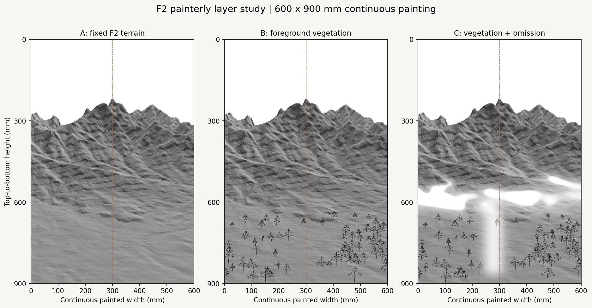
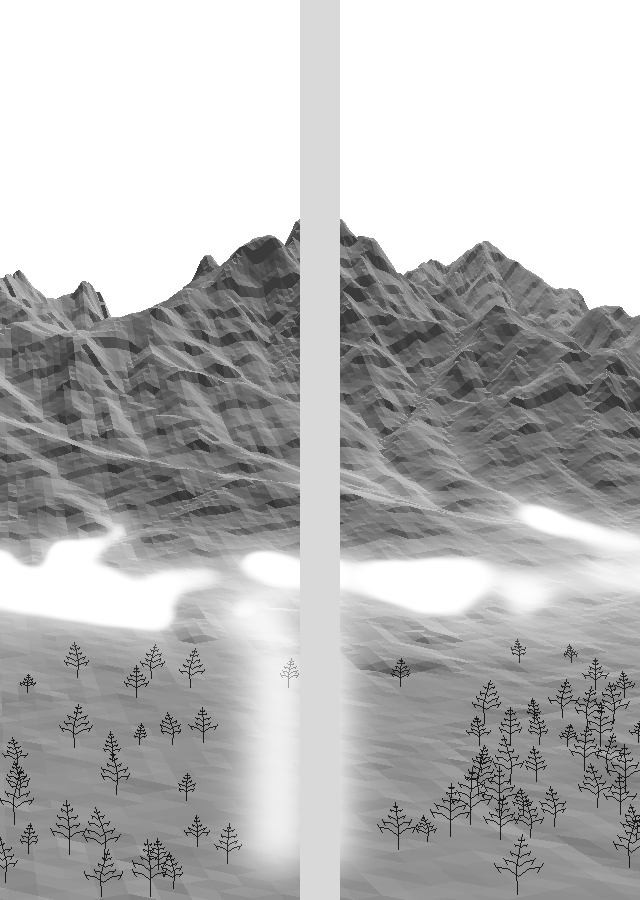
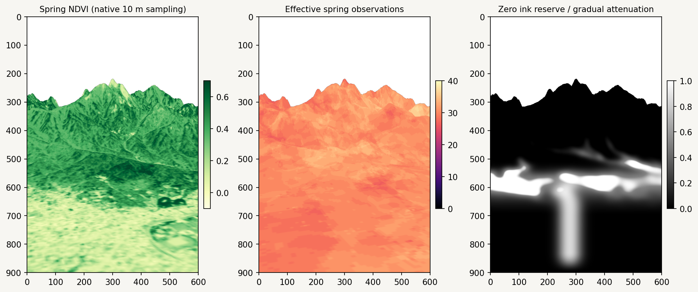
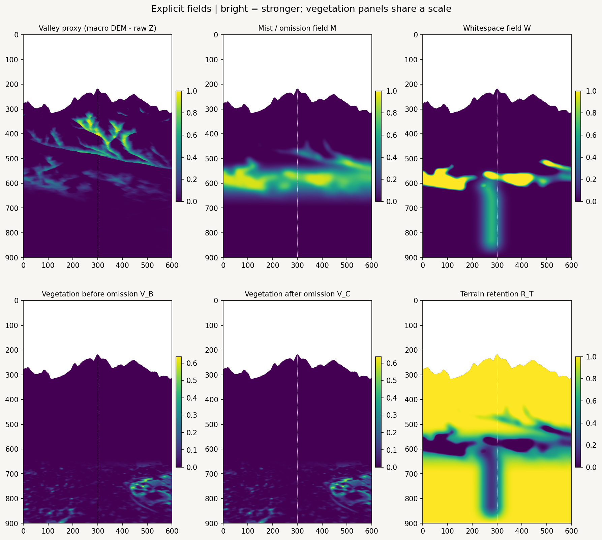

# F2 painterly layer rules v0.1

Fixed F2 terrain with explicit rules for adding foreground vegetation and leaving paper visible. Mist is a **composition reserve**, not weather or white pigment. The source DEM, F2 projection, previous studies, original artworks, palette and hardware files are unchanged.



| Variant | Additions | Reading of the space |
| --- | --- | --- |
| A | Archived F2 terrain only | Continuous valley-to-mountain geometry; little separation between the low foreground and foothills. |
| B | 65 schematic foreground plants | Adds a near scale cue and stronger side groups. The terrain still connects almost continuously behind them. |
| C | Same candidates, 63 retained plants, gradual omission and paper reserves | Separates the near ground from the mountain, preserves upper ridges and opens a quieter foreground passage. The reserve can still read as a broad horizontal belt; review its strength before generating final strokes. |

C is the strongest **space study** of these three. Its main gain comes from terrain omission: vegetation field mass falls by only 1.65%, because vegetation is mostly nearer than the main reserve. This is deliberate layer separation, not evidence of a fully solved vegetation/mist interaction. Plant shapes are generic seeded branching marks, not an observed tree inventory or a finished vegetation style.

## Fixed composition and panel geometry

The source is [`seoul_ground_composition_v01.json`](../../../configs/scenes/seoul_ground_composition_v01.json). A reproduces the archived [`F2_continuous.png`](../spring_ground_composition_v01/F2_continuous.png) **pixel for pixel**. No camera, relief coefficient, terrain tile or source height was changed.

The painting is one continuous **600 × 900 mm** image, split at x = 300 mm. Each panel is 300 × 900 mm. Only the installation preview inserts the **40 mm physical gap**, giving a 640 × 900 mm pair. Its gray strip represents empty installation space, not painted content. Continuous, individual-panel and installation previews are included for A/B/C.



## Geographic evidence

Both inputs use EPSG:32652. MASTER is 30 m; VEG is 10 m. Their north origins differ by **20 m**, so rows cannot be paired by index. For each visible pixel, source XYZ is recovered with the same barycentric interpolation used by the mapped F2 triangle. Native-center bilinear sampling then uses each raster's own affine transform. Aspect uses interpolated sine/cosine rather than a linear average across 359°/1°.

Only samples with at least 0.999 finite bilinear support are accepted; NaN/NoData never becomes a vegetation zero. Seasonal NDVI outside [-1, 1] or negative observation support is rejected. Missing seasonal evidence suppresses vegetation; it does not create synthetic values. All four seasons have valid samples over the visible terrain in this scene.

Bilinear `N_*` values are **effective observation support**, not integer native counts. The bottom 300 mm has spring NDVI p10/median/p90 = **0.076 / 0.144 / 0.379**, with effective spring support **28 / 30 / 31.35**. Sparse foreground marks follow the locally stronger patches; this low median does not justify asserting a continuous forest. NDVI cannot identify species, trees, buildings, roads or accessibility.



## Explicit fields

All fields live on the unchanged visible F2 surface. Outside visible terrain, the archive includes `occupied = false`; display background is not a computed reserve. Raster previews use 600 × 900 pixels, so one preview pixel corresponds to one painted millimeter.



Let `S(t) = clamp(t, 0, 1)^2 × (3 − 2 clamp(t, 0, 1))`, `z` be source height in meters, `q` horizontal forward distance in meters, and `(u, v)` screen fractions measured from the top left.

### Valley, mist and whitespace

A mask-aware Gaussian macro DEM uses sigma **300 m** on the native source grid. This is a feature surface only; it never replaces the rendering DEM.

| Component | Rule | Interpretation |
| --- | --- | --- |
| Valley proxy T | `S((macro_z − z − 8) / 52)` | Local terrain below its broader surroundings; not a mapped hydrological valley. |
| Low ground L | `1 − S((z − 80) / 140)` | Keeps reserves associated with lower terrain. |
| Depth role D | `exp(−0.5 ((q − 1600) / 800)^2) × S((q − 350) / 450)` | Prefers the transition behind the foreground. |
| Resting zone E | `exp(−0.5 ((v − 0.62) / 0.075)^2)` | Declared screen composition preference. |
| Peak protection H | `1 − S((z − 350) / 200)` | Fades the reserve contribution above 350 m; zero at 550 m and above. |
| Upper protection U | `S((v − 0.38) / 0.12)` | Keeps upper ridges intact. |
| Mist M | `0.94 × S((blur_10mm(D × (0.65T + 0.20L + 0.15E) × H × U) − 0.10) / 0.33)` | Soft omission field, with mask-aware screen feathering. |
| Strong core | `S((M − 0.62) / 0.20)` | Lets the strongest candidates reveal bare paper. |
| Whitespace W | `max(strong_core, 0.65 × passage)` | Combines the middle reserve with a softer foreground opening. |

The passage is a Gaussian across a row-wise center estimated from `(0.15L + T)` on visible terrain, biased toward screen u = **0.46** with sigma **0.20**, then smoothed vertically at **16 mm**. Its lateral sigma is **26 mm**. It fades in from v = 0.58 to 0.70, fades out from v = 0.92 to 1.00, and fades with distance from 1400 to 2400 m; it is also weighted by L. This is a painterly opening, **not a measured path, river or meteorological feature**. The center bias is intentionally slightly left of the panel seam.

Pixels with W ≥ **0.90** are hard paper reserves. The final scene contains **15,362** such pixels: **4.09% of visible terrain**. M > 0.5 over **13.19%** of visible terrain. These numbers describe this configuration; they are not target quotas.

### Vegetation density

`V_B` multiplies measured proxies by explicit placement choices. Evidence is mandatory; composition preferences cannot bypass it.

| Factor | Current rule |
| --- | --- |
| Seasonal NDVI | `S((NDVI_spring − 0.10) / 0.55)` |
| Observation support | Require effective N ≥ 6; confidence rises to 1 at N = 12. |
| Seasonality | If summer/winter evidence is valid, `0.8 + 0.2 × clamp((spring − winter) / max(summer − winter, 0.08))`; otherwise 0.9. |
| Slope | `0.30 + 0.70 × (1 − S((slope − 5°) / 20°))` |
| Elevation | `1 − 0.60 × S((z − 120) / 230)` |
| Aspect | `0.9 + 0.1 × cos(aspect − 135°)`; flat slopes ≤1° use 1. This is a weak declared artistic bias, not a validated ecological model. |
| Foreground distance | Full through 450 m; fades to zero at 1100 m. |
| Screen role | Fades in from v = 0.70 to 0.78. |
| Balance | Side-weighted density; center floor 0.35. |
| Controlled variation | 50 mm correlated screen noise, scaled to [0.70, 1], with a recorded seed. It is screen variation, not a geospatial ecosystem model. |

Roots are sampled from `V_B ≥ 0.003`, with weighted proposals, **22 mm** minimum spacing and at most **65** roots. This cap is a preview density control, not a tree count prediction. Heights are drawn from 27–65 mm and reduced with source distance. Each root records source XYZ, NDVI, support, slope, aspect, depth, stable ID and generic polylines.

B and C use the **same root candidates and geometry**. Each candidate has a recorded uniform draw; C keeps it only when that draw is below its local vegetation retention. C also attenuates all rasterized branch contributions pointwise, so branches cannot cross a hard reserve with ink.

### Adding and omitting ink

| Field | Application |
| --- | --- |
| Terrain retention R_T | `(1 − 0.80M) × (1 − W)^1.8` |
| Vegetation retention R_V | `(1 − 0.90M) × (1 − W)` |
| V_C | `V_B × R_V` |
| Hard reserve | Set R_T and R_V to **0**, not merely a light gray. |

Terrain shade is converted to an ink-coverage proxy `I = 1 − shade`. B combines terrain and plant coverage with `1 − (1 − I_terrain)(1 − I_plant)`. C attenuates the **contributions before combining them**, then displays `1 − total_coverage` against the paper. There is no white-paint layer. Maximum C ink coverage in every hard-reserve pixel is **exactly 0**.

For later vector work, zero retention means omit/split strokes at the reserve; partial retention can control seeded thinning, line spacing or layer count. Color layers should use the same reserve gate, with separately recorded per-layer retention. Do not treat the preview gray value as a calibrated pigment concentration or brush pressure. No color distribution, full stroke engine, G-code or hardware execution is implemented here.

## Reproduce and inspect

From the repository root:

```bash
python -m pip install -e ".[research,dev]"
python -m datascape.rendering.painterly_layers \
  /path/to/SeoulNorth_v02_MASTER_30m.tif \
  /path/to/SeoulNorth_v02_VEG_10m.tif \
  --config configs/scenes/seoul_f2_painterly_layers_v01.json \
  --output outputs/f2_painterly_layers_v01
python -m pytest tests -q
```

The [`06_f2_painterly_layers.ipynb`](../../../notebooks/06_f2_painterly_layers.ipynb) notebook reads `DATASCAPE_DATA_DIR` (default `data/raw`). Select the Python environment where the package is installed. Change one JSON parameter at a time and write to a **new output directory**. Keep F2 and the original inputs fixed for comparable studies.

[`record.json`](record.json) includes both source SHA-256 hashes, input metadata, the exact configuration, fixed F2/config/image hashes, metrics and seed streams: **101** for density noise, **202** for common root placement/C thinning and **303** for mark geometry. Seed = **20261014**. Both TIFF hashes were checked again after rendering and match the input hashes.

[`fields.npz`](fields.npz) contains float32 M/W/retention/vegetation/depth/NDVI/support arrays, recovered XYZ and boolean occupied/evidence/reserve masks. All field arrays are indexed `[top-to-bottom row, left-to-right column]`; XYZ adds a final three-component axis in raw source meters. Coordinates are quantized to float32 in this archive (up to about 0.25 m northing precision here); computation uses float64. Scalar fields outside occupied terrain must be ignored. [`plants.json`](plants.json) records exploratory marks; it is not a machine-ready stroke file.

Validation: **44 tests passed**. The notebook's four code cells were validated and replayed in one shared Python namespace; all 18 generated artifacts matched the CLI run byte for byte. This checks cell logic and reproducibility, not a launched VSCode/Jupyter kernel. Every published PNG was fully decoded. Existing tracked blobs are verified unchanged when constructing the PR tree.
