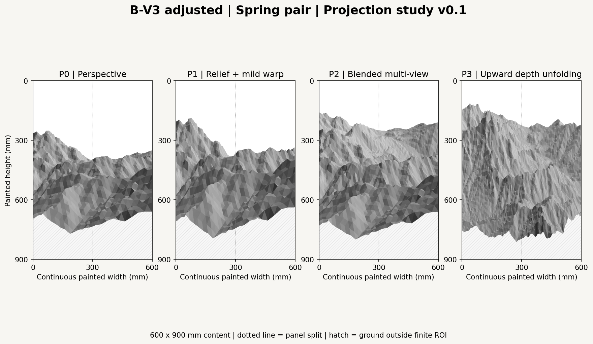
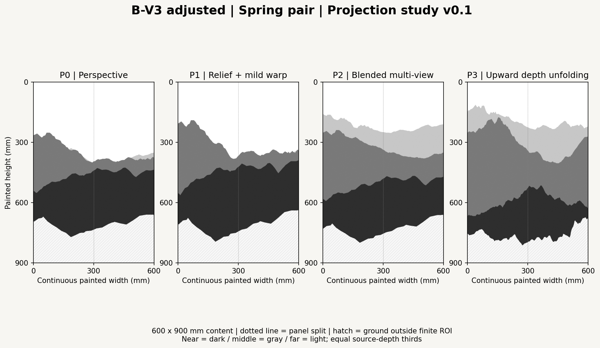
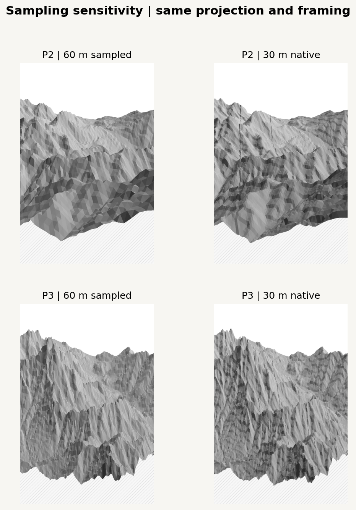
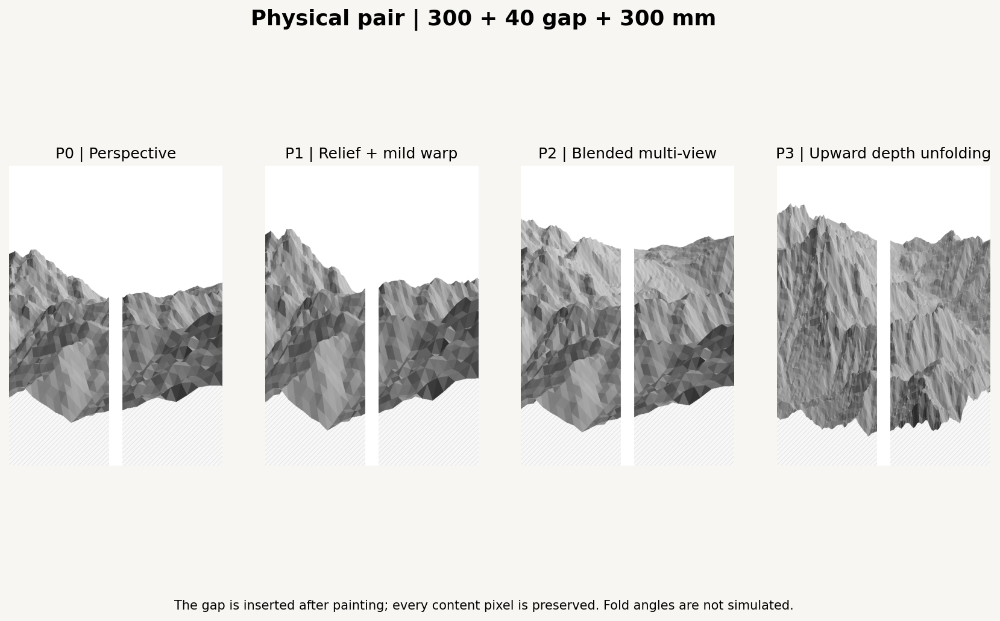
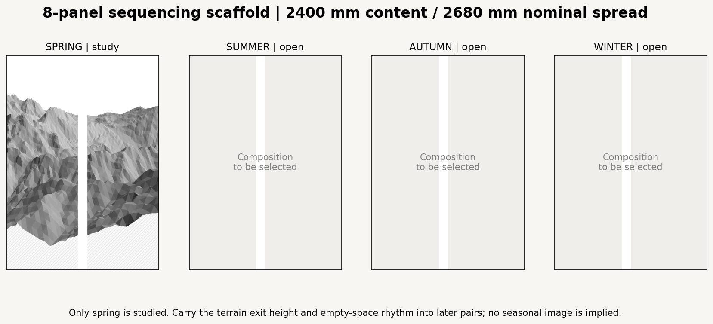

# Projection & Composition Study v0.1

Spring benchmark: two 300 x 900 mm panels. This study translates one B-V3 terrain composition into four spatial mappings before brush-path development. It preserves the earlier [viewpoint exploration](../seoul_viewpoints_v01/README.md). Starting main: `ca358f1254edc3e271fd8036afbd5ac68e1ba7b9` (PR #4 merged).



## Shared Scene and Layout

- B1 ROI, EPSG:32652 bounds (west, south, east, north): **318120, 4167770, 325320, 4174970 m**, 7.2 x 7.2 km. WGS84 center: 126.978487 E, 37.672214 N. Place names are not inferred.
- Target: (321720, 4171370, 252.822509765625) raw meters. The highest native sample is 801.771 m. Native pixel centers and DEM elevations are retained; no smoothing or normalization.
- B-V3 look azimuth **240 degrees**, horizontal distance **6480 m**, base display height scale **1.8**. Adjust elevation from 12 to **10 degrees** and vertical FOV from 22 to **38 degrees** to include foreground and the main left peak in a narrow portrait screen. P0-P3 use the same source ROI and aim; there is no per-result automatic fit.
- Generate **600 x 900 mm continuous painted content** at 600 x 900 px. Split at x=300 mm, then insert a 40 mm physical gap, producing a 640 x 900 mm nominal spread. No painted pixel is discarded or stretched. This intentionally differs from the previous gap-masked crop. Fold angles are not simulated.
- The primary mesh samples existing pixels at 60 m spacing. P2 and P3 also have native 30 m checks. All methods use identical raw-world face shading: northwest light, 45-degree altitude, and a fixed source-depth tone. No cast shadows or ink behavior are simulated.
- Foreground/middle/background are **equal thirds of horizontal look-axis depth across this ROI**, not named mountains or manually segmented ridges. The depth extent and full configuration are recorded in [study.json](study.json).
- Source input SHA256: `837f4b6b2e01e3b97b05db3e62fbd0869ce052ba4c18cc47a99d97873317f0fb`. No random sampling is used; random seed is null. Only MASTER DEM band 1 is needed. VEG, historical originals, palette, and hardware files are neither imported nor executed.

## Projection Parameters

| Method | Screen mapping | Parameters and interpretation |
| --- | --- | --- |
| P0 | Existing pinhole camera | 240-degree look, 10-degree depression, 6480 m horizontal distance, 38-degree vertical FOV, raw Z x 1.8. Physical perspective baseline in an exaggerated model. |
| P1 | Depth-dependent relief scale, then mild Y expansion | Multiply relief around target height by 1.15 / 1.24 / 1.08 for near/middle/far, on top of base 1.8. Effective local scales 2.07 / 2.232 / 1.944; expand screen Y around its center by 1.08. Keep the base eye fixed. |
| P2 | Smooth blend of three pinhole views | Near/middle/far depression angles 8 / 12 / 16 degrees; same bearing, distance, target, FOV and base scale. Shift image Y by +0.10 / -0.01 / -0.12 times frame height. Blend across 0.12 of ROI depth around the one-third and two-thirds boundaries with cubic smoothstep weights. |
| P3 | Orthographic lateral placement and upward depth unfolding | Lateral width scale 5200 m per 600 mm frame; `y/H = 1.04 - 0.95*d^0.85 - 0.45*(raw_z-target_z)/1000`. Depth `d` is in [0,1]. Height is a local screen displacement, not a claimed physical exaggeration ratio. |

Positive screen Y is downward. P2 weights are nonnegative, sum to one, and have continuous first derivatives. Hard band seams are avoided, but smooth blending can still stretch terrain forms. P3 removes perspective width shrinkage, so more distant lateral forms remain legible.

**Visibility convention:** P0 uses its physical camera depth. P1-P3 use that same P0 source depth for reciprocal-depth triangle overlap ordering. This is a deliberate diagnostic compositing rule, not a physically correct multi-camera surface. Original elevations and display mappings remain separate. Before generating strokes, visibility and line continuity must be evaluated in the selected mapped space; the old Taebaek Horizon Mask cannot simply be assumed to work unchanged.

## Depth Reading



Dark / medium / light gray identify source-depth thirds independently of face lighting. Fractions below are of visible terrain pixels, not the whole frame. Centroid Y is measured downward from the top. These describe coverage and separation; they are not objective measures of artistic quality.

| Method | Visible terrain share: F / M / B | Centroid Y: F / M / B | White above/beside ROI: frame share | Missing lower ground: frame share |
| --- | --- | --- | --- | --- |
| P0 | 67.23% / 31.60% / 1.17% | 65.3% / 44.5% / 41.2% | 38.4% | 21.0% |
| P1 | 67.20% / 32.77% / 0.03% | 64.4% / 41.1% / 38.9% | 34.7% | 20.6% |
| P2 | 43.52% / 36.28% / 20.20% | 68.9% / 45.8% / 30.9% | 24.4% | 18.7% |
| P3 | 29.56% / 51.60% / 18.84% | 75.1% / 48.9% / 29.2% | 21.3% | 15.2% |

| Method | Visual reading | Limitation |
| --- | --- | --- |
| P0 | A recognizable left summit and foreground-to-middle overlap; a stable geographic reference. | Most background terrain hides behind the middle mass. Vertical content is compressed into the center; increasing blank space alone does not create deep distance. |
| P1 | Stronger peak height and slightly larger near/middle forms. | Height exaggeration increases middle-ground occlusion: almost no background third remains visible. It does not solve this composition's depth problem. |
| P2 | Best balance of near/middle/far coverage. The central valley remains readable, and the farther terrain lifts above the middle ridge without dominating the whole screen. | Transition areas can elongate slopes; near terrain still follows the finite ROI cutoff. It is a composite screen mapping rather than one possible photograph. |
| P3 | Largest near-to-far vertical centroid separation; strong upward unfolding and more persistent lateral detail. | Middle terrain dominates, and the surface can read as a steep wall. Removing width shrinkage weakens the familiar perspective cue. Fine line density will need restraint. |

**Recommended shortlist: P2 first, P3 second.** P2 offers a conservative bridge from the measured scene to composite viewpoints. P3 offers a stronger vertical spatial translation to compare when line generation begins. P0 remains the geographic control. P1 is useful as a height control but is not the preferred depth solution for this scene. No final production composition is selected.

An initial P2 trial using 8/20/30-degree views and Y offsets +0.13/-0.03/-0.20 exposed depth strongly but produced excessive middle-slope stretching and too little upper whitespace. Reducing the angle range to 8/12/16 and the offsets to +0.10/-0.01/-0.12 gives the selected comparison. P3 depth-rise values 0.65 and 1.12 were inspected; 0.95 retained more air above the peaks than 1.12 while separating depths more clearly than 0.65. These are editorial parameter choices, not an automatic optimum.

### Terrain and Display Limits

Lower diagonal hatching means **ground outside the finite ROI**. It is not cloud, water, measured flat land, or a chosen painting reserve. Keep it visible during composition review; obtain appropriate source foreground coverage before treating the lower area as finished content. White above/beside the mesh is absence of terrain in this view, not an atmospheric simulation. Peaks can extend off the left/right edges intentionally; viewport coverage is recorded separately.

Projected triangle orientation changes relative to P0 are recorded in the JSON. They include newly exposed or reversed-facing slopes as well as possible local projection inversions; they do **not** by themselves establish a foldover rate. This study does not prove that P2/P3 are globally one-to-one mappings.



The native 30 m meshes retain P2/P3's large-scale composition and reveal finer crests. Faceted shading at either spacing is a triangulation diagnostic, not evidence of exposed rock or a proposed brush texture. The images do not model trees, buildings, roads, or mist.

## Painting References and Interpretation

The reference scope is deliberately specific: two Northern Song works by Guo Xi, rather than a single rule claimed for all East Asian painting.

- [National Palace Museum: Early Spring](https://theme.npm.edu.tw/selection/Article.aspx?lang=2&sNo=04000960) describes a vertical connection between foreground forms, winding middle terrain, and the principal mountain, with intervening mist and lateral depth. The museum's [three-distance explanation](https://artsandculture.google.com/story/MAVhq9CUx6JmSQ?hl=en) distinguishes upward, overlapping, and lateral spatial readings.
- [The Met: Old Trees, Level Distance](https://www.metmuseum.org/art/collection/search/39668) places close trees against an extensive river valley. Its horizontal handscroll format provides a useful contrast to the vertical benchmark.

**Our interpretation:** P2 separates viewing rules by depth; P3 turns depth into a rising screen coordinate. Neither is a reconstruction of Guo Xi's technique, a universal traditional projection, or a copy of the paintings' features. Blank space and winding movement suggest future composition controls, but no artificial mist, trees, buildings, or invented terrain are added here. Reference paintings are linked rather than redistributed.

## Physical Pair and Eight-Panel Context



The center split passes through a valley transition; a physical gap will interrupt the view while preserving both painted halves. Compare continuous and separated layouts before choosing where to place dense lines. A main crest should not depend solely on a narrow feature crossing the split.



The eight-panel work has 2400 mm of painted width and seven nominal 40 mm gaps, totaling 2680 mm. Only spring is studied; later pairs remain open. Carry the spring right-edge terrain level, valley exit direction, and upper reserve into the next pair's entry. Vary dense/open rhythms across seasons after each composition is chosen. This scaffold is not a completed eight-panel panorama and does not assign untested viewpoints to other seasons.

## Reproduce

```bash
python -m pip install -e ".[research,dev]"
python -m datascape.rendering.composition_study --master /path/to/SeoulNorth_v02_MASTER_30m.tif --config configs/scenes/seoul_projection_composition_v01.json --output outputs/projection_composition_v01
python -m pytest tests -q
```

Open [03_projection_composition.ipynb](../../../notebooks/03_projection_composition.ipynb) in VSCode/Jupyter, select the installed environment, and set `DATASCAPE_DATA_DIR` to the original data folder. `DATASCAPE_PROJECTION_OUTPUT` selects an output folder. Each run records input SHA256, exact configuration, software versions, source depth convention, native sampling comparisons, and a check that both source elevations and the GeoTIFF hash stay unchanged.

The CLI and notebook code cells were executed in this environment and produced matching JSON and PNGs. The notebook was schema-validated; cells were run sequentially in a shared Python namespace because this environment cannot start a socket-based Jupyter kernel. Local VSCode kernel startup is not verified here. Twenty tests cover the existing data/terrain utilities and new projection continuity, overlap ordering, P0 camera equivalence, source preservation, and gap preservation.

## Files Added

- `configs/scenes/seoul_projection_composition_v01.json`: pinned benchmark scene.
- `src/datascape/projection/composition.py`: display mappings and lossless physical gap insertion.
- `src/datascape/rendering/composition_study.py`: common shading, depth diagnostics, study records and CLI.
- `tests/test_composition_projection.py`: six geometry/layout checks.
- `notebooks/03_projection_composition.ipynb`: executable study.
- This directory: README, study JSON, four continuous renders, and six comparison/scaffold images.

No existing source module, previous exploration result, original artwork, palette, hardware YAML, or root README is modified. Terrain/stroke generation, digital rendering and G-code remain distinct future stages; no vector-stroke or hardware implementation is introduced by this PR.
