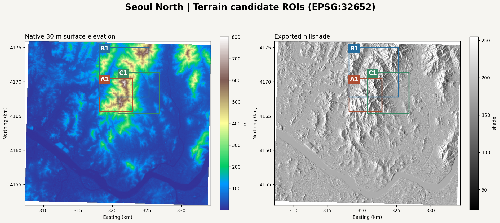
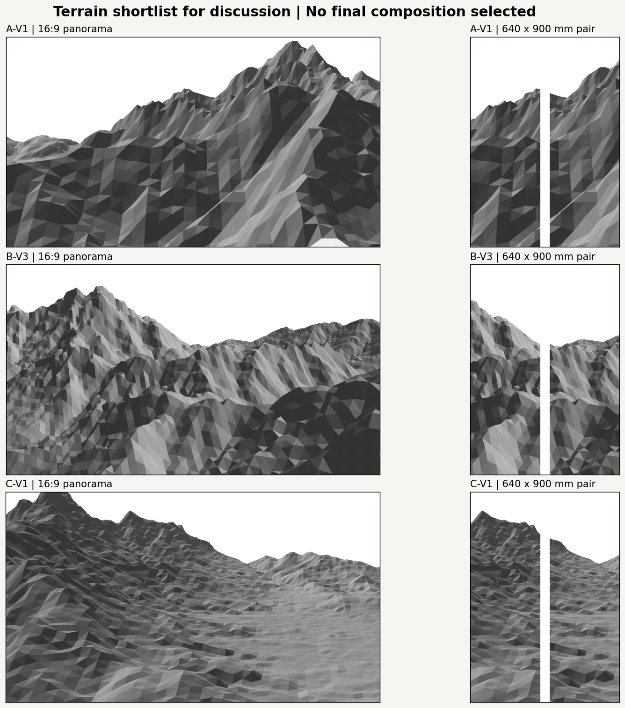
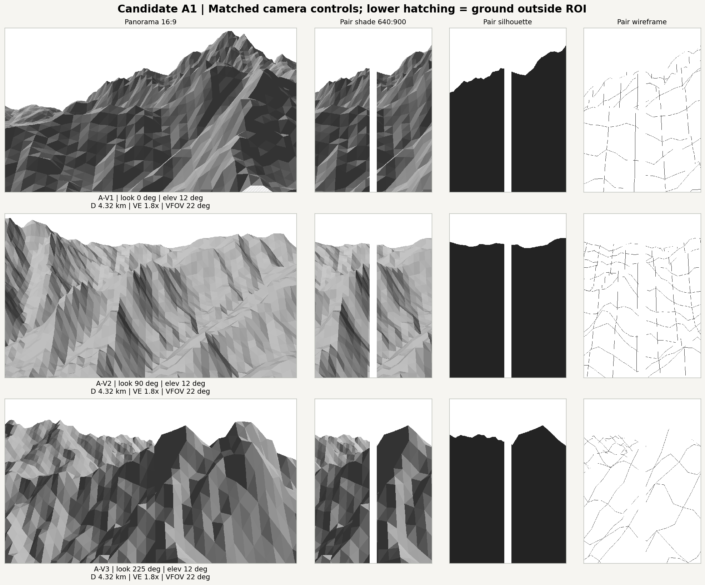
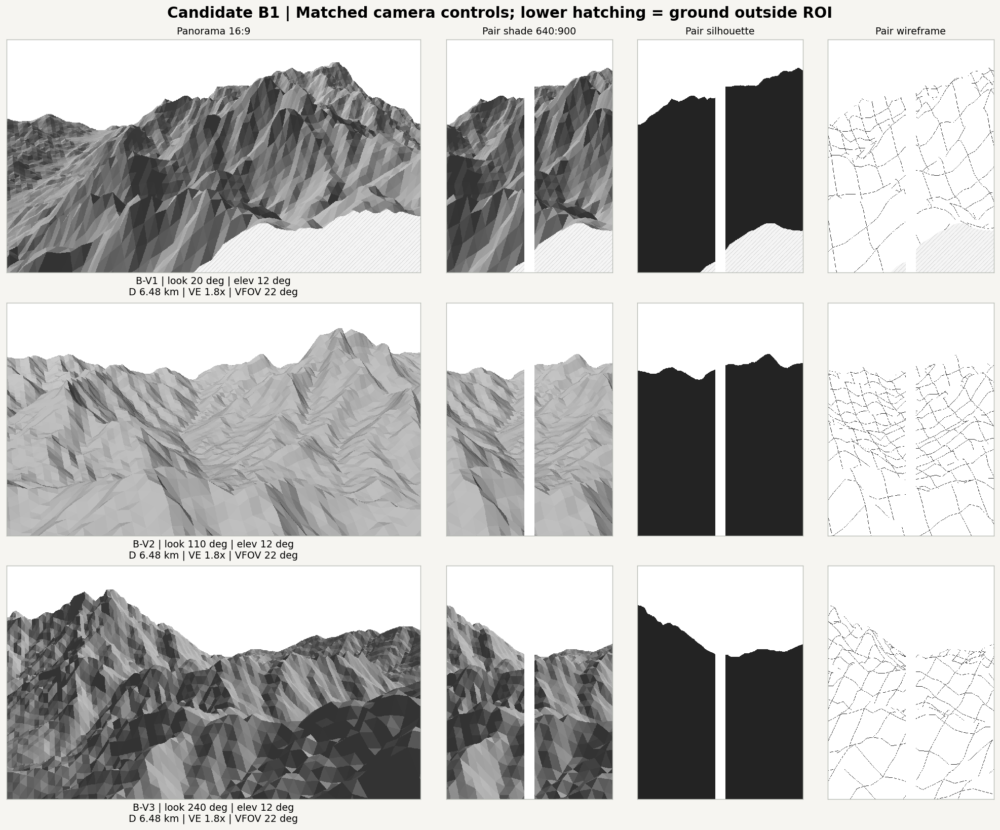
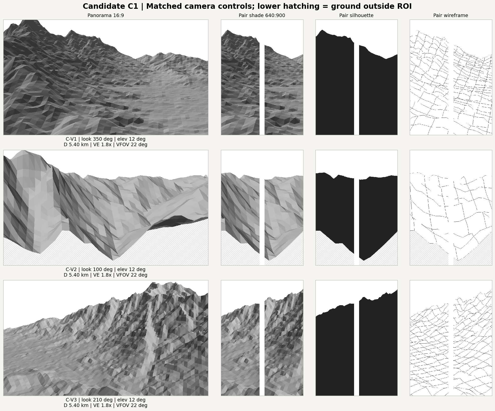
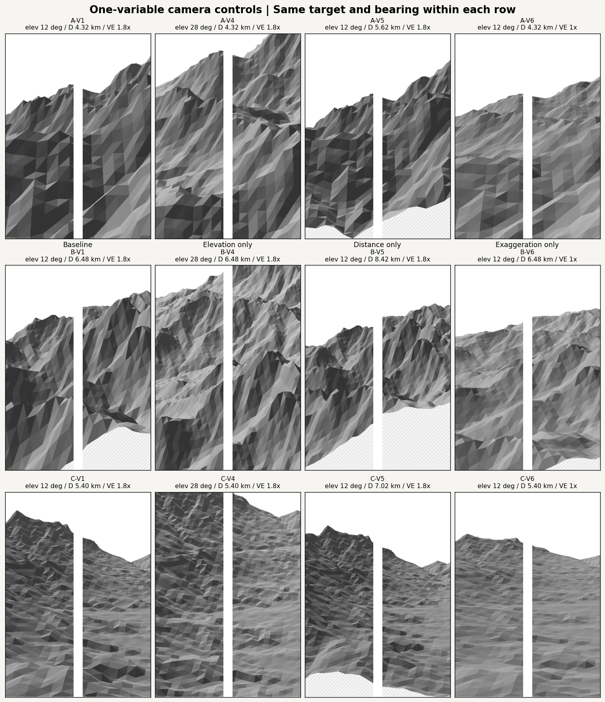
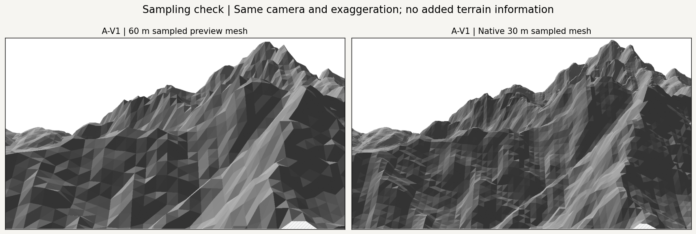

# Seoul North — Terrain and Viewpoint Exploration v0.1

Scope: candidate regions and diagnostic terrain views. No brush strokes, vegetation generation, palette changes, or G-code. Starting main: `282dab31bf9928918f79ba562859e32f3e29907b` (PRs #2 and #3 merged).

## Candidate Regions

These are three overlapping crops within the same prominent mountain complex: a steep southern/core crop, a broader northern crop, and an eastern mountain/lowland boundary. They are not three independent mountain ranges. Place names have not been verified and are intentionally omitted.

| Candidate | Center: longitude, latitude (WGS84) | UTM bounds: west, south, east, north (EPSG:32652) | Size | Elevation range | Slope ≥25° |
| --- | --- | --- | --- | --- | --- |
| A1 | 126.965699, 37.642254 | 318120, 4165670, 322920, 4170470 | 4.8 × 4.8 km | 34.1–801.8 m | 46.2% |
| B1 | 126.978487, 37.672214 | 318120, 4167770, 325320, 4174970 | 7.2 × 7.2 km | 33.1–801.8 m | 32.2% |
| C1 | 127.003009, 37.645596 | 320820, 4165370, 326820, 4171370 | 6.0 × 6.0 km | 18.4–801.8 m | 22.4% |

A1 was selected for steep terrain and high relief; B1 for larger-scale ridge/valley complexity and a distinct northern center; C1 for adjoining low and high elevations. **Rock exposure and urban land use are not established by DEM/Hillshade alone.** The faceted diagnostic shading does not prove that a surface is rocky.



### Screening Method

Scan square windows of 4.8/7.2/6.0 km at 900 m steps, requiring at least 99.5% finite input coverage. Within each type, retain five high-scoring windows separated by more than 2.5 km between centers. A uses steep fraction × relief; B uses local residual roughness × relief / 100; C uses √(low fraction × high fraction) × relief. Relief is p95 minus p05; low/high thresholds are 100/300 m. The mask-aware Gaussian scale is 360 m and is used **only for ranking**, not for rendered geometry. Scores differ by type and are not a measure of artistic quality.

Use the first retained A and C windows and the second B window to diversify the crop center. This is a heuristic shortlist, not an exhaustive search or a final composition choice. Selected windows have 100% finite DEM coverage. All retained windows and metrics are in [exploration.json](exploration.json).

## Camera and Display Conventions

- Pinhole perspective; UTM east/north remain in meters. Azimuth is the **look direction**, clockwise from north, not the camera's orbit bearing.
- Distance is horizontal eye-to-target distance. Elevation is the downward sight angle; the target's raw height is the ROI median elevation.
- Display Z = raw elevation × vertical exaggeration. The source elevations are never normalized, smoothed, or overwritten for rendering. Display-eye Z is an exaggerated model coordinate, not a measured geographic camera altitude.
- Vertical FOV is 22° for all views. Compare three bearings with identical elevation/distance/exaggeration, then change just elevation, distance, or exaggeration from V1.
- Panorama: 1200 × 675 px (16:9). Pair: a centered 480 × 675 px crop (640:900), preserving vertical FOV. The 40 mm gap is 30 px, leaving 225 px per 300 mm panel. The gap removes its portion of the continuous image; terrain is not squeezed to replace it.
- The preview mesh samples the original grid every two pixels (60 m); A-V1 is also checked with all 30 m samples. No new topographic information is invented.
- Flat Lambert face shading uses fixed northwest light at 45° altitude and a small distance tone. Cast shadows, ink spread, and physical brush pressure are not simulated.
- A reciprocal-depth z-buffer resolves occlusion. Diagnostic mesh rows/columns are not production brush paths. All 18 cameras have zero near-plane-discarded triangles.
- **Lower diagonal hatching marks ground outside the finite ROI mesh. It is not sky, water, a valley, or intentional pictorial whitespace.** A full regional horizon and foreground context must be checked after a view is selected.

| View | Look azimuth | Elevation | Horizontal distance | Vertical scale | Vertical FOV |
| --- | --- | --- | --- | --- | --- |
| A-V1 | 0° | 12° | 4320 m | 1.8× | 22° |
| A-V2 | 90° | 12° | 4320 m | 1.8× | 22° |
| A-V3 | 225° | 12° | 4320 m | 1.8× | 22° |
| A-V4 | 0° | 28° | 4320 m | 1.8× | 22° |
| A-V5 | 0° | 12° | 5616 m | 1.8× | 22° |
| A-V6 | 0° | 12° | 4320 m | 1× | 22° |
| B-V1 | 20° | 12° | 6480 m | 1.8× | 22° |
| B-V2 | 110° | 12° | 6480 m | 1.8× | 22° |
| B-V3 | 240° | 12° | 6480 m | 1.8× | 22° |
| B-V4 | 20° | 28° | 6480 m | 1.8× | 22° |
| B-V5 | 20° | 12° | 8424 m | 1.8× | 22° |
| B-V6 | 20° | 12° | 6480 m | 1× | 22° |
| C-V1 | 350° | 12° | 5400 m | 1.8× | 22° |
| C-V2 | 100° | 12° | 5400 m | 1.8× | 22° |
| C-V3 | 210° | 12° | 5400 m | 1.8× | 22° |
| C-V4 | 350° | 28° | 5400 m | 1.8× | 22° |
| C-V5 | 350° | 12° | 7020 m | 1.8× | 22° |
| C-V6 | 350° | 12° | 5400 m | 1× | 22° |

## Visual Review

The shortlist below shows A-V1, B-V3, and C-V1 as useful starting points for discussion, not a final selection.



| Candidate / view | Pictorial strengths | Limits and next framing question |
| --- | --- | --- |
| A1 / A-V1 | Strong rising slope, distinct relief, and a clear change from low left terrain to the higher right mass. | The tall main peak falls outside the central pair crop. Shift the aim/framing before committing to a two-panel composition; avoid interpreting triangle facets as actual rock planes. |
| B1 / B-V3 | A central valley separates the left high mass from the right ridge. Foreground, middle distance, and farther relief are easier to distinguish. | The portrait crop removes much of the left peak; the gutter cuts the central valley. Aim placement and a wider regional foreground need review. B-V2 is an alternative for a valley-dominated view. |
| C1 / C-V1 | A strong mountain-to-lowland transition and a descending lateral flow. The panorama leaves more sky to the right and distinguishes dense relief from the flatter foreground. | The tall mountain is clipped at the panorama's upper left, and the narrow pair loses much of the lowland width. A farther view such as C-V5 may help; city identity requires additional evidence. |

### Candidate A: Direction Comparison



### Candidate B: Direction Comparison



### Candidate C: Direction Comparison



### One-Variable Controls



V4's higher 28° elevation reveals more ground but reduces skyline whitespace and makes the view more map-like. V5's larger distance gives more room around the mountain mass, while increasing the visible finite-ROI cutoff. V6's 1× scale provides a reference for actual relative relief; the 1.8× version emphasizes height but is an artistic transformation.

### Native Sampling Check



The native 30 m mesh refines facets and crest detail but retains A-V1's main rising form. Neither mesh resolves individual trees or fine rock texture. The native comparison checks only A-V1; the other 17 views remain 60 m previews.

## Reproduce

```bash
python -m pip install -e ".[research,dev]"
python -m datascape.rendering.exploration --master /path/to/SeoulNorth_v02_MASTER_30m.tif --config configs/scenes/seoul_viewpoint_exploration.yaml --output outputs/seoul_viewpoints_v01 --base-revision 282dab31bf9928918f79ba562859e32f3e29907b
```

Open [02_terrain_viewpoints.ipynb](../../../notebooks/02_terrain_viewpoints.ipynb) in VSCode using the same environment. Set `DATASCAPE_DATA_DIR` or edit the notebook's data path. Inspect the pair crop as well as the panorama before choosing a view.

The workflow reuses [data-quality masking](../../../src/datascape/data/quality.py); new helpers are [ROI screening](../../../src/datascape/terrain/candidates.py), [camera geometry](../../../src/datascape/projection/camera.py), [terrain previews](../../../src/datascape/rendering/terrain_preview.py), and [contact-sheet orchestration](../../../src/datascape/rendering/exploration.py). Input hash, exact bounds, target/eye coordinates, configuration, source-module hashes, and all views are recorded in the JSON. No randomness is used (`random_seed: null`).

Tests cover camera convention, metric distance, non-mutating transforms, perspective-correct depth, order-independent occlusion, actual-height mesh sampling, panel/gap ratio, and invalid camera settings. Saved images are fully decoded before publishing. Historical sources, raw TIFFs, palette YAML, and FluidNC settings are unchanged.

Validation for this snapshot: eight tests passed, editable package imports succeeded, and every notebook Python cell executed in one shared interpreter. Its candidate and view records exactly matched the CLI output. A native Jupyter kernel session was not launched on this restricted host.

See [Taebaek source analysis and module boundaries](taebaek_analysis.md). No historical script was imported or executed.

## Data Attribution

Figures produced using Copernicus WorldDEM-30 © DLR e.V. 2010-2014 and © Airbus Defence and Space GmbH 2014-2018 provided under COPERNICUS by the European Union and ESA; all rights reserved.

The organisations in charge of the Copernicus programme by law or by delegation do not incur any liability for any use of the Copernicus WorldDEM-30.
