# A-density v2: mountain-relative breathing

This experiment keeps PR #11's `blended_color_ready` intact and redistributes A within measured terrain forms. Production C remains unchanged; new opaque diagnostics make it readable.

The v2 A length changes from **72.47 m to 73.26 m (+1.09%)**. This is primarily a spacing redistribution, not another overall density increase. The requested crest → open shoulder → descending re-density sequence is strongest in selected middle-distance forms; it remains conservative on narrow exposed crests.

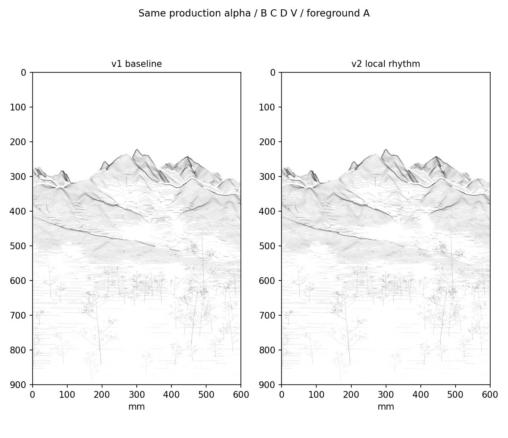

## Locked inputs

F2 camera/projection, original DEM/NDVI, the 70/30 foreground retention, all whitespace fields and the published mist transfer are unchanged. B, C, D and V are the same saved records, except their absolute list indices. All **213 foreground A paths** below the inherited 1,600 m source-depth boundary are copied exactly. No object, vegetation, rock, path, color or G-code generator is added.

The PR #11 baseline archive was independently rebuilt to its exact published Git blob before this experiment. Previous results, original works, palette and FluidNC settings are preserved.

## Form-relative placement

1. Break adjacency at actual source-surface jumps. DEM summit neighborhoods and the existing D supports seed geodesic catchments in source XY meters. Crossing a valley has a higher cost. The resulting 13 analysis regions are **not named geographic mountains or a geological segmentation**; their bounds, seed/crest source coordinates and local relief are recorded in `record.json`.
2. Within each catchment, map its 98th-percentile height to crest and its 10th-percentile height to foot. Density depends on normalized local relief, not global elevation or screen y. Tests shift one form's absolute elevation independently and shift source depth without changing the local rule.
3. A continuous relative-density profile places emphasis near crest/D, opens selected shoulders, and strengthens a lower slope passage. Anchors are `t=[0,.10,.28,.43,.60,.72,.88,1]`, relative weights `[1.9,1.9,.35,.35,1.8,1.8,.95,.8]`. These are requested weights, not guaranteed realized contrasts.
4. Integrate in **source-depth meters** within each form/column run. The old phase supplies endpoint row budgets, not the internal frequency schedule. Cumulative normalization preserves endpoint phase counts. Corrections return to zero at form boundaries and the foreground scope boundary. A positive directional phase derivative prevents folded stroke-coordinate pockets; it reduces contrast where necessary. No terrain coordinate or projection is transformed.
5. Trace actual transverse phase contours on the fixed visible surface. If a spline leaves its phase surface, retain the checked native contour rather than silently deleting the row. The unchanged mist transfer then performs actual path omission/shortening and width/alpha attenuation. Existing zero cores and the bottom 2 mm guard override placement.

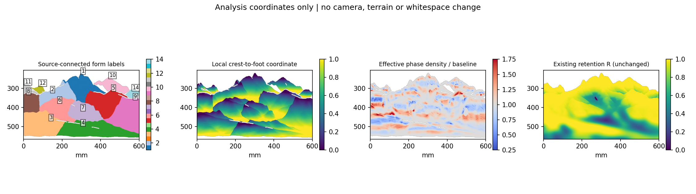

The 1,600 m boundary limits this focused mountain experiment; it does not drive the internal density pattern. Foreground continuity and C grain therefore remain direct controls.

## A-only evidence before mist

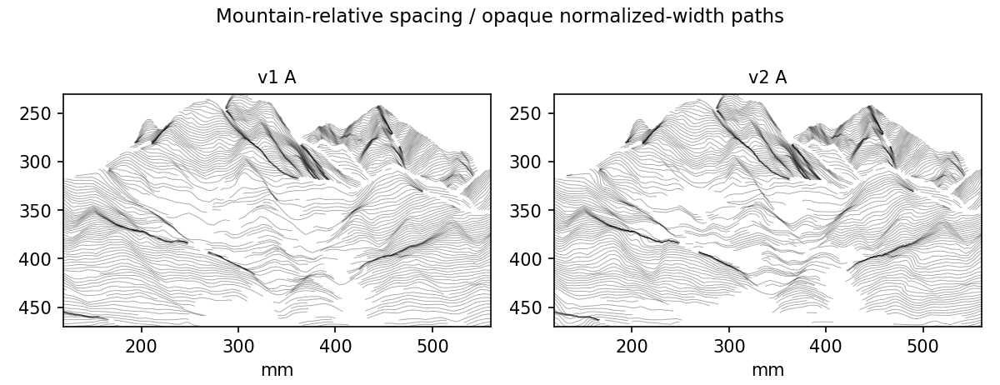

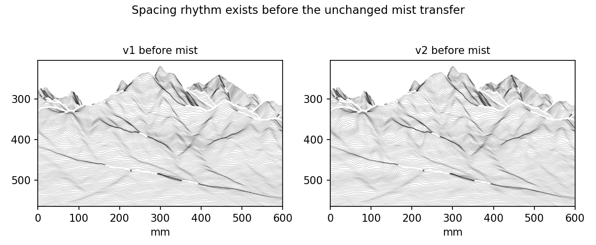

The A-only views use constant 0.28 mm diagnostic width and alpha 1, so digital darkness cannot create the spacing effect. The before-mist comparison uses actual candidate vectors; it is explicitly not a production drawing.

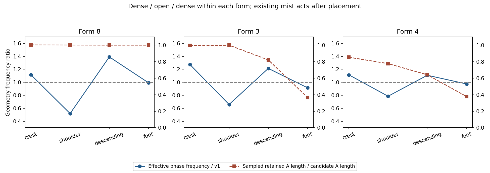

The blue curves below measure the effective phase-frequency ratio to v1 along the original transverse normal. They include boundary blending and topology limiting, rather than merely showing requested weights. The red curves measure sampled retained centerline length divided by candidate length. These are geometric/length diagnostics, not simulated opacity or brush pressure.

| Form | Crest | Shoulder | Descending | Foot |
| --- | --- | --- | --- | --- |
| 1 | 1.13 | 0.85 | 1.07 | 1.00 |
| 2 | 1.10 | 0.78 | 1.15 | 0.90 |
| 3 | 1.27 | 0.66 | 1.21 | 0.92 |
| 4 | 1.11 | 0.79 | 1.11 | 0.97 |
| 5 | 1.47 | 0.84 | 1.06 | 0.94 |
| 6 | 0.99 | 0.84 | 1.26 | 1.00 |
| 7 | 1.11 | 0.85 | 1.15 | 1.05 |
| 8 | 1.12 | 0.52 | 1.39 | 0.99 |
| 9 | 1.02 | 0.76 | 1.28 | 0.93 |
| 10 | 1.12 | 0.84 | 1.15 | 0.94 |
| 11 | — | 1.00 | 1.21 | — |
| 12 | — | 0.93 | 1.41 | 0.79 |
| 14 | — | 0.80 | 1.14 | 1.04 |

A value of 1 means unchanged frequency relative to v1; below 1 opens spacing. The three highlighted forms are selected by measured contrast with sufficient band area; all regions are reported above to avoid implying uniform success.

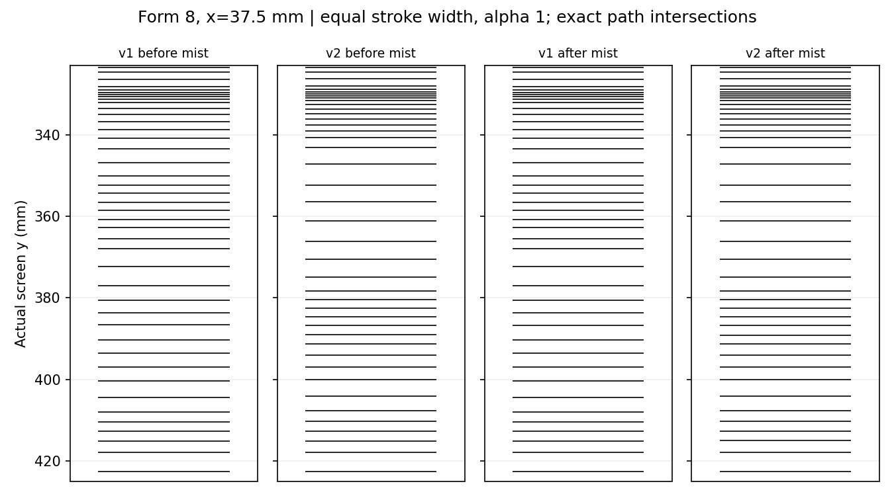
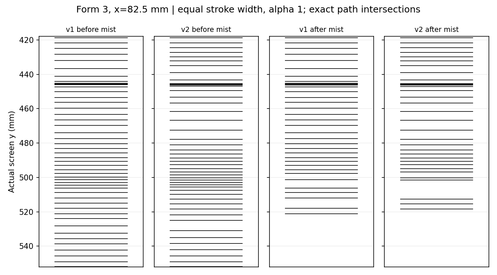
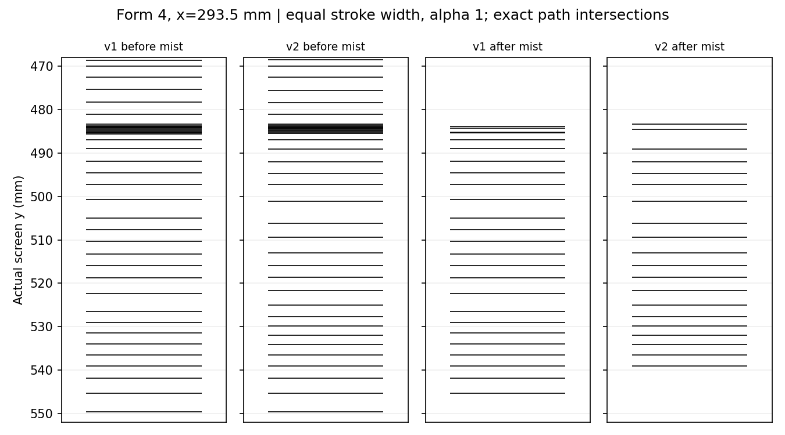

Each comb diagram is a fixed x-coordinate intersecting actual paths. Tick positions use actual screen y in millimeters, with identical line width/opacity. The same form is shown before and after the unchanged mist transfer. In forms where existing retention is high, the foot **does not** acquire a new mist gap; this pass does not manufacture a new whitespace band to force the final dissolve stage everywhere.

## C readability without changing production

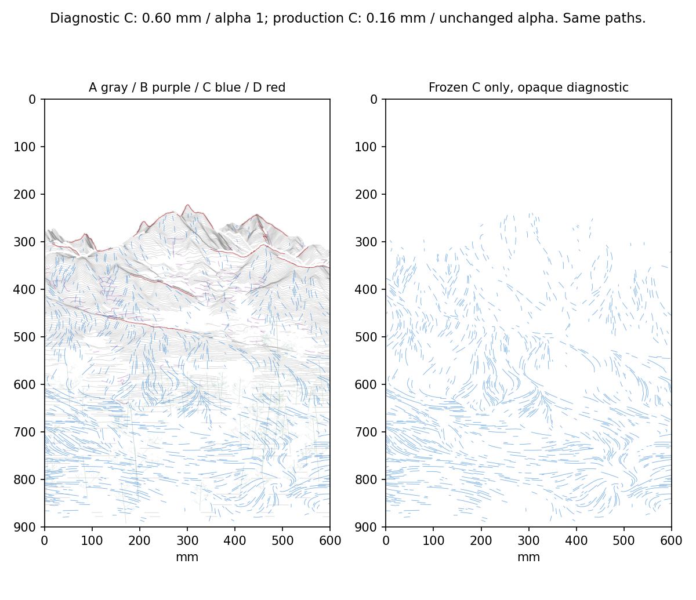

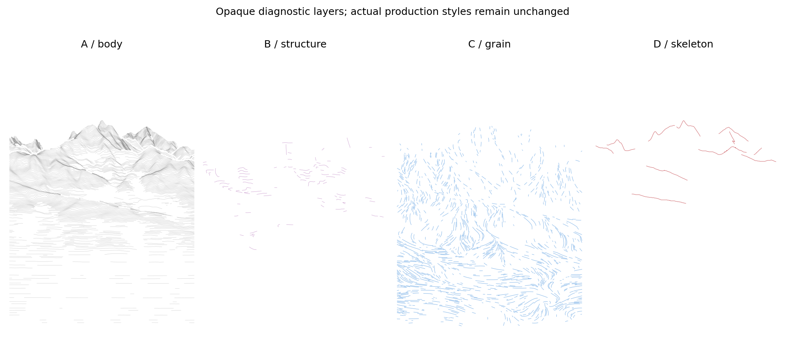

Production retains D > B > A > C with the existing width/opacity profiles. Diagnostic A is gray, B purple, C blue and D red. C is drawn at **0.60 mm / alpha 1 only in diagnostics**, versus its unchanged nominal **0.16 mm** production geometry/style. The diagnostic draw order brings C above A for inspection. These display choices are not a new material assignment or physical brush prescription. Actual C coordinates, segmentation and density remain identical to PR #11.

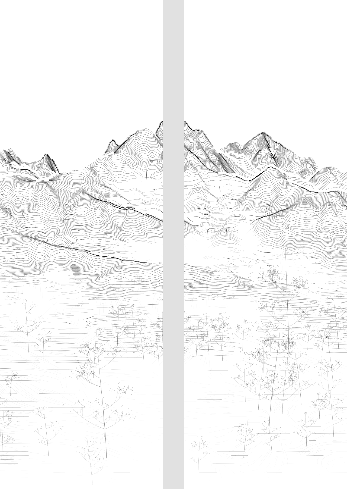

The painting is still continuous 600×900 mm content, split at x=300 mm, with a 40 mm physical interval inserted after rendering. No content is generated in that gap.

## Metrics and limits

| | PR #11 baseline | v2 |
| --- | --- | --- |
| A panel paths | 1207 | 1122 |
| A length | 72.47 m | 73.26 m |
| All paths, including fixed vegetation | 7717 | 7632 |
| All length | 116.63 m | 117.42 m |

The local opening/re-density is more explicit than v1, while the production image remains close in total weight. Some boundaries still read as a transverse-line system; narrow far-distance forms cannot sustain the same contrast as large middle-distance masses without introducing undesirable turns. This study does not claim that every form now completes a strong four-stage rhythm. Review the A-only and comb views before adopting v2 as a new production baseline; `blended_color_ready` remains the preserved baseline.

## Reproduce

```bash
python -m pip install -e '.[research,dev]'
python -m datascape.rendering.mass_density_study \
  /path/to/SeoulNorth_v02_MASTER_30m.tif \
  /path/to/SeoulNorth_v02_VEG_10m.tif \
  --config configs/scenes/seoul_spring_a_density_v02.json \
  --output /path/to/reproduced-study
python -m pytest tests -q
```

Open [the notebook](../../../notebooks/spring_a_density_v02.ipynb) in VSCode/Jupyter. Set `DATASCAPE_MASTER`, `DATASCAPE_VEG` and optionally `DATASCAPE_OUTPUT`. Config, input hashes, code hashes, fixed seed, form coordinates, actual crossing positions and band measurements are recorded. The canonical [v2 vectors](v2_strokes.json.gz) drive both production PNG and SVG. Candidate archives are diagnostic only.

Validation: **112 tests passed**. The 7 actual notebook code cells were replayed in one Python namespace, reproducing 43 generated artifacts byte-for-byte against the CLI; no kernel socket was launched. 38 PNGs, three archives and one SVG decode/parse. SVG coordinates/widths/alpha match canonical vectors. Frozen B/C/D/V, inherited foreground A, unchanged full-precision retention, sampled omission cores, bottom 2 mm footprints and no exact same-layer duplicate paths pass. There are no nonpositive phase-derivative pixels in the declared checked surface. All 583 parent blobs are preserved by the Git overlay.

See [validation.json](validation.json) for environment versions. Physical brush spreading remains a later paper test; diagnostic alpha and line width are not calibration. No main merge or hardware execution is part of this study.
