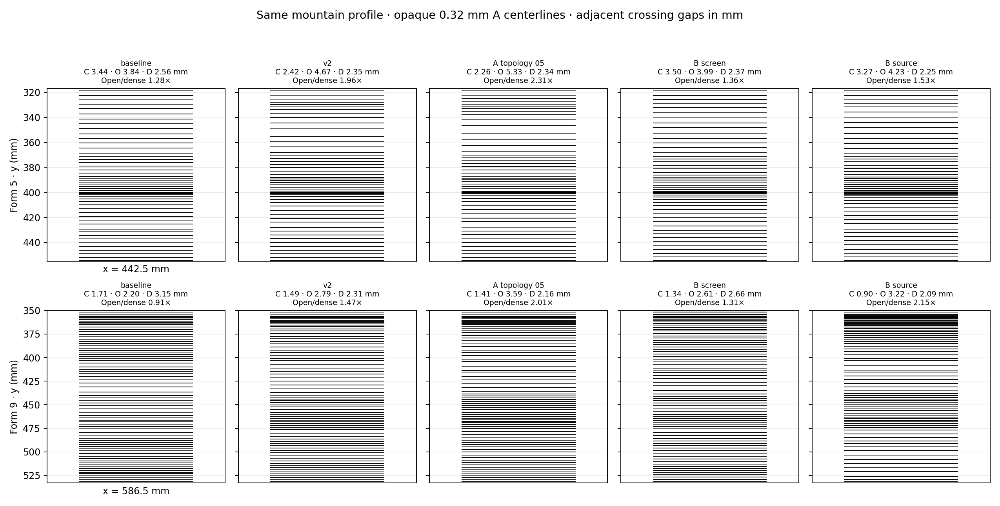
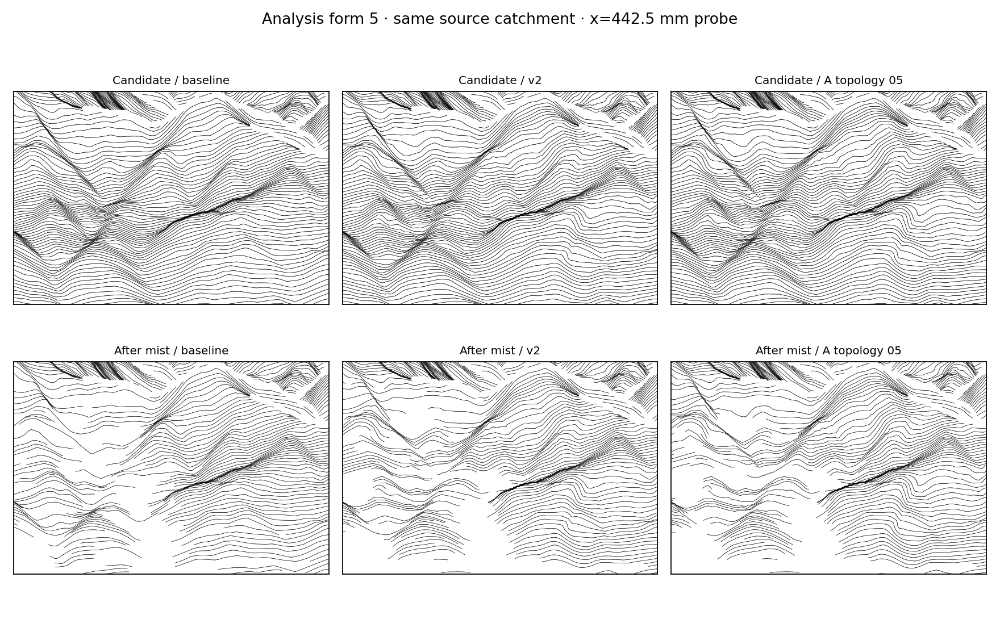
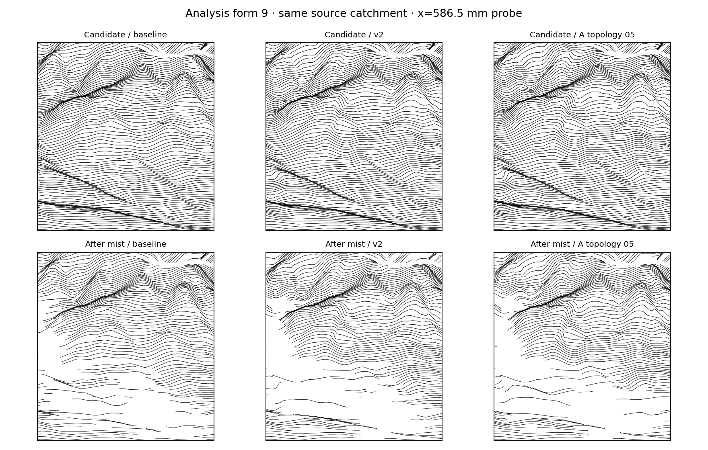
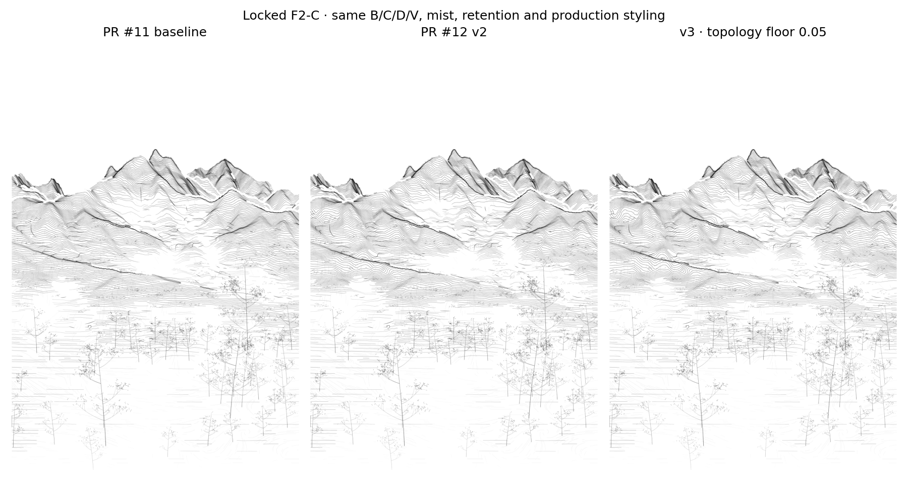
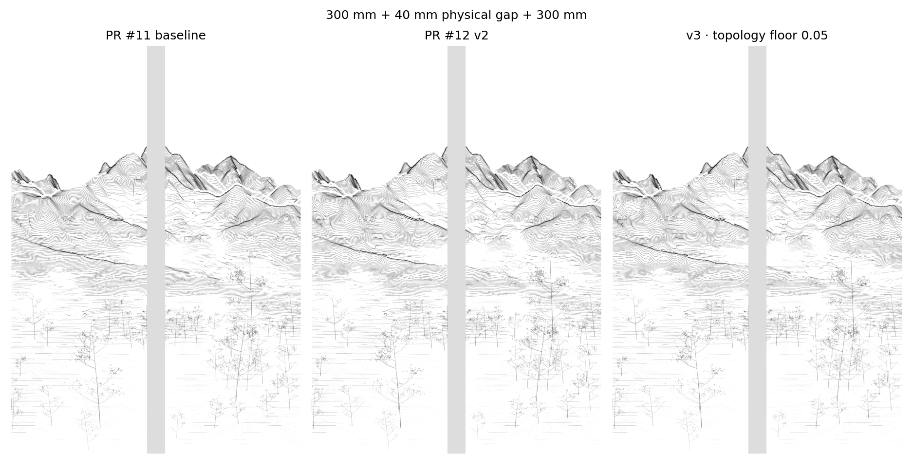
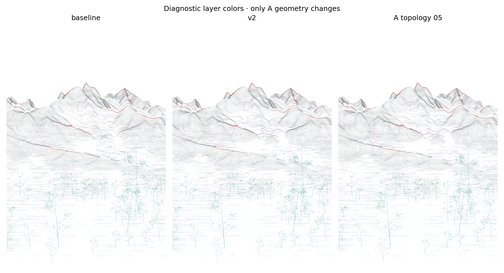

# A-Density v3: Visible Accordion Rhythm

This focused study tests why PR #12's mountain-relative A spacing remained visually restrained, then compares a narrowly relaxed phase guard with two explicit spacing schedules. The F2-C scene, camera, DEM, 70/30 foreground retention, mist fields and transfer, and all B/C/D/V paths remain fixed. PR #11 `blended_color_ready` remains the approved baseline; PR #12 remains an unchanged experiment. See the [PR #11 study](../spring_density_rhythm_v01/README.md) and the [PR #12 study](../spring_a_density_v02/README.md) for the preserved baseline and v2 records.

## Finding

PR #12 requests relative weights of 1.9 at the crest, 0.35 across the open shoulder, and 1.8 on the descending slope. The requested crest-to-shoulder weight ratio is 5.43:1, but that is not the spacing ratio delivered to the visible vectors.

The main contrast loss is the positive directional phase-derivative limiter. In PR #12, its final correction gain is **0.34 for form 5 and 0.33 for form 9**. The source-continuous mass labels contain broad and narrow areas, so the locally integrated correction creates negative phase derivatives in parts of the projected surface. The guard scales the entire mass correction to avoid folded or reversed stroke coordinates.

One-factor ablations show the relative contribution of the other constraints:

| Constraint change | Form 5 topology gain | Form 9 topology gain | Result |
| --- | ---: | ---: | --- |
| PR #12 settings | 0.340 | 0.331 | Local opening is visible, but uneven |
| Remove per-run endpoint conservation | 0.326 | 0.464 | Small and mixed change; does not solve both forms |
| Remove 18 mm boundary feather | 0.220 | 0.171 | Five checked nonpositive derivative pixels; rejected |
| Remove 3 mm phase smoothing | 0.169 | 0.314 | More severe limiter reduction; rejected |
| Raise displacement cap from 8 to 16 mm | 0.340 | 0.331 | The cap affected 2.5% and 5.0% of selected form pixels; little contrast gain |
| Lower derivative floor from 0.25 to 0.10 | 0.408 | 0.397 | Improves actual spacing, with positive derivatives retained |
| Lower derivative floor from 0.25 to 0.05 | 0.430 | 0.420 | Best tested phase ablation; positive derivatives retained |

Boundary feathering and smoothing protect continuity at form edges; removing them does not recover a safe rhythm. Raising the displacement cap has only a minor effect. Endpoint conservation does redistribute the available row budget, but removing it changes the two forms in different directions. The derivative limiter is the dominant constraint.

Projection and form width also matter. The screen-space schedule creates **6,536 nonpositive directional-derivative pixels before its topology guard**; the source-space schedule creates **2,303**. Once guarded, screen-space spacing remains modest. The source-space schedule performs strongly in form 9 but is weaker in form 5 and increases total A length more than the selected phase ablation. These methods do not provide one consistent result across both forms.

## Actual vector spacing

Two existing source-connected analysis forms were selected because each contains a sufficiently long visible crest-to-foot run. Their numeric labels are algorithmic catchments, not verified geographic mountain names. Each local probe intersects actual A centerlines at one fixed x coordinate. All paths in the opaque diagnostic use the same 0.32 mm width and alpha 1. Adjacent crossing gaps are measured in screen millimeters; the dense-to-open summary compares the open-shoulder median with the mean of crest and descending medians.

| Form | Version | Crest gap | Open shoulder gap | Descending gap | Open / dense mean |
| --- | --- | ---: | ---: | ---: | ---: |
| 5 | PR #11 baseline | 3.43 mm | 3.86 mm | 2.63 mm | 1.28× |
| 5 | PR #12 v2 | 2.44 mm | 4.67 mm | 2.35 mm | 1.95× |
| 5 | v3, derivative floor 0.05 | 2.27 mm | 5.34 mm | 2.42 mm | **2.28×** |
| 9 | PR #11 baseline | 1.72 mm | 2.21 mm | 3.12 mm | 0.91× |
| 9 | PR #12 v2 | 1.48 mm | 2.79 mm | 2.31 mm | 1.47× |
| 9 | v3, derivative floor 0.05 | 1.42 mm | 3.57 mm | 2.16 mm | **2.00×** |

The v3 ratios change only slightly after the unchanged mist transfer: **2.31× to 2.28×** in form 5 and **2.01× to 2.00×** in form 9. Mist is not erasing the demonstrated local spacing rhythm. Across nine x probes per analysis form, the measured ratio is **2.09×** for form 5 and **1.77×** for form 9. The second form therefore still varies more across its width; the result does not claim a uniform accordion in every part of either mass.







## Full composition check

The complete comparison uses the original production styling and the same frozen B/C/D/V records. The full-scene difference is intentionally subtle: the v3 A geometry changes total A length from **72.47 m to 73.54 m (+1.48%)**, while the path count changes from **1,207 to 1,099**. The result is a redistribution of actual paths, not an overall darkness increase.







## Decision and limits

The best tested v3 candidate is the **existing phase-redistribution model with its minimum directional derivative ratio lowered from 0.25 to 0.05**. It preserves monotonic phase, source-continuous contours, the fixed terrain and projection, and the current mist/whitespace transfer. It produces a clear measured dense–open–dense rhythm in the two selected profiles, with approximately twofold open-to-dense spacing and only a 1.48% increase in total A length.

This is a localized proof, not a blanket replacement of the approved baseline. The whole composition remains close to PR #11, and broad form 9 measurements are less consistent than its selected profile. Keep `blended_color_ready` as the production reference until the artist accepts the v3 candidate. If a stronger, more uniform rhythm is later required, the next useful method is an order-preserving local normal-coordinate remap within explicitly traced mountain corridors, with continuity checked path by path. A per-column screen-phase schedule should not be generalized: its pre-guard fold count demonstrates that the projected terrain does not support it safely as currently formulated.

## Reproduce

```bash
python -m pip install -e '.[research,dev]'
python -m datascape.rendering.a_density_v03_study \
  /path/to/SeoulNorth_v02_MASTER_30m.tif \
  /path/to/SeoulNorth_v02_VEG_10m.tif \
  --config configs/scenes/seoul_spring_a_density_v03.json \
  --output /path/to/a-density-v03
```

Open [the Jupyter notebook](../../../notebooks/a_density_v03_study.ipynb) in VS Code and set `DATASCAPE_MASTER`, `DATASCAPE_VEG`, and optionally `DATASCAPE_OUTPUT`. The notebook and CLI call the same renderer. [The study record](record.json) captures source hashes, fixed parameters, phase ablations, candidate and post-mist vector crossings, path counts and lengths, and the frozen-layer checks. The [v3 full stroke archive](v3_full_strokes_after_mist.json.gz) and [pre-mist A candidates](v3_A_candidates_before_mist.json.gz) are canonical vector outputs.

Validation: **85 project tests passed**. The CLI renderer completed from the supplied MASTER and VEG GeoTIFFs; its source/config hashes match the PR #12 GitHub branch. The previous PR #11 and PR #12 records, original notebooks and artwork code, source TIFFs, palette, hardware settings, and approved vectors are preserved. No composition search, vegetation work, color system or G-code is included.
