# A-density v4: Local breathing on locked F2-C

The current v3 is the working baseline. This iteration changes **A geometry only**, comparing the locked v3 with a mountain breathing pass and an optional near-ground island/channel pass. Camera, projection, terrain selection, original DEM/NDVI, 70/30 retention, all whitespace fields and mist transfer, and every B/C/D/V path remain fixed. Production uses the same saved stroke widths and alpha profiles.

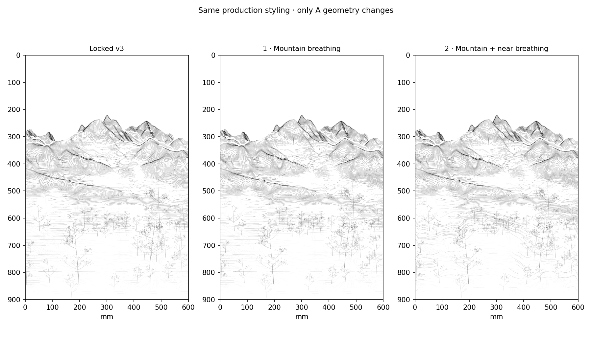

## What changed

V3 scaled each analysis form's entire phase correction by its single worst directional derivative. A few difficult pixels therefore weakened spacing contrast throughout a large form. V4 replaces that mass-wide gain with a **local constrained phase fit**. The sparse quadratic solve keeps the phase derivative positive along source-depth normals, smooths adjacent displacement, and holds a zero-displacement boundary collar. Its floor remains 0.05, as in v3. It must converge; a timed-out or inaccurate solve is rejected.

The requested mountain anchors remain 1.9 / 0.35 / 1.8 for crest / open shoulder / descending slope. They were not increased. Existing source-connected form coordinates use each form's relative relief, so a lower local crest can receive a dense structural zone. The integrated source-row budget, original boundary feather, smoothing and displacement cap are retained. The requested displacement from v3 is moderated to 70% before the local solve.

Before the original mist transfer, A placement now reads the existing retention R through `1 - 0.65 × (1 - smoothstep(R / 0.85))`. This opens actual candidate spacing as R falls; it does not edit R, its zero cores, or the transfer algorithm. The same density/length/width/alpha omission pass then runs as before. Candidate 1 copies all 213 inherited foreground A paths exactly.

Candidate 2 adds a near A schedule. Measured mound/ridge support and gentle slope favor closer intervals; measured valley/low-flow support and declining R favor wider intervals. No fixed x locations, fabricated rocks, paths or objects are used. Each continuous source run keeps its endpoint phase budget. The near target is moderated to 65%, with a six-cycle displacement bound. The 70/30 composition field and legacy 0.72 A-candidate keep policy remain unchanged.

The preserved 0317 source was checked again: its geometric row step follows a squared normalized row maximum. The named x-based `density_wave` also changes pressure and color omission; its row average is constant. V4 uses the interval-control principle without copying that global row-height rule or changing the historical file.

## Actual A geometry

The opaque views use the same 0.32 mm A width and alpha 1. No gray DEM shade or digital alpha creates the spacing effect.

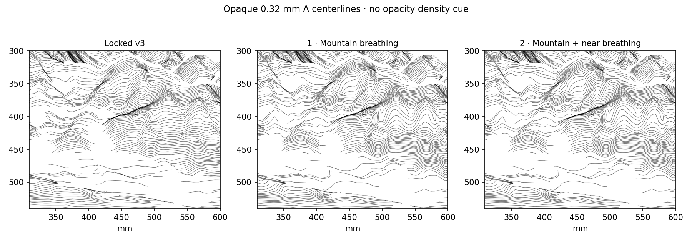

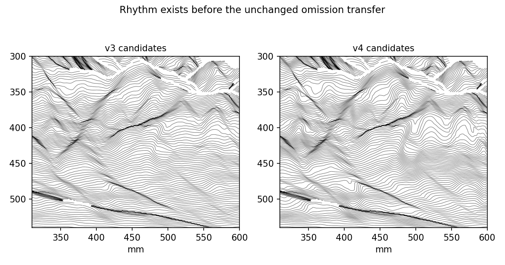

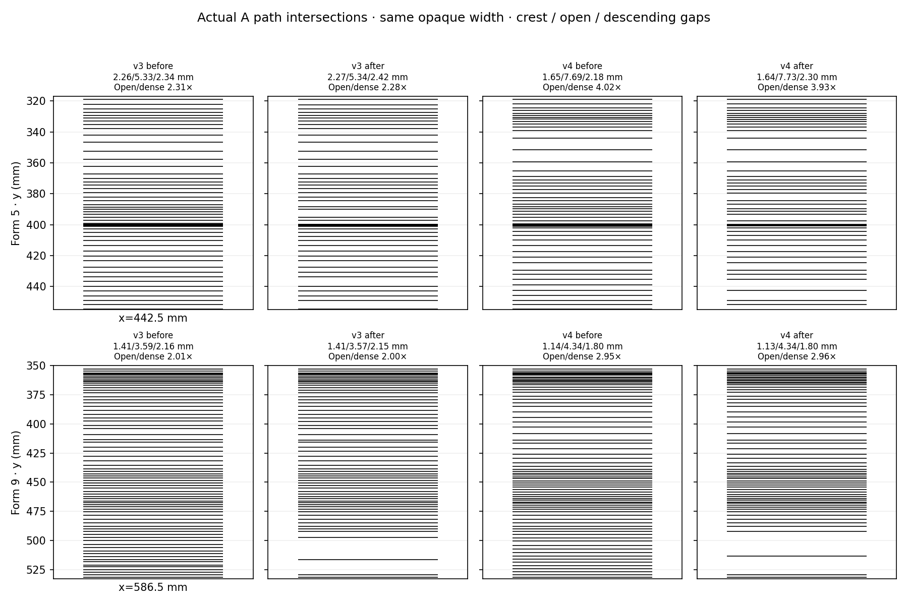

| Form | Paths | Crest / open / descending gaps (mm) | Open / dense mean |
| --- | --- | --- | ---: |
| 5 | v3 before | 2.26 / 5.33 / 2.34 | 2.31× |
| 5 | v3 after | 2.27 / 5.34 / 2.42 | 2.28× |
| 5 | v4 before | 1.65 / 7.69 / 2.18 | 4.02× |
| 5 | v4 after | 1.64 / 7.73 / 2.30 | 3.93× |
| 9 | v3 before | 1.41 / 3.59 / 2.16 | 2.01× |
| 9 | v3 after | 1.41 / 3.57 / 2.15 | 2.00× |
| 9 | v4 before | 1.14 / 4.34 / 1.80 | 2.95× |
| 9 | v4 after | 1.13 / 4.34 / 1.80 | 2.96× |

These are actual vertical intersections at the same v3 form probes, not target weights or pressure values. The open/dense summary divides the shoulder median gap by the mean crest and descending gap. Before/after plots show that the contrast exists before omission. The nine-column regional summaries below also report the forms that remain weak.

| Existing form | v3 regional ratio | Candidate 1 ratio | Candidate 1 gap samples (crest / open / descending) |
| --- | ---: | ---: | --- |
| 1 | 1.29× | 1.68× | 53 / 39 / 102 |
| 2 | 1.69× | 2.27× | 24 / 18 / 58 |
| 3 | 1.82× | 2.62× | 76 / 51 / 81 |
| 4 | 1.41× | 2.06× | 18 / 13 / 41 |
| 5 | 2.09× | 2.92× | 51 / 29 / 80 |
| 6 | 1.36× | 1.34× | 80 / 70 / 67 |
| 7 | 0.89× | 1.38× | 28 / 34 / 65 |
| 8 | 4.00× | 4.55× | 128 / 20 / 70 |
| 9 | 1.77× | 3.48× | 88 / 28 / 105 |
| 10 | 0.64× | 0.69× | 22 / 61 / 48 |
| 11 | 0.67× | 0.67× | 10 / 25 / 48 |
| 12 | 1.68× | 1.68× | 14 / 21 / 41 |
| 14 | 1.53× | 1.46× | 20 / 16 / 26 |

The labels are inherited analytical catchments, not verified geographic mountains. Large forms improve more consistently; forms with narrow or compound exposed geometry still do not all complete the requested four-stage sequence. A single strong probe is not treated as whole-scene success.

## Foreground and mist

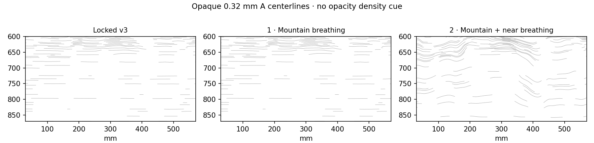

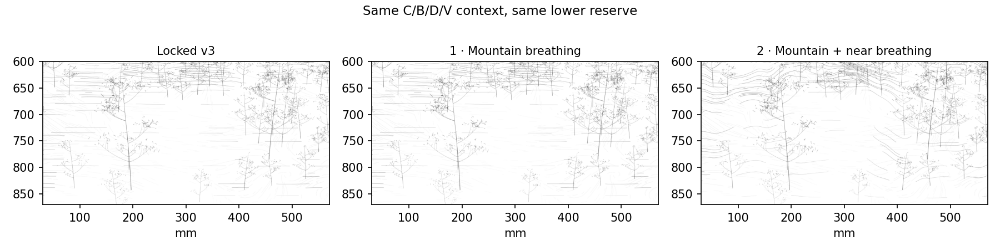

| Measured region | v3 A density (mm/mm²) | Candidate 2 A density | Change |
| --- | ---: | ---: | ---: |
| island | 0.1305 | 0.1724 | +32.1% |
| channel | 0.0791 | 0.0760 | -4.0% |

The masks in this table are fixed measured-support regions used for all candidates. Density is actual A centerline length per paper area. The change is spatially selective: supported ground gains paths while low-flow channels open. Candidate 1 remains an exact foreground control.

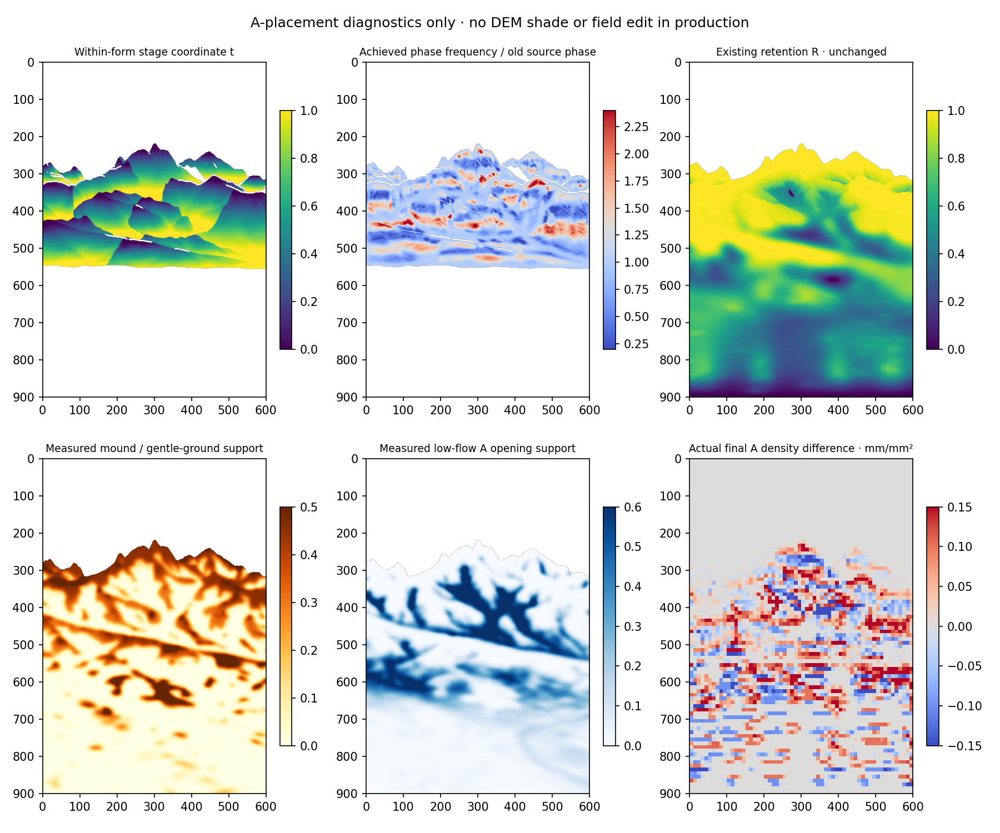

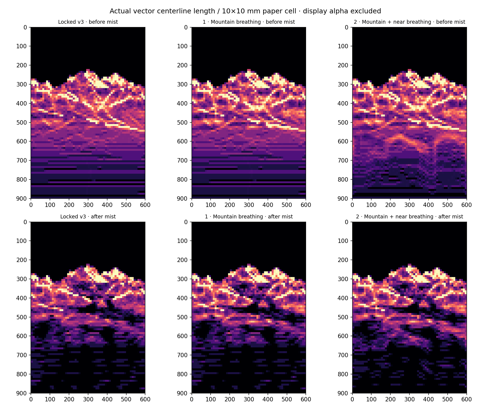

Before the unchanged mist transfer, actual candidate A density falls from 0.400 to 0.339 mm/mm² in the existing R < 0.2 region (-15.2%), and from 0.428 to 0.366 in R = 0.2–0.4 (-14.5%). This gives a measurable geometric release before the final path cuts. Existing zero cores and the bottom 2 mm guard still override all placement. The raw density map is a candidate diagnostic; the inherited v3 foreground production paths are copied exactly in candidate 1.

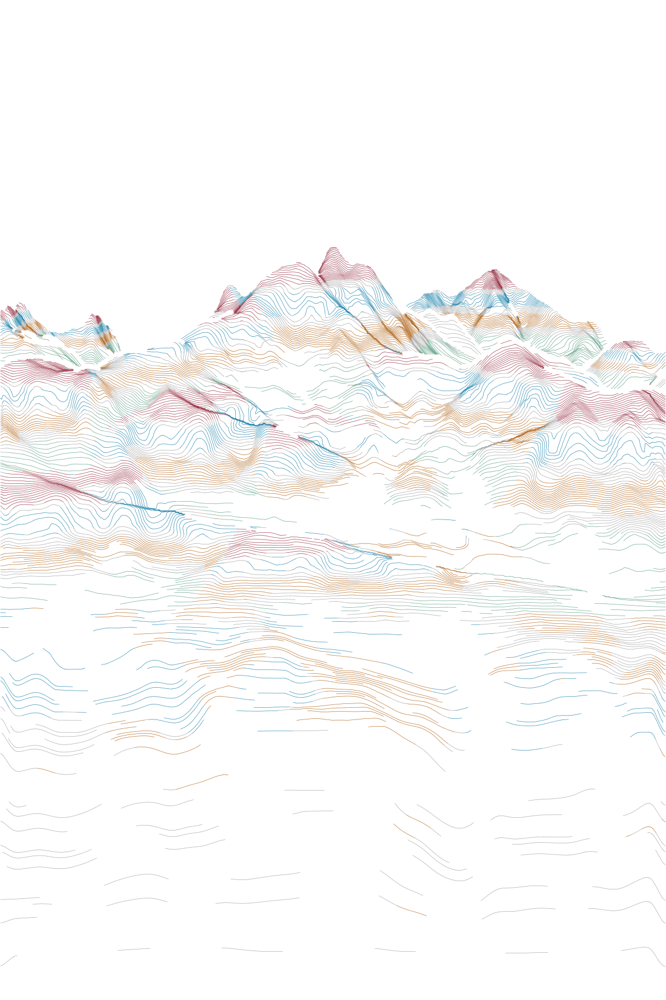

Stage colors are diagnostic only: red = crest support, blue = open shoulder/channel, ochre = descending re-density or near mound support, green = foot release, gray = transitional support. Stage labels identify rule locations, not guaranteed measured success at every pixel. Production remains black.

## Frozen C as future color-path geometry

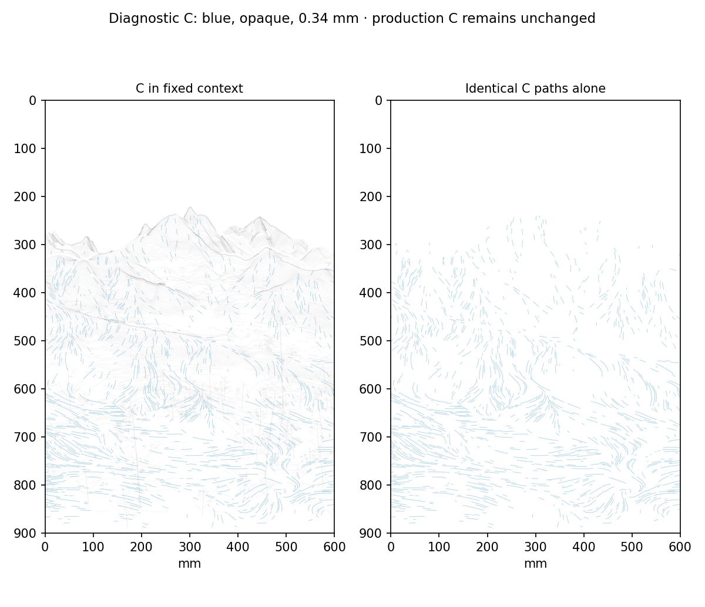

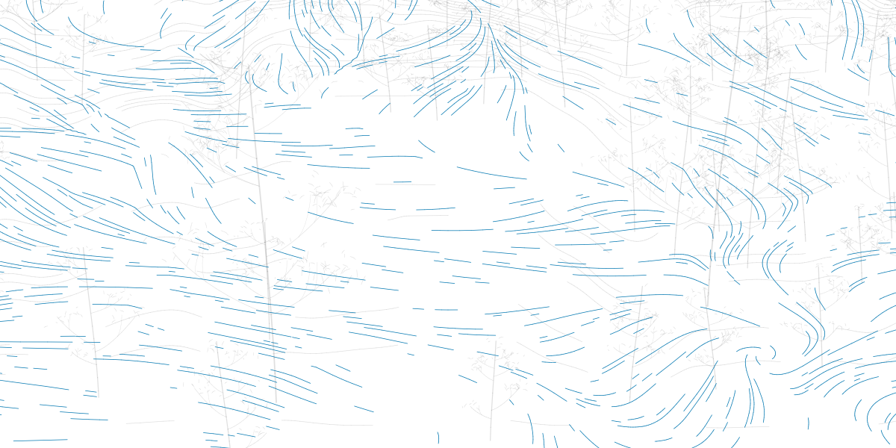

C retains exactly 1,214 paths and 19.09 m of centerline geometry, including its depth-specific short/long mark structure and existing material metadata. The diagnostic draws the same vertices last in opaque blue at 0.34 mm; this is not a production style change or color assignment. C remains usable as a directional/color-path family. It is still faint in the unchanged production preview, so the blue diagnostic is the appropriate view for evaluating its geometry. Increasing A has not removed or regenerated C. C length by source depth is 13.39 m near, 5.37 m middle, and 0.32 m far. Near and middle C are viable support families; far C currently provides sparse touches. Broad far-distance color coverage is not demonstrated by this geometry and should not be inferred from the diagnostic color.

## Assessment

The mountain pass creates visibly larger openings between denser crest and descending groups. Some overall weight increase remains, but the A-only views and pre-mist measurements show geometric redistribution rather than relying on opacity. The full-size overview still reads as a transverse-line system; several narrow forms remain restrained, and some broad openings have an arch/contour character that should be judged by the artist.

Candidate 2 gives the near ground more curved bundles and more open passages. Its density gain is concentrated on measured ground supports, although the final painterly interpretation of those bundles as footholds/islands is not automatic. C continues to supply a distinct directional grammar in the diagnostic.

Keep v3 as the working baseline while reviewing these candidates. Candidate 1 is the focused mountain option; candidate 2 adds the moderated foreground option. This study does not reopen composition or proceed to object, vegetation, color or G-code development.

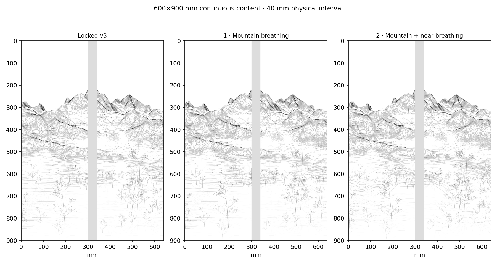

| | A paths after mist | A length | Change from v3 |
| --- | ---: | ---: | ---: |
| baseline | 1,099 | 73.54 m | +0.00% |
| candidate1 | 1,104 | 75.71 m | +2.94% |
| candidate2 | 1,092 | 77.33 m | +5.14% |

## Reproduce

```bash
python -m pip install -e '.[research,dev]'
python -m datascape.rendering.accordion_study \
  /path/to/SeoulNorth_v02_MASTER_30m.tif \
  /path/to/SeoulNorth_v02_VEG_10m.tif \
  --config configs/scenes/seoul_spring_a_density_v04.json \
  --output /path/to/a-density-v04
python -m pytest tests -q
```

The local solve adds the OSQP research dependency. Open [the notebook](../../../notebooks/spring_a_density_v04.ipynb) in VS Code/Jupyter and set `DATASCAPE_MASTER`, `DATASCAPE_VEG`, and optionally `DATASCAPE_OUTPUT`. The notebook and CLI use the same module. [The record](record.json) includes source hashes, locked inputs, solver convergence, all 13 form measurements, foreground masks, actual line lengths, mist-bin densities and frozen-layer checks. The [mountain candidate vectors](candidate1_strokes.json.gz) and [mountain + near candidate vectors](candidate2_strokes.json.gz) are the canonical data used by the previews.

Validation: 89 project tests passed. The CLI was run from the supplied source GeoTIFFs. All v3 archives, historical artwork code, original data, palette and hardware values remain preserved. Main is not merged.
