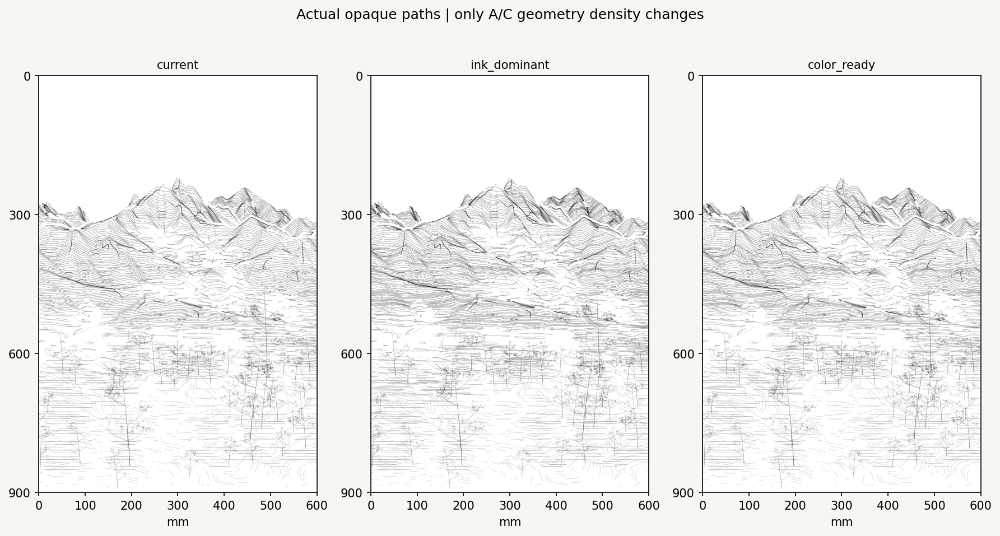
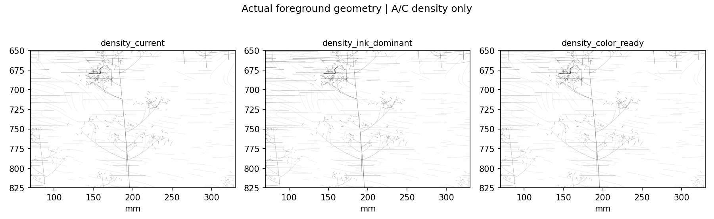
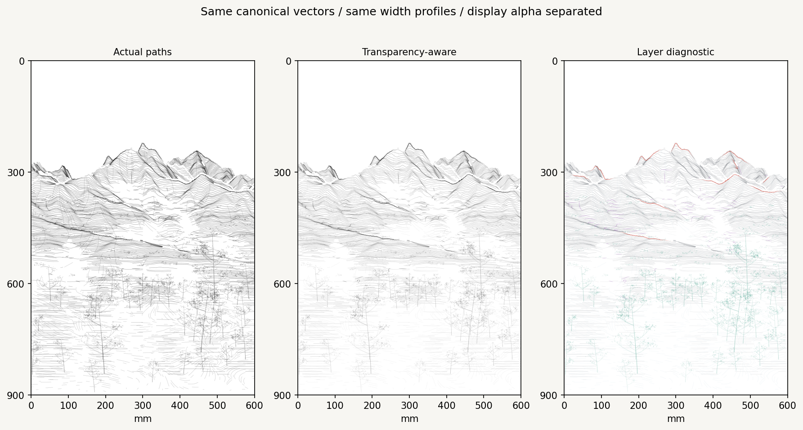
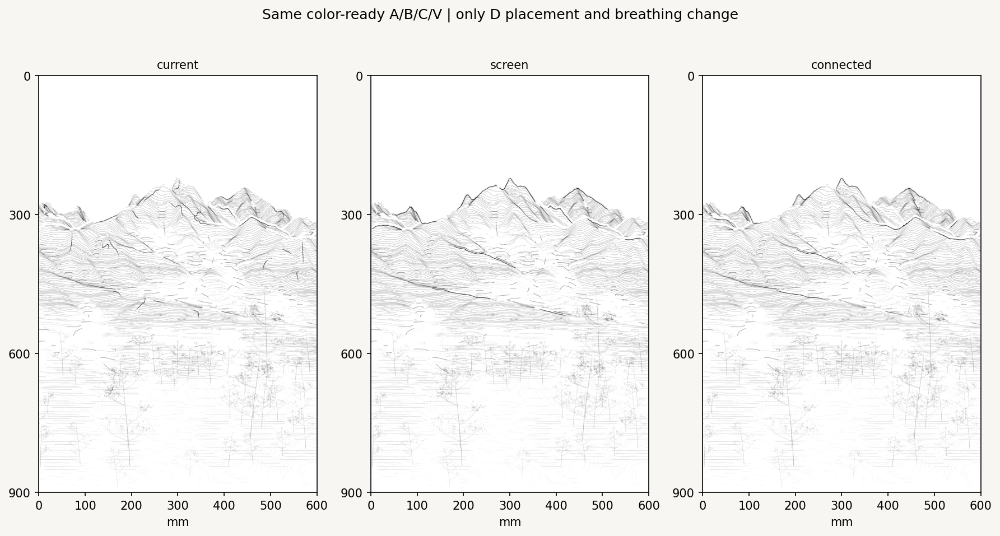
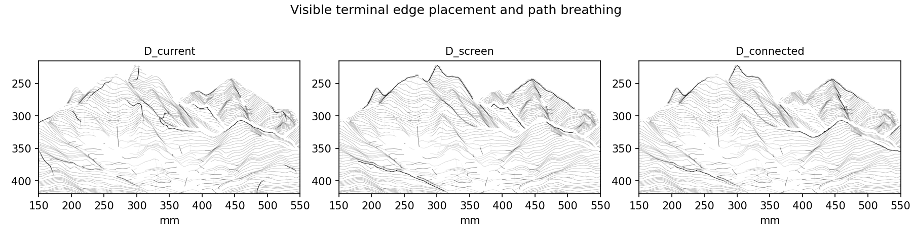
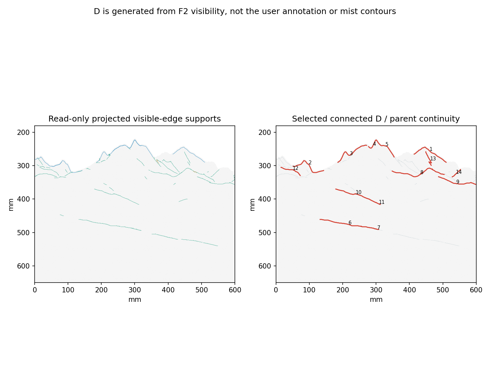
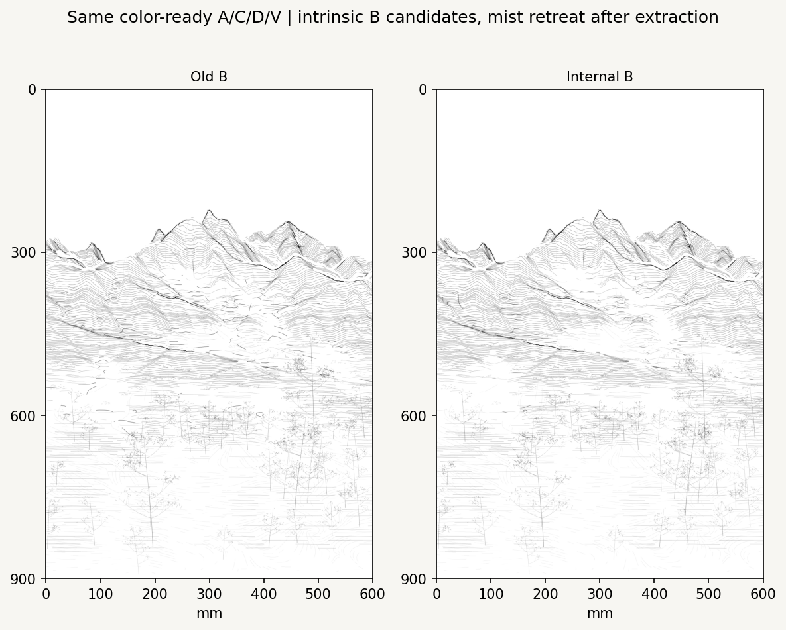
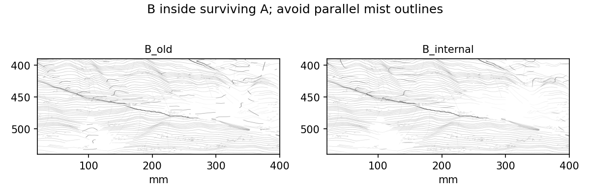
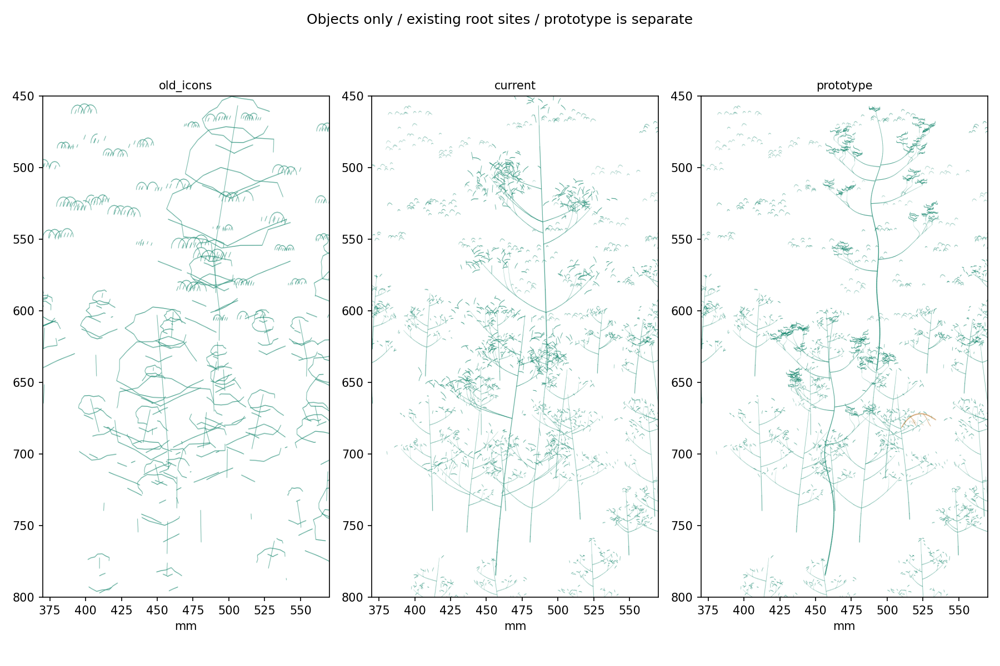
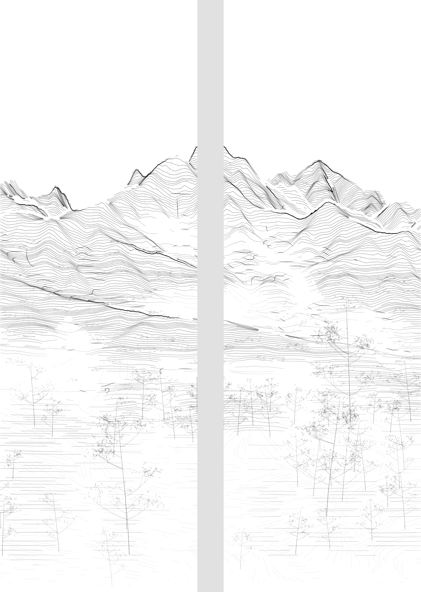

# Spring Color-Ready Stroke Study v0.2

Refine the vector grammar on the selected F2-C spring pair. The original DEM and seasonal NDVI, camera/nonlinear projection, 70% existing + 30% selective foreground, top reserve, bottom guard and near/middle/far whitespace fields remain fixed. Previous experiments and original artworks are preserved.

**Recommended primary review dataset:** color-ready A/C + revised internal B + connected, tapered terminal D + current vegetation. The limited hero/rock prototype is a separate choice, not a prerequisite for the primary stroke decision. No final color mixing, G-code or machine execution is included.

## 1. Actual density and color-ready transparency




| Preset | A paths / actual length | C paths / actual length | All-layer length |
| --- | ---: | ---: | ---: |
| Current | 949 / 59.402 m | 559 / 13.983 m | 99.222 m |
| Ink-dominant | 1,208 / 75.872 m | 701 / 17.456 m | 119.165 m |
| Color-ready | 1,057 / 67.455 m | 664 / 16.569 m | 109.860 m |

In the color-ready preset, A length increases by **13.56%** and C by **18.49%**. New A curves come from actual intermediate source-depth rows (50, 70, 90… m between the original 40, 60, 80… m levels), not screen offsets or duplicate traces. Omission and preset selection act on each continuous 600 mm parent before panel splitting. Both presets retain all current A paths. C uses a nested selection from the archived direction-field proposals, preserving all current C paths. In these three comparisons B/D/V are exactly identical.

Density controls are experimental gains. A additional-row keep probabilities are near/middle/far 0.16/0.14/0.08 for color-ready and 0.40/0.28/0.15 for ink-dominant. C selector gain is 1.04 or 1.26, compared with the earlier dense setting of 0.88; these gains are not literal area-coverage percentages. Fixed retention continues to shorten, thin and omit paths, so the foreground is not filled uniformly.



| Layer | Maximum nominal width | Simulated composite alpha | Role |
| --- | ---: | ---: | --- |
| D | 0.82 mm | 0.98 | Sparse terminal skeleton |
| B | 0.46 mm | 0.82 | Internal structural accent |
| A | 0.32 mm | 0.63 | Main transverse body |
| C | 0.16 mm | 0.22 | Light directional grain |

The black preview forces display alpha to one; the composite applies the stated hierarchy to the stored omission/strength profiles. Coordinates and width profiles are identical between the two modes. Actual path density, simulated alpha and future brush pressure/dilution are separate quantities. **SVG alpha is not a prediction of dried ink opacity.** Color-ready leaves more perceptual room for later translucent layers without creating any final color field now.

## 2. D: visible terminal edges rather than general terrain ridges





| Variant | Panel paths | Actual length | Median panel-path length |
| --- | ---: | ---: | ---: |
| Current D | 25 | 1.369 m | 44.78 mm |
| Visible screen-space D | 13 | 1.029 m | 75.35 mm |
| Connected + tapered D | 14 | 1.268 m | 98.69 mm |

Candidate priority is projected visible geometry: peak-centered skyline shoulders and near-side depth/source discontinuities first. Six skyline windows, 89 occlusion supports and four gated rock-edge proxies are available; no crest proxy passes all current visibility gates. The final selection uses four skyline and seven occlusion parents. Rock proxies are not promoted simply to fill a category or length budget.

A depth step must exceed 60 m and adjacent source XY separation must exceed 60 m. Paths are inset toward the nearer occupied surface; skyline inset follows the local inward normal rather than a vertical offset. Source-continuity guards reject false bridges. The F2 volume Jacobian remains positive over the visible domain (minimum 0.025334); that check does not establish that every artistic projected edge is a physical geological boundary.

A endpoints provide secondary references: the implementation adds a small A-tip alignment score after geometric support extraction. Neither stroke-tip patterns nor the mist mask generate D candidates. Compatible endpoint bridges require matching support type, tangent change below 35°, gap below 14 mm, bounded source separation and no hard-core crossing. Twenty-five joins are accepted. Sixteen paths at most, 7 mm spacing, per-type quotas and a 2.4 m ceiling keep selection sparse; the final result has 11 parents / 14 panel pieces and occupies **1.16%** of recommended all-layer length.

Parent arclength controls weak entry → strong middle → weak exit. The inherited envelope rises over the first 26%, sustains the center and releases after 62%, with lower-foot/mist release applied before excessive descent. Interior profile controls are retained at intervals of at most 1.2 mm, so a geometrically straight path does not collapse to two weak endpoints. The envelope continues through x = 300 mm rather than restarting at the seam. Minimum connected parent length is 30 mm; shorter panel pieces can belong to a valid parent.

[Artist's red reference](reference_red_annotation.png) is used qualitatively for evaluation only. The generated paths move toward the marked upper shoulders, mountain endings and long front/back separators, while removing many of the earlier descending interior ridge accents. The automatic selection does not reproduce every red mark, particularly some short peripheral or interior shoulders. No point list is traced from the annotation; the generator has no annotation-image input.

## 3. B: structure inside surviving A




Candidate axes and slope-contour paths are extracted from unmasked DEM derivatives and terrain geometry. Intrinsic curvature/valley salience is scored before the current retention and A support are applied. The previous depth-overlap salience term is removed; mist gradients never become structural candidates.

The starting inward retreat is 9 mm and can be changed or disabled. An orientation penalty is strongest for paths close and parallel to an explicit transition; genuine structural paths crossing a transition can survive and taper. This is not a fixed 15–25 mm exclusion strip.

| Sampled B relation | Old | Revised |
| --- | ---: | ---: |
| Length near strong transitions | 63.42% | 47.43% |
| Length near and parallel to transitions | 26.95% | 7.59% |
| Length inside surviving-A support | 57.28% | 99.16% |

These are 0.6 mm centerline-sampled diagnostics, not image-edge measurements. Revised B contains 82 panel paths / 1.686 m; its budget remains tied to A length. The visual reading is calmer inside the mountain body, with fewer detached dark marks following whitespace edges. The long terminal separators belong to D.

## 4. Limited Shan Shui audit and object prototypes

Read the [actual-source audit](shan_shui_audit.md) and preserved [MIT license/notice](../../../third_party/shan_shui/NOTICE.md). The audit is pinned to commit `9f754d2b2e73495db7883d4d4055a7b0903b0454`.

`Tree.tree02()` is a foliage-blob clump, not a general branching hero tree. `Tree.tree03()`, internal `branch()`/`twig()`, `stroke()` and `Mount.rock()` are confirmed in the source. Filled/white polygon backings and the landscape system are unsuitable for this experiment and are not imported. No JavaScript is copied or translated; the small prototypes use independent centerline algorithms.



[Colored object preview](object_prototype_colored.png) · [Prototype physical pair](object_prototype_physical.png)

Only the three existing hero glyphs are replaced, with their roots and physical heights preserved. Irregular trunk bending, nonuniform branches, attached twig sprays and clustered short foliage strokes replace the earlier regular canopy appearance. Other near trees and middle/far vegetation remain current. The prototype still needs an artistic decision about crown rhythm; it is not part of the recommended primary dataset.

Three small open-facet rock forms use DEM-supported anchors, local F2-projected slope direction, dimensions and seed. Raw source XYZ, slope and canvas coordinates are in `record.json`; source CRS is **EPSG:32652**. These are procedural objects, not observed boulders. Upper edges and short internal grain are centerline strokes; no white cover or filled rock polygon is generated. Diagnostic green/brown colors are separate from the unchanged 20-color artwork palette.

## 5. Primary review result and checks



[Full 600 × 900 mm composite](recommended_composite.png) · [Opaque paths](recommended_black.png) · [Separate layers](layer_diagnostics.png) · [Canonical JSON](recommended.json.gz) · [Composite SVG](recommended_composite.svg) · [Panel 1](recommended_panel_1.svg) · [Panel 2](recommended_panel_2.svg)

The primary drawing contains 7,017 panel paths totaling 109.095 m. The two 300 × 900 mm panels preserve all 600 × 900 mm content; the 40 mm gap is inserted only for physical presentation. All nominal footprints stop above the absolute bottom 2 mm guard.

Actual length, depth distribution, sampled neighboring-path spacing and 1 mm convergence-cell counts are recorded for each preset. The color-ready multiple-path-cell fraction is 7.17% versus 6.11% currently; legitimate transverse A/C crossings and seam neighbors are included. These estimates are not exact collision or brush-overlap proofs. Full-size ink/material testing remains distinct from preview alpha.

The JSON is canonical for both renderer and future machine planning. SVG profile intervals are display segments, not instructions to lift the brush at every segment. A future G-code backend must use continuous parent paths and calibrated pressure/material rules. Future color layers should inherit the same unconditional boundary and hard-omission gates. No FluidNC settings, palette values, original artwork sources or earlier study outputs are changed.

## Reproduce

```bash
python -m pip install -e ".[research,dev]"
python -m datascape.rendering.color_ready_study \
  /path/to/SeoulNorth_v02_MASTER_30m.tif \
  /path/to/SeoulNorth_v02_VEG_10m.tif \
  --config configs/scenes/seoul_spring_color_ready_v02.json \
  --output outputs/spring_color_ready_v02
python -m pytest tests -q
```

Use [the notebook](../../../notebooks/spring_color_ready_v02.ipynb) in VSCode/Jupyter with `DATASCAPE_DATA_DIR` set to the original TIFF directory. [Configuration](../../../configs/scenes/seoul_spring_color_ready_v02.json) locks used parent sources; [record](record.json) logs source/implementation hashes, seed, settings and metrics. [Validation](validation.json) records tests and the notebook replay method. The earlier PR #9 canonical drawing was independently regenerated and matched its published Git blob exactly before this study began.
