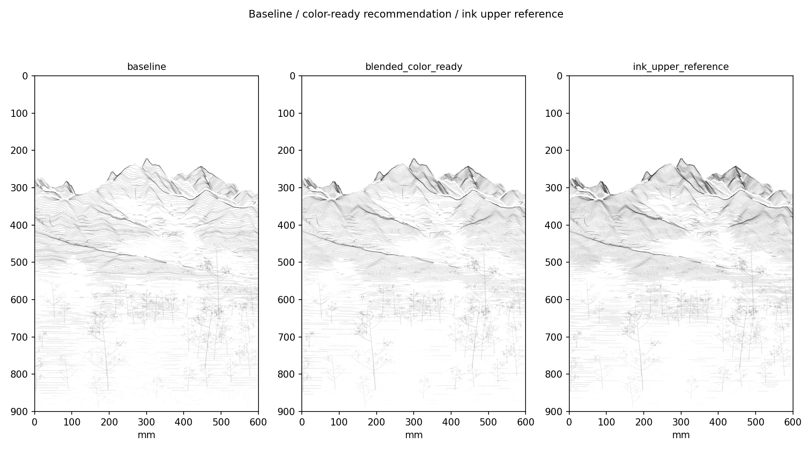
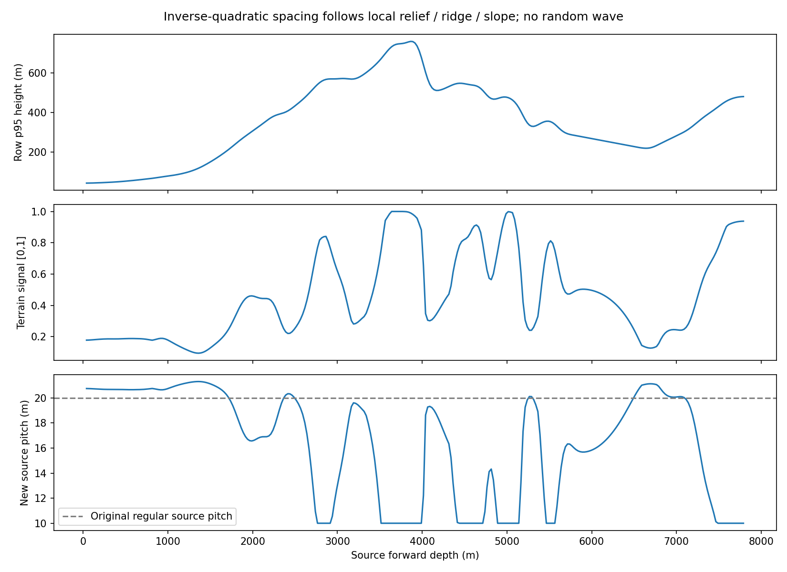
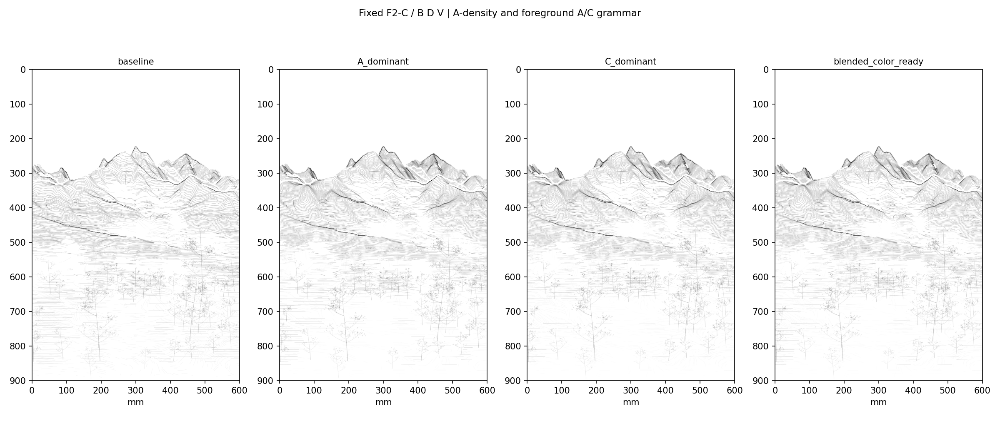
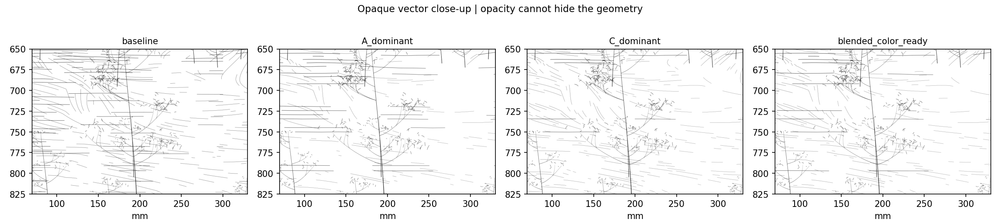
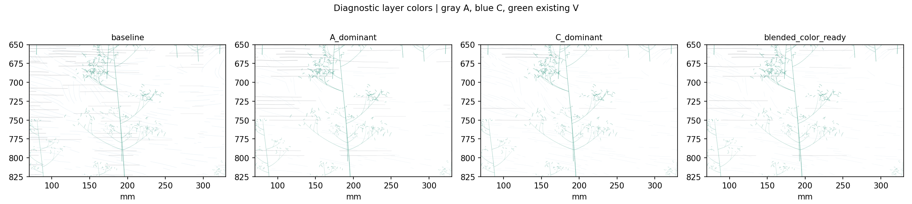
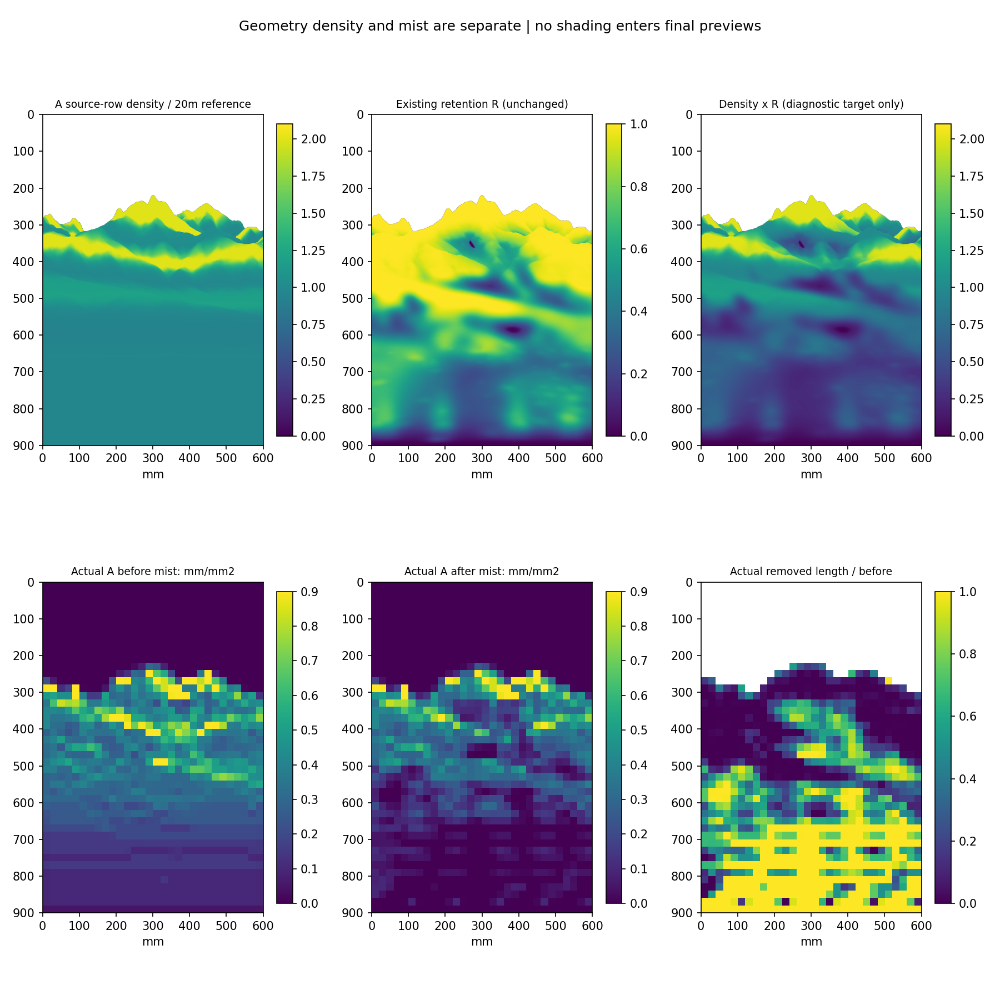
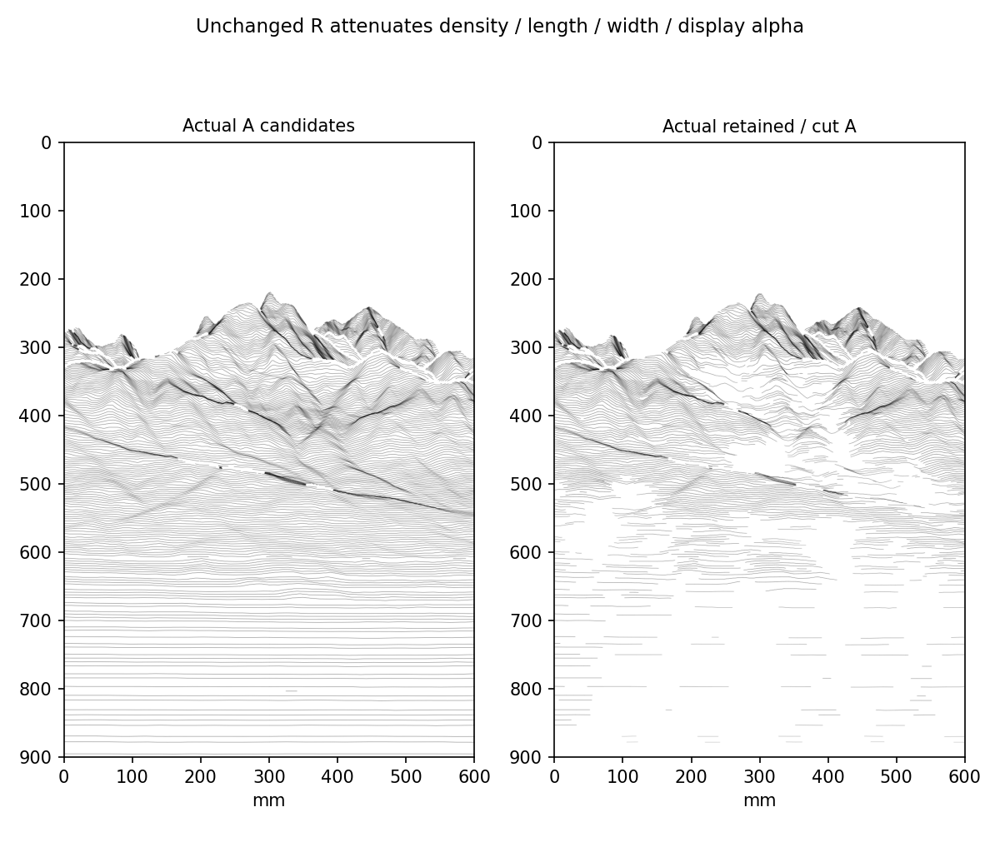
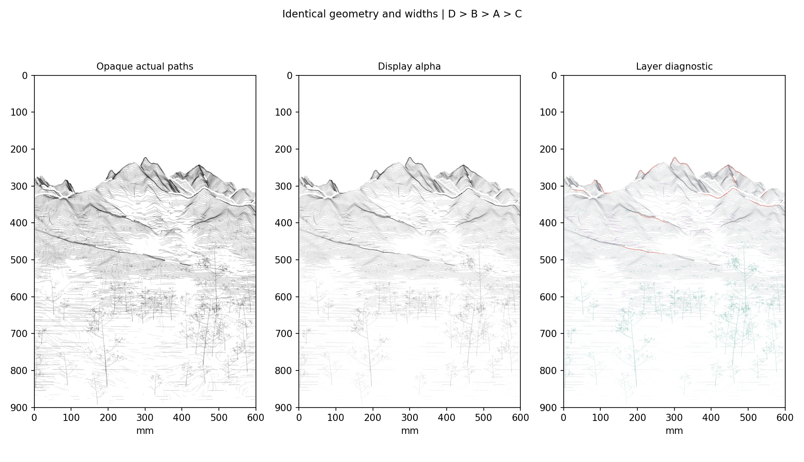
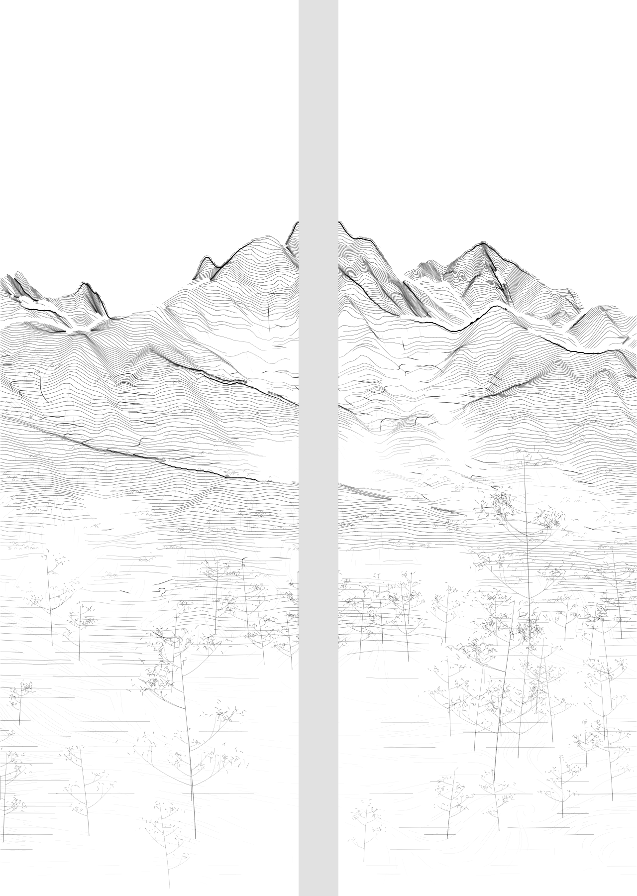

# Spring A-density and foreground grammar v0.1

Recommend **blended_color_ready** as the terrain-stroke baseline for the spring pair. It keeps A as the mountain body, opens foreground A spacing, and gives C more surface-flow work. Its total centerline length is 6.9% above the PR #10 recommendation. The ink upper reference is deliberately denser and is not the production recommendation.

F2-C camera/projection, original DEM/NDVI, 70% existing + 30% selective foreground retention, all whitespace fields, the bottom 2 mm guard, palette and hardware settings are unchanged. **B/D algorithms and their actual saved vectors are fixed.** The existing 5,200 vegetation vectors are also fixed; no vegetation, rock, path or prop generator runs in this experiment.



## Historical finding

The preserved 0317 V39.10 code changes row spacing according to squared row-maximum DEM height. Its separate depth pitch, relief projection, x shift, horizon visibility and contact-pressure logic also affect visible rhythm. The variable called `density_wave` primarily controls pressure and color-path eligibility; its mean is constant in the row-step expression.

Read the [source audit](geumgang_source_audit.md) for formulas and precise source locations. The file is named `0317test`; its identity as the final production version remains provisional. The original code is unchanged and was not executed.

## Actual vector rules

1. Aggregate terrain evidence in source-depth meters, using 120 m windows every 25 m and 70 m smoothing. Combine local peak-height residual (50%), macro-relative relief (25%), ridge support (15%) and slope (10%). This changes the row schedule, not the F2 mapping or elevation.
2. Use an inverse-quadratic terrain gap with contrast exponent 2. A bounded global gain of 1.24 is normalized with a source-contour screen-length proxy and expected retained coverage. Local mist is never inverted or weakened to meet the gain. The resulting color-ready source pitch ranges from 10.00 to 21.31 m: dense, open, then dense again around actual terrain features.
3. Integrate `1/pitch(q)` to a strictly increasing phase, then contour integer phase values. Raw transverse curves use the existing source-continuity checks and 3 mm chord-length spline knots. There is no random spacing wave, copied offset curve, new horizon reset or projection warp. The old regular candidate pitch was 20 m; the PR #10 baseline additionally contains selected half-depth interleaves.
4. Apply the **unchanged published combined mist transfer** after path selection and before the exact x=300 mm panel split. It removes candidate paths, shortens runs, omits zero cores, and retains width/opacity profiles. Density, length, width and display alpha are separately inspectable.
5. Integrate the same existing DEM direction-field grammar from a fixed 4 mm seed grid, 1 mm integration step and 1 mm separation radius. The seeded proposal order is fixed. Candidate windows are 48/16/6 mm near/middle/far, with 7/10/12 mm real gaps. This is a continuous foreground grain family, shorter middle-distance directional touches and sparse far-distance grain, not a tree/object system.
6. Foreground variants use A keep factors 1.00 / 0.30 / 0.72 and C near keep factors 0.48 / 1.00 / 0.82. Mid/far C weights remain 0.30/0.12 across these three variants. Source-depth weights are smooth, not fixed y bands. A's 0.72 stroke keep setting is **not** a change to the fixed 70/30 ground-retention rule.



## Foreground comparison







- **Current baseline:** preserves the exact PR #10 paths, including its long directional curves. Ground is continuous but transverse strokes remain prominent.
- **A-dominant:** the density rhythm clarifies broad landform. In the foreground it still produces a strongly ruled surface.
- **C-dominant:** directional texture is clearest. Some foothold areas lose the lateral structure that explains their continuity, so it is a useful contrast rather than the preferred complete grammar.
- **Blended:** A retains ground structure while C breaks its horizontal regularity. It leaves color space without making the foreground depend entirely on grain marks. This is a visual judgment from the supplied previews, not a physical brush proof.

The separate [A-only density control](A_density_isolation.png) keeps **B/C/D/V** identical to baseline and changes only A. This isolates the spacing study from the C redesign. The baseline is stored intact in `baseline.json.gz`; old results are not overwritten.

## Counts, spacing and local density

| Variant | Panel paths incl. fixed V | All length (m) | A (m) | C (m) | Change vs baseline |
| --- | --- | --- | --- | --- | --- |
| baseline | 7017 | 109.09 | 67.45 | 16.57 | +0.0% |
| A_dominant | 7494 | 114.62 | 75.16 | 14.38 | +5.1% |
| C_dominant | 7800 | 117.06 | 70.44 | 21.55 | +7.3% |
| blended_color_ready | 7717 | 116.63 | 72.47 | 19.09 | +6.9% |
| ink_upper_reference | 8527 | 147.13 | 96.72 | 25.33 | +34.9% |
| A_density_only | 7214 | 116.80 | 75.16 | 16.57 | +7.1% |

Counts refer to finalized panel paths, not SVG profile intervals or drawing moves. The total includes the same 22.118 m of existing vegetation in every variant. Fixed B is 82 paths / 1.686 m; fixed D is 14 paths / 1.268 m. The color-ready A/C terrain body remains distinguishable from simulated darkness.

| Source depth | Baseline A / C (m) | Blended A / C (m) | Baseline / blended A probe gap p50 (mm) |
| --- | --- | --- | --- |
| near | 15.58 / 13.61 | 11.05 / 13.39 | 6.10 / 6.44 |
| middle | 39.65 / 2.40 | 43.04 / 5.37 | 2.87 / 2.74 |
| far | 12.21 / 0.55 | 18.36 / 0.32 | 2.50 / 1.55 |

These diagnostic depth labels use source q below 1,600 m / 1,600–3,400 m / above 3,400 m. Actual grammar blending uses the existing smooth depth-role fields. The probe gaps are vertical screen intersections of distinct transverse rows on a source-continuous surface, with occlusion jumps excluded. They are not an exact normal spacing, a brush gap or the source-depth pitch. Full p10/p50/p90 distributions are in `record.json`.

| Paper crop (mm) | Baseline A / C (mm/mm²) | Blended A / C (mm/mm²) |
| --- | --- | --- |
| foreground [70, 650, 330, 825] | 0.0516 / 0.0818 | 0.0208 / 0.0694 |
| lower_transition [60, 770, 540, 900] | 0.0323 / 0.0667 | 0.0124 / 0.0464 |
| middle [20, 390, 400, 540] | 0.3137 / 0.0206 | 0.2964 / 0.0466 |
| far [150, 215, 550, 420] | 0.2581 / 0.0150 | 0.3550 / 0.0163 |

Local density is actual sampled centerline length per paper area, independent of alpha. In the foreground crop the blended C/A length ratio is greater than in the complete scene: A can remain the global main language while C carries local ground texture. A increases in the mountain body while opening in the foreground.

## Density × mist





The top row separates planned source-row density, unchanged retention R and their diagnostic product. The bottom row measures actual A path length before/after mist and the removed fraction in 20 mm cells. The product image is not used as a raster shading layer. The unattenuated archive is explicitly diagnostic-only; it is not an approved production drawing.

The full-precision retention field is hashed before and after generation and remains identical. Zero cores and the unconditional bottom boundary override all density gains. Near mist still separates paper from ground; middle mist separates terrain masses; far mist releases mountain feet. No new reserve or mist field is authored.

## Material and preview separation

| Layer | Role | Nominal width | Composite display alpha |
| --- | --- | --- | --- |
| D | Frozen sparse final skeleton | 0.82 mm + existing envelope | 0.98 |
| B | Frozen internal structural accent | 0.46 mm + existing profile | 0.82 |
| A | Main transverse mountain body | 0.32 mm + unchanged mist response | 0.63 |
| C | Directional support / future color geometry | 0.16 mm + unchanged mist response | 0.22 |



Opaque and transparency-aware previews read the **same canonical coordinates and width profiles**. The hierarchy is D > B > A > C; layer colors are diagnostics only. Alpha is not a calibrated dilution or pressure. It does not remove paths from a machine export.

`C_material_options.json` references the saved C geometry once. `assign_material` can label the family as light ink, color support or ink-and-color without changing a vertex or width. These are intent options, not automatic duplicate passes or a final palette assignment. Middle/far C can be evaluated as color-stroke geometry later without regenerating the ground.

## Physical pair and reproducibility



The painting remains 600×900 mm. Vector clipping creates two 300×900 mm panels; the physical mockup inserts 40 mm after clipping. No terrain is generated inside that interval. See the [four-way physical comparison](physical_pair_comparison.png).

```bash
python -m pip install -e '.[research,dev]'
python -m datascape.rendering.density_rhythm_study \
  /path/to/SeoulNorth_v02_MASTER_30m.tif \
  /path/to/SeoulNorth_v02_VEG_10m.tif \
  --config configs/scenes/seoul_spring_density_rhythm_v01.json \
  --output /path/to/reproduced-study
python -m pytest tests -q
```

Open the [notebook](../../../notebooks/spring_density_rhythm_v01.ipynb) in VSCode/Jupyter. Set `DATASCAPE_MASTER`, `DATASCAPE_VEG` and optionally `DATASCAPE_OUTPUT` to external paths. Input hashes must match the frozen selection. Parameters, implementation hashes, source parent, seed and scalar-field hash are recorded. Exact package versions are in [validation.json](validation.json).

Validation: **104 tests passed**. All 10 actual notebook code cells were replayed in one Python namespace and reproduced 79 generated artifacts byte-for-byte against the CLI; no kernel socket was launched. All 66 PNGs, 7 archives and four SVGs decode/parse. SVG coordinates, widths and alpha match canonical vectors. Production outputs have no exact same-layer duplicate paths, no sampled zero-core violations and no bottom-2-mm footprint contribution. All materialized parent blobs are unchanged; the Git overlay preserves all 496 parent blobs.

The sampled fraction of occupied 1 mm cells containing multiple terrain paths changes from 7.55% to 9.75% (ink upper reference 12.91%). Legitimate crossings, split neighbors and seam neighbors count; this is not an exact brush-collision or wet-overlap test. Inspect dense far-ridge passages on paper before production.

Keep the selected geometry, omission cores, actual gaps, shared seam decisions, material separation and fixed seed when moving to the object catalog, color or G-code studies. Resolve paper/paint/brush calibration and material pass order separately. No hardware command or final color mixing is implemented here. Do not merge without the artist's review.
