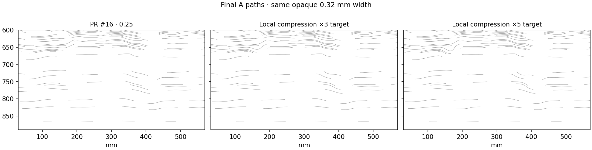
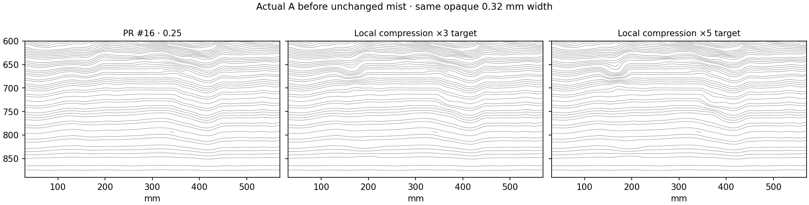
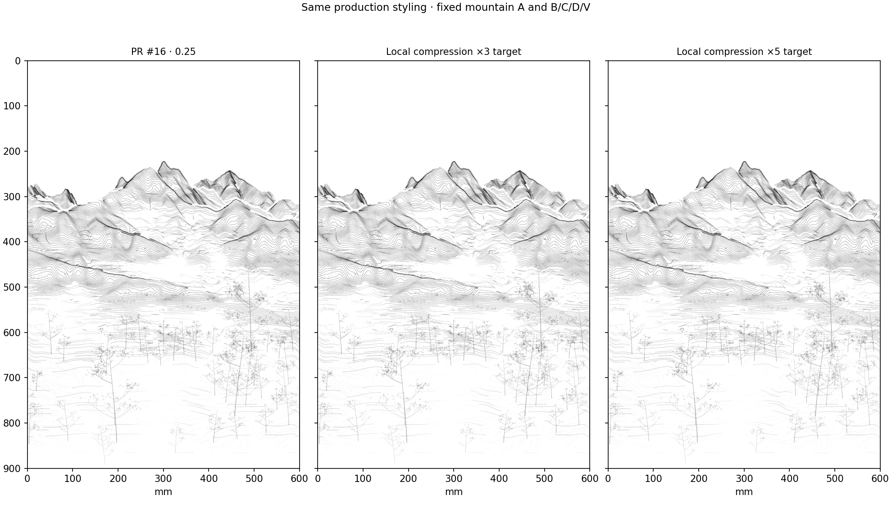
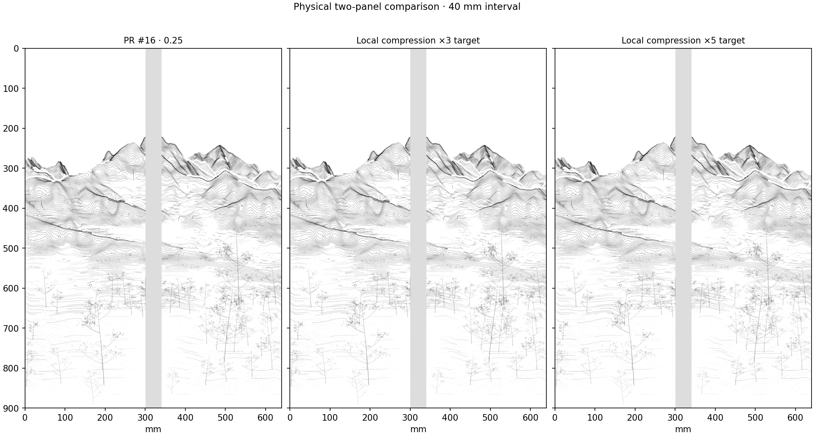
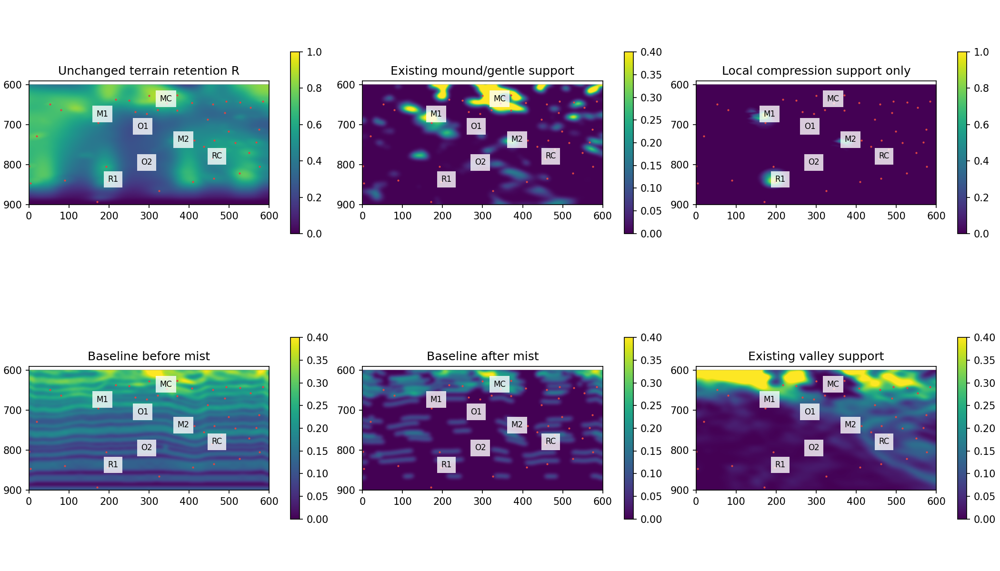
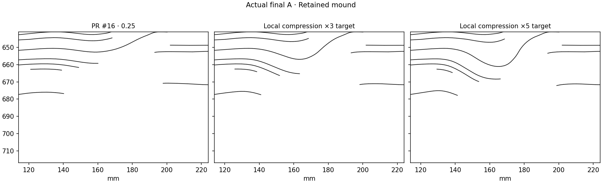
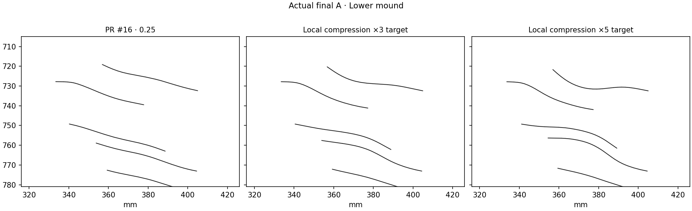
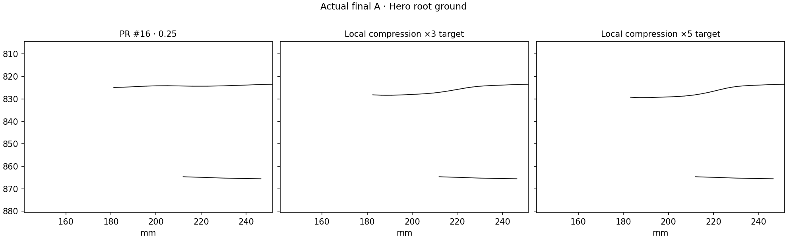

# Final foreground A-density review

**Decision: keep PR #16 unchanged.** Neither of the two local compression trials creates a convincing improvement at production scale. The issue is real, but another small A-spacing change does not resolve it under the fixed omission policy. This bounded review ends here; the experimental candidates are not adopted.

The next Work should start from **[baseline artifact/code commit `fdae976d3c3414f50c23054ad0f9cfa6e2945bca`](https://github.com/ggooonn/Datascape/commit/fdae976d3c3414f50c23054ad0f9cfa6e2945bca)**, baseline ID `spring-f2c-a025-provisional-v01`, configuration `configs/scenes/seoul_spring_provisional_baseline_v01.json`, foreground target strength **0.25**. [The existing handoff](../../baselines/spring_f2c_a025_v01/README.md) remains authoritative. This review does not replace its vectors or change its selection.

## Controlled visual evidence









The foreground crop is x = 30–570 mm, y = 600–890 mm. Before-mist means actual candidate paths after the inherited foreground keep pass, immediately before the unchanged combined mist transfer. These are actual generated paths, not raster density effects. Both opaque views use alpha 1 and width 0.32 mm. Production reuses saved width/alpha profiles and fixed B/C/D/V.

## Diagnosis before intervention

The baseline was regenerated from the exact PR #15 method at 0.25. Its finalized near A records match PR #16 exactly. The pre/final comparison therefore isolates the existing transfer rather than comparing different historical geometries.



Red points identify archived procedural near-tree roots, not observed trees. Terrain features are DEM-derived placement proxies, not mapped rocks or paths. The source XYZ, slope and depth at every measured region are recorded in [record.json](record.json).

| Possible cause | Finding |
| --- | --- |
| Insufficient geometric concentration | Partly. Before mist, lower/root ground is much more evenly spaced than the already dense upper near mass. A alone does not yet establish a strong lower-ground rhythm. |
| Phase constraints | Local run budgets, narrow footprints, 15 mm feathering and 4 mm smoothing reduce the requested contrast. The tested positive-derivative and displacement limits are **not** the active bottleneck: minimum checked local ratios are 0.511 / 0.297, above the 0.05 floor; maximum changes are 2.12 / 3.14 cycles, below the six-cycle limit. |
| Retention and mist suppression | **Dominant in the failing retained-ground regions.** Some pre-mist concentrations lose most of their actual path length. Opacity cannot explain those missing paths. |
| Production opacity | Secondary. Saved mean alpha in the selected retained regions is about 0.47–0.62. Production makes surviving lines lighter, but the equally opaque final-path view is already sparse. |
| Placement relative to terrain and roots | Important. The existing schedule strongly favors upper mound support. The hero root at (196.5, 842.5) mm is on measured 2.67° ground but has essentially no original mound support; it receives little local density emphasis. Terrain and vegetation use different retention/visibility paths, so a visible tree does not guarantee A below its root. |

Across the fixed foreground y ≥ 600 mm, only 15.5% of candidate length survives in terrain-retention R = 0.25–0.50, and 32.0% in R = 0.50–0.75. At R > 0.75, survival is 70.9%. These are geometric length ratios before digital alpha, not a claim that R directly equals a length-retention probability.

## One bounded experiment, two prescribed strengths

Three small supports were fixed after the diagnosis:

| Region | Center, canvas mm | Basis |
| --- | --- | --- |
| M1: retained mound | (169, 679) | Existing terrain mound maximum, 2.49° slope, little valley support |
| M2: lower mound | (371, 743) | Existing terrain mound, 3.54° slope, little valley support |
| R1: hero root ground | (196.5, 842.5) | Existing hero root on retained 2.67° ground; not an invented mound |

Each edit scope is an ellipse with radii 55 × 38 mm, intersected with the original source-continuity domain, near depth and R > 0.25. The smoothly varying focus reads mound/gentle-ground support or the fixed root-ground support, then fades with retention and valley support. It does not define a horizontal screen band or alter R.

The existing source-normal phase frequency is multiplied by `1 + gain × focus`; gains are fixed at **2 and 4**. Thus the labels “×3 target” and “×5 target” describe upper requested frequency bounds, not achieved path-spacing ratios. Measured maximum requests are 2.96× / 4.92×. The existing integration conserves each local run's endpoint phase budget. The existing local solver and all its limits remain unchanged. All paths are regenerated from the phase; no finished strokes are interpolated or added as overlays.

The phase is exactly unchanged outside the three domains. Middle/far A and every B/C/D/V record are copied exactly from PR #16. Source XYZ, retention, bottom guard, palette and hardware settings are unchanged.

## Actual local density and spacing

Measurements use fixed ellipses with radii 35 × 23 mm inside the scopes, and the same visible near-terrain mask for every variant. Density is actual A centerline length / paper area in mm/mm². It includes no opacity weight.

| Region | Baseline before | Baseline final | Local ×3 before → final | Local ×5 before → final |
| --- | ---: | ---: | ---: | ---: |
| M1 retained mound | 0.2150 | 0.0085 | 0.2422 → 0.0171 | 0.2601 → 0.0268 |
| M2 lower mound | 0.1508 | 0.0604 | 0.1553 → 0.0634 | 0.1579 → 0.0653 |
| R1 hero root ground | 0.1058 | 0.0146 | 0.1082 → 0.0151 | 0.1094 → 0.0156 |
| MC existing upper mass, control | 0.2641 | 0.1512 | 0.2640 → 0.1512 | 0.2642 → 0.1513 |
| O1 open passage, control | 0.1410 | 0.0034 | 0.1411 → 0.0033 | 0.1413 → 0.0035 |
| O2 open passage, control | 0.0815 | 0.0000 | 0.0813 → 0.0000 | 0.0813 → 0.0000 |

M1's final density triples in the stronger trial, but from a very low starting value. Only 10.3% of its candidate length remains, versus 3.9% at baseline. That is not a coherent dense ground mass. M2's final density rises only 8.2%; R1 rises 7.0%. The measured open passages remain open. No uniform foreground darkening is introduced: classified near A length is 11.353 / 11.364 / 11.373 m for baseline / local ×3 / local ×5.

Five fixed vertical probes cross each ellipse. The intervals below are actual adjacent A intersections in screen mm; they are not normal-distance estimates. A missing median means **no adjacent pair in the probes**, not zero spacing or no stroke anywhere in the region.

| Region | Before mist: baseline / ×3 / ×5 median gap | Final: baseline / ×3 / ×5 median gap | Final interval counts |
| --- | --- | --- | --- |
| M1 | 3.77 / 3.24 / 2.89 mm | — / 3.76 / 5.83 mm | 0 / 1 / 2 |
| M2 | 5.40 / 5.07 / 4.87 mm | 17.05 / 13.77 / 11.71 mm | 8 / 9 / 9 |
| R1 | 7.62 / 5.96 / 5.42 mm | — / — / — | 0 / 0 / 0 |

The source-run budgets and boundary transitions turn the requested local frequency bounds into much weaker realized pre-mist contrasts. The subsequent transfer removes most of the useful concentration in M1/R1. Merely pushing the requested gain further is not justified by this result.







At M1 the stronger trial bends a few surviving paths into a local scoop; it does not form a stable ink body. M2 remains a set of isolated curves. R1 still has no group of adjacent A paths explaining the root's ground. At full composition and physical-pair scale these changes are too weak to justify replacing the baseline. The stronger curves also begin to read as localized contour turns rather than a convincing new ground grammar.

## Identity and locality limitation

The known PR #15/16 path-ID-dependent omission is preserved. The phase edit is local, but whole contour/spline extraction and ID-keyed transfer do not guarantee that all final near paths outside the edit are byte-identical. Outside the scopes plus a 10 mm collar, the final one-mm length-map L1 change is 116 / 153 mm for the two trials. This is a difference-map measure, not newly added path length. It can include resampling and spline changes as well as changed omission; no causal split between those effects is claimed here. Frozen mountain A and B/C/D/V remain exact.

## Closure and next Work

**Outcome A: retain PR #16, foreground strength 0.25.** This is a decision to preserve the better-established baseline, not a claim that the foreground dense–open rhythm is solved. A supplies continuity and a transverse scaffold; under the locked transfer it cannot, in these trials, reliably create strong lower/root masses by local spacing compression alone.

The next Pictorial Grammar Catalog Work should keep the exact baseline and treat root-to-ground attachment as an explicit unresolved design requirement. Do not assume that C or future objects will automatically repair it. This review starts no catalog, vegetation, rock, path, color or G-code generator and makes no further density iteration.

## Reproduce

```bash
python -m pip install -e '.[research,dev]'
python -m datascape.rendering.final_foreground_review \
  /path/to/SeoulNorth_v02_MASTER_30m.tif \
  /path/to/SeoulNorth_v02_VEG_10m.tif \
  --config configs/scenes/seoul_spring_final_foreground_review_v01.json \
  --output output/spring-final-foreground-review
python -m pytest tests -q
```

The same `run` function is callable from Jupyter. [The record](record.json) contains exact fixed inputs, source anchors, all crossing positions, local lengths/spacing, saved-alpha diagnostics, root sites, solver results and invariants. [Local ×3 vectors](local_2_strokes.json.gz) and [local ×5 vectors](local_4_strokes.json.gz) are archived experimental results, **not selected baselines**. The baseline vectors remain at the immutable PR #16 path.

Validation: exact baseline regeneration; positive checked phase derivatives; identical mountain A/B/C/D/V; unchanged float64 retention/source XYZ; empty omission cores and bottom 2 mm footprints. Existing 118 tests pass. The source DEM, historical artwork code, prior results, palette and hardware settings are preserved. No main merge.
