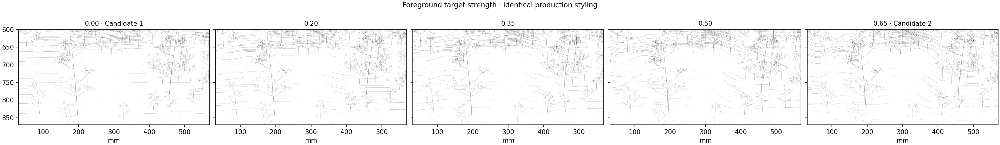
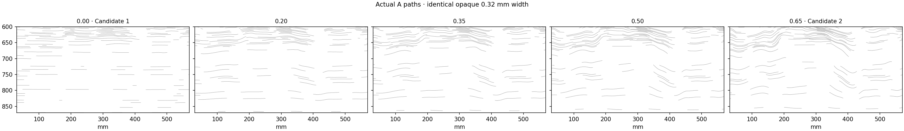
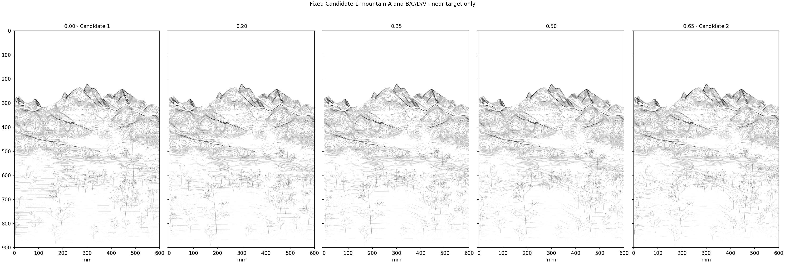
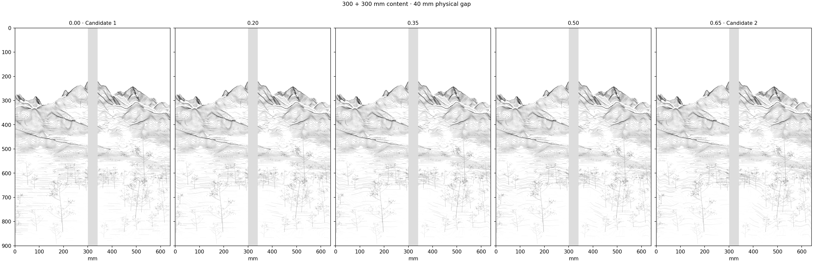
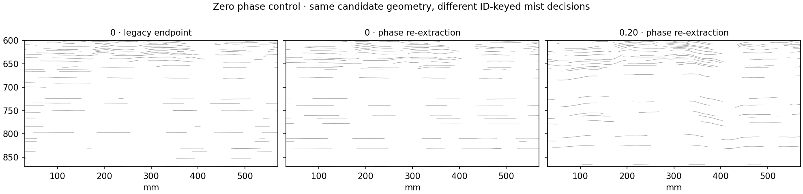

# Foreground target-strength interpolation

This small experiment keeps PR #14 Candidate 1's mountain A as a fixed reference and regenerates near A at target strengths **0.00, 0.20, 0.35, 0.50 and 0.65**. F2-C, camera, source DEM/NDVI, 70/30 retention, whitespace fields, mist transfer, B/C/D/V records and production styling remain unchanged. No finished near polylines are blended, selected from different candidates or overlaid.

**A conservative compromise is 0.20; 0.35 is the more visibly active alternative.** Both introduce ground curvature without the pronounced parallel arch bundles of 0.50–0.65. The saved production baseline is not replaced. The zero endpoint has an ID-dependent omission discontinuity, diagnosed below, so this is not presented as a perfectly smooth visual crossfade.

## Same-style comparisons





The crop is x = 30–570 mm, y = 600–870 mm. C and vegetation remain identical. The opaque view separates actual geometry from the existing display alpha and vertex width profiles.





Each continuous painting is 600 × 900 mm. The physical view splits at x = 300 mm and inserts a 40 mm interval without deleting painting content. Existing top reserve and bottom 2 mm absolute omission are preserved.

## What the parameter does

The original foreground target is calculated once from measured mound/ridge support, gentle ground, valley support and the existing retention field. For each strength `s`:

```text
requested_phase = mountain_phase + s × (full_foreground_target − mountain_phase)
phase = existing_local_monotone_projection(requested_phase)
near_A = existing_contour_and_spline_extraction(phase)
near_A = existing_foreground_keep_and_mist_transfer(near_A)
```

The foreground solver keeps its 0.05 positive derivative floor, smoothness 6, six-cycle maximum displacement, two-mm fixed boundary collar and existing domain. The target's integration budgets, smoothing, feather and depth-scope transition are unchanged. Strength is a phase-target coefficient, not opacity or a percentage of finished Candidate 2 vectors. Before constraints, 0.20 requests about 31% of Candidate 2's 0.65 target displacement.

All generated results reuse Candidate 1's exact middle/far A records and every B/C/D/V record. The legacy 0.00 foreground is regenerated from its original `a_proposals` rules and verified against the archived Candidate 1. At 0.65 the complete A records exactly match Candidate 2. These endpoint checks ignore only absolute draw order, not coordinates, widths, alpha profiles or source IDs.

## Actual geometry and density

“Near paths” uses the same inherited mean-source-depth cutoff of 1,600 m. Length is full centerline length of those classified paths; it is not the sum of near-only path portions. Density masks are the fixed PR #14 measured island/channel regions. Density is centerline length per paper area, independent of digital opacity.

| Strength | Near A paths | Near A length | Change from Candidate 1 | Island density | Channel density |
| ---: | ---: | ---: | ---: | ---: | ---: |
| 0.00 | 213 | 11.049 m | — | 0.1305 | 0.0791 |
| 0.20 | 197 | 11.148 m | +0.9% | 0.1360 | 0.0729 |
| 0.35 | 203 | 11.718 m | +6.1% | 0.1489 | 0.0742 |
| 0.50 | 203 | 12.247 m | +10.8% | 0.1629 | 0.0765 |
| 0.65 | 201 | 12.667 m | +14.6% | 0.1724 | 0.0760 |

Density units are mm/mm². At 0.20, island density rises 4.2% and channel density falls 7.9%; at 0.35 they change by +14.1% and −6.2%. The result is not a uniform foreground density increase. Candidate 1 has 75.708 m of total A; 0.20 has 75.807 m and 0.35 has 76.376 m. Mountain A is identical in all cases.

## Does the behavior vary smoothly?

### Phase motion: nearly proportional, with active limits

| Strength | Maximum near displacement, phase cycles | Mean absolute displacement* | Near derivative-floor pixels** |
| ---: | ---: | ---: | ---: |
| 0.00 | 0.000 | 0.000 | 0 |
| 0.20 | 2.000 | 0.835 | 8 |
| 0.35 | 3.500 | 1.460 | 32 |
| 0.50 | 5.000 | 2.086 | 305 |
| 0.65 | 6.000 | 2.666 | 910 |

Mean displacement is measured in the fixed near domain where the full requested change exceeds 0.02 cycles. Near-floor pixels have a checked directional ratio below 0.051, out of approximately 200,000 near variables. These are active monotonicity constraints, not folds. No checked derivative is nonpositive. The maximum displacement hits the six-cycle bound at 0.65; 0.20–0.50 remain below it.

The fixed, strictly convex phase solve has a continuous, piecewise-linear response to the target. Active derivative and displacement constraints change its slope. The measured phase motion is close to proportional over 0.20–0.50. This does not imply that final stroke counts, median visible gaps or omission cuts must change monotonically.

### Zero endpoint: an ID-keyed omission discontinuity



Candidate 1 inherited the legacy foreground; Candidate 2 re-extracts it through `generate_a`. A same-phase zero control isolates that pipeline switch:

- The two zero-phase pipelines produce **65 identical near candidate paths**, after the foreground keep pass, when ID spelling is ignored.
- Legacy candidates use `A-rhythm-…`; re-extracted candidates use `A-mass-…`.
- The unchanged mist algorithm hashes candidate ID with the fixed seed for density/length gating. The spelling change therefore changes omission decisions despite identical geometry and retention.
- Legacy zero finishes with 213 near paths / 11.049 m. New-extractor zero finishes with 192 / 10.542 m, a 4.6% length reduction.
- Changing **only** the new zero candidates' ID prefix back to the legacy prefix restores all legacy final near records exactly. This controlled ablation establishes the cause for this endpoint; no production variant is renamed.

Consequently, the 0.00→0.20 comparison includes both the phase adjustment and a historical change of omission identities. The 0.20–0.65 variants all use the Candidate 2 pipeline. Even there, level-set component births/splits, source-continuity cuts, spline acceptance/fallback, enumeration-based foreground keep decisions, ID-keyed mist gates and minimum-length rejection are discrete operations. A continuously moving phase can therefore change path count or visible spacing in steps.

For example, the retained median vertical gap at x = 150.37 mm is 9.97 / 7.29 / 8.15 / 11.65 mm for 0.20 / 0.35 / 0.50 / 0.65. Before mist, the corresponding broad-crop medians are 5.50 / 5.40 / 5.45 / 5.29 mm. These are exact intersections in y = 600–870 mm, including the surviving openings; they are not nearest-normal spacing or evidence that every interval changes in the same direction. [The record](record.json) includes all crossing positions, gaps and three fixed probes.

The current ID policy is deliberately preserved to reproduce both PR #14 endpoints. A future identity-stability change would need a separate decision and a new reference; it is not silently included here.

## Visual assessment

- **0.00:** most stable and open, but near A is predominantly horizontal.
- **0.20:** shallow, coherent bends appear around retained ground; broad white channels stay open. It gives useful movement with only 0.9% more classified near A length. This is the conservative recommendation for visual review.
- **0.35:** mound and ground flow are easier to read. The upper part of the foreground crop begins to organize into parallel bundles, but less strongly than Candidate 2. Keep it as the stronger alternative.
- **0.50–0.65:** larger shared arches increasingly read as contour bands. They are useful upper-strength references, but less restrained around the existing C/vegetation context.

The full composition changes less than the foreground crop because its mountain scaffold is fixed. The experiment demonstrates a useful intermediate *generation setting*, not a finished-path hybrid or a final baseline selection. It does not claim to solve all A rhythm or foreground grammar questions.

## Reproduce and inspect

```bash
python -m pip install -e '.[research,dev]'
python -m datascape.rendering.foreground_interpolation_study \
  /path/to/SeoulNorth_v02_MASTER_30m.tif \
  /path/to/SeoulNorth_v02_VEG_10m.tif \
  --config configs/scenes/seoul_spring_foreground_interpolation_v01.json \
  --output output/foreground-interpolation-v01
python -m pytest tests -q
```

Open [the notebook](../../../notebooks/spring_foreground_interpolation_v01.ipynb) in VS Code/Jupyter and set `DATASCAPE_MASTER` and `DATASCAPE_VEG`. It calls the same module. The committed source inputs, parameters, seed, solver records, fixed-layer checks, input hashes and geometry metrics are in [record.json](record.json). The CLI also exports compact float32 phase diagnostics for inspection; generation and checks use float64.

Canonical stroke data: [0.00 / Candidate 1](../spring_a_density_v04/candidate1_strokes.json.gz), [0.20](strength_0_20_strokes.json.gz), [0.35](strength_0_35_strokes.json.gz), [0.50](strength_0_50_strokes.json.gz), [0.65 / Candidate 2](../spring_a_density_v04/candidate2_strokes.json.gz), and [zero re-extraction control](zero_reextracted_strokes.json.gz). The endpoint files are reused rather than duplicated. Every preview uses actual generated stroke records.

Validation: both historical A endpoints match exactly; all B/C/D/V records and mountain A remain fixed; retained float64/source XYZ hashes are unchanged; omission cores and bottom 2 mm footprint are empty; all phase solves converge with positive checked derivatives. The existing 118 tests pass. No original artwork, palette, hardware, composition field or prior result is modified. No main merge.
