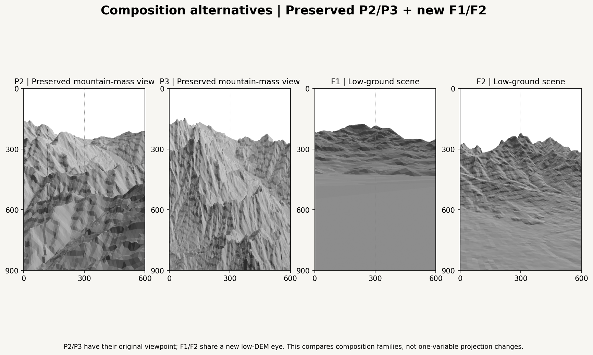
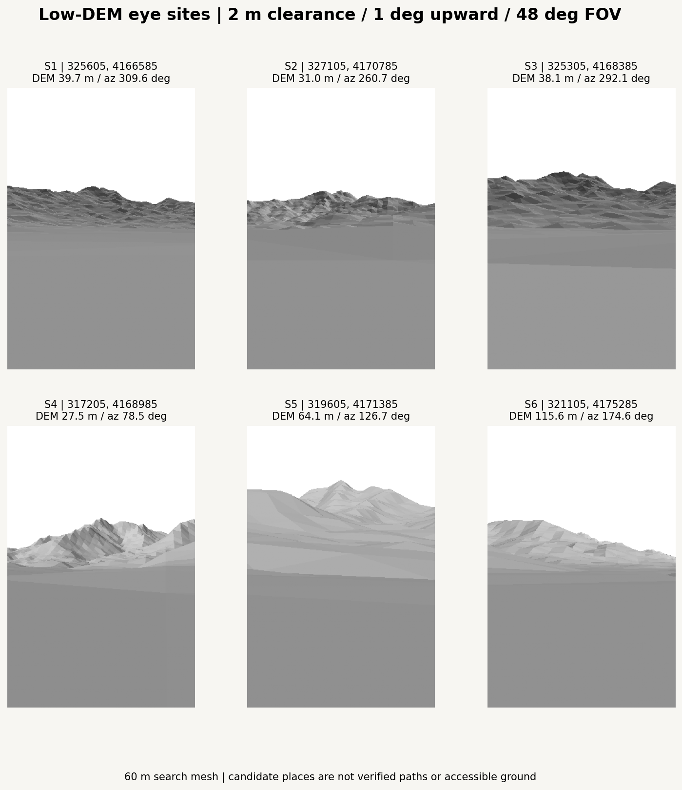
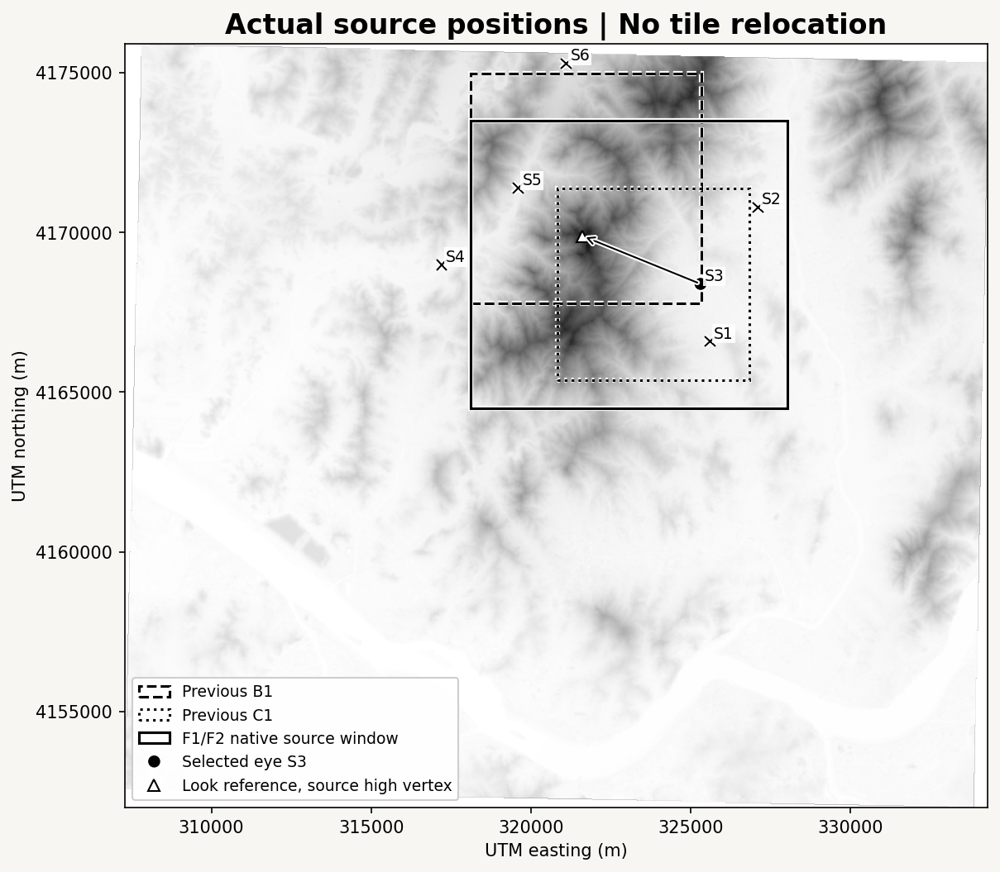
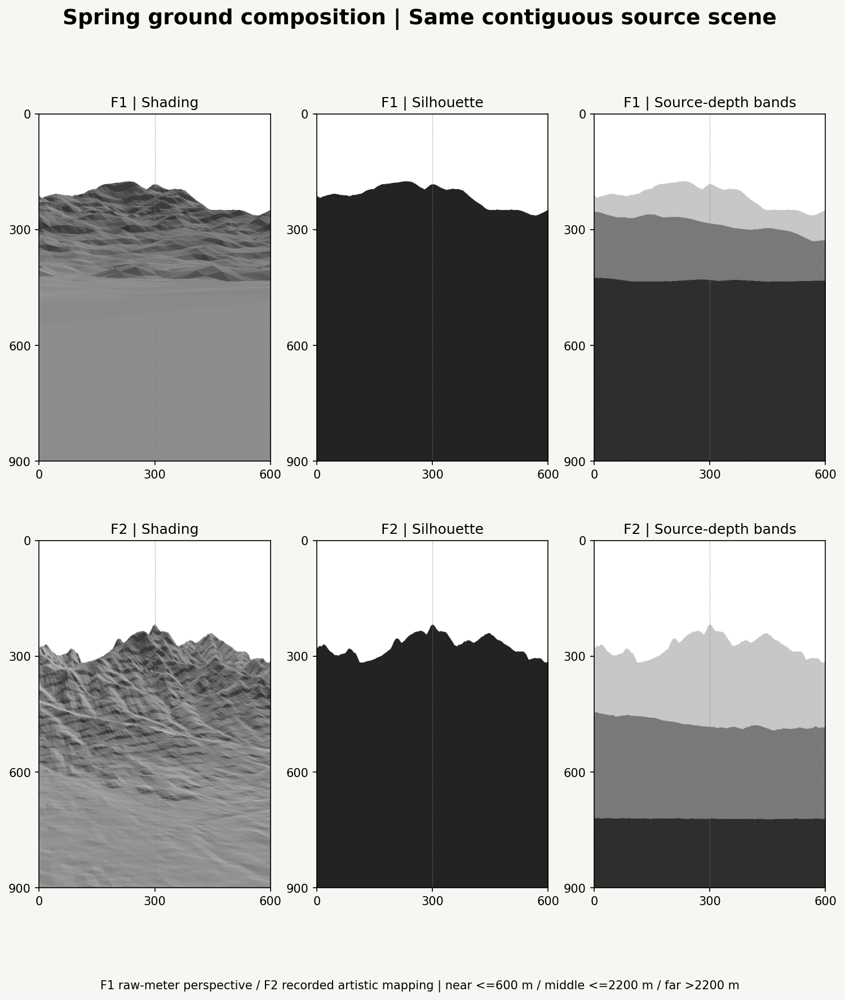
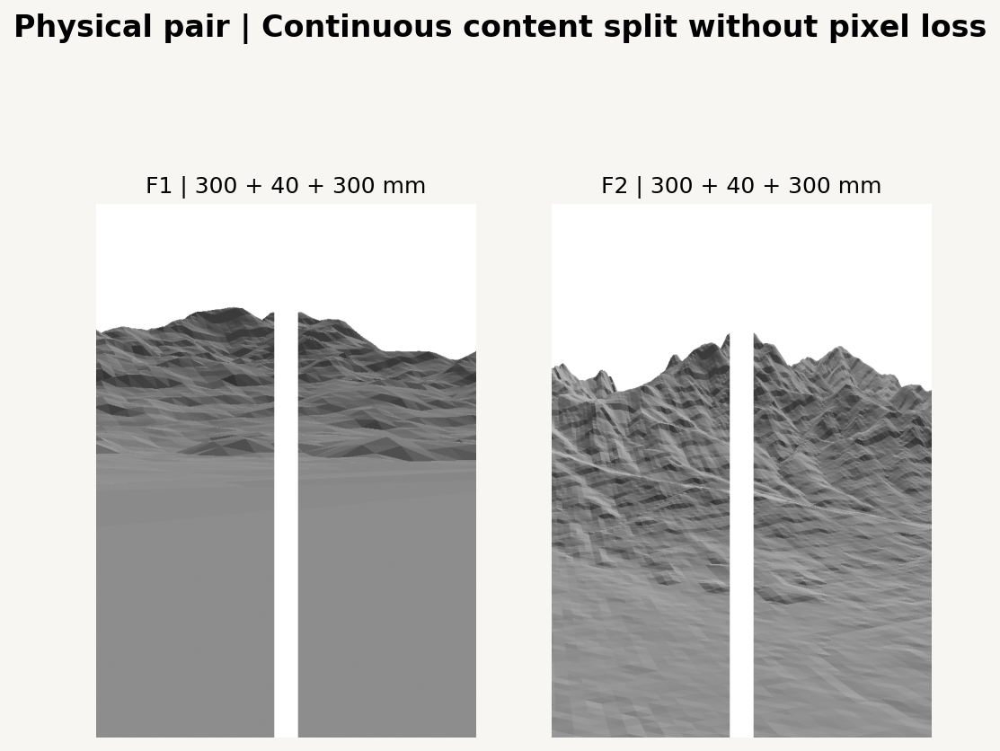

# Spring Pair Composition Refinement v0.1

The previous spring study filled missing lower terrain, but its foreground still read as a steep mountain wall. This extension tests **low ground beneath a middle passage and distant mountain**, keeping all previous P2/P3 images and modules unchanged. It adds F1 physical ground-relative perspective and F2 a recorded composite on the same newly selected, contiguous terrain scene.

Base PR #6 head: `a2ca981c94fa0ddd81ff8e48597ffbc3ca067443`. This work extends the existing `feat/spring-pair-production-v01` branch; it does not merge main. The [original spring production result](../spring_production_v01/README.md) remains a separate composition family.



## Source Position and Camera Search

Six low-DEM sites were pinned after a coarse terrain screen around B1/C1 and the surrounding mountain complex: elevation below 120 m, exported slope below 6 degrees, local 150 m neighborhood relief below 15 m, and roughly 2.5-6.5 km from the source high vertex. The gallery is a selected subset, not an exhaustive optimum or a claim about accessible locations. Its cameras use 2 m DEM clearance, 1-degree upward pitch, 48-degree vertical FOV and 60 m mesh spacing. The final comparison narrows FOV to 36 degrees and uses a horizontal sight line, with all native 30 m samples.



Select **S3 on the eastern low terrain near C1** to retain a broad low foreground and a middle passage. A western site gives a more monumental visible peak but less consistently gentle foreground in the composite; a closer northwestern site compresses the distant depth behind nearer masses. These are visual composition judgments, not verified place identities.

| Selected scene item | Value |
| --- | --- |
| Eye XY, EPSG:32652 | 325305 / 4168385 m |
| Eye longitude / latitude, WGS84 | 127.019829 / 37.646014 |
| DEM sample at eye | 38.128067 m |
| Eye clearance above that sample | 2.000 m |
| Raw-model eye Z | 40.128067 m |
| Exported SLOPE at eye | 2 degrees |
| Look reference XY | 321615 / 4169885 m; a high source vertex, not a verified named peak |
| Horizontal distance to look reference | 3983.227 m |
| Look azimuth | 292.121942 degrees clockwise from north |
| F1 pitch / vertical FOV / height scale | 0 degrees horizontal / 36 degrees / 1.0 |
| Native source bounds W/S/E/N | 318120 / 4164500 / 328020 / 4173500 m |

The eye is on a **30 m DEM surface**, which may include unresolved surface objects. It is not a surveyed street/ground elevation or evidence that someone can stand there. No tree, path, waterbody, building, exposed rock or access condition is identified from these previews. The supplied reference image was reviewed for low foreground, middle passage and upper mountain arrangement only; its objects are not added and the image is not redistributed.



All new terrain is from one contiguous 9.9 x 9.0 km source window. No tile is cut from another location or relocated. Original elevations, georeferencing, valid-value masks and the TIFF stay unchanged. Source MASTER SHA256: `837f4b6b2e01e3b97b05db3e62fbd0869ce052ba4c18cc47a99d97873317f0fb`.

## F1: Ground-Anchored Perspective

Use a true pinhole camera in raw metric coordinates with no vertical exaggeration. Unlike the earlier camera API's positive downward depression, the new camera's signed pitch is positive upward; the final F1 pitch is zero. Camera XY and eye clearance, rather than an elevated mountain-center target, define the observation position.

The physical perspective establishes that low foreground beneath the distant mountain is possible in this dataset. It also shows a constraint: much of the bottom of the image sees a very small nearby surface area. At 2 m clearance and 30 m source resolution, a few terrain triangles expand into a nearly uniform foreground, while the middle distance is compressed. The preview does not invent fine ground texture to compensate.

Clip triangles crossing the near plane at **1.0001 m**. New vertices are intersections along existing terrain triangle edges; they are not new measured samples. This keeps the surrounding foreground surface without discarding whole camera-crossing triangles. Use perspective-correct reciprocal-depth interpolation for F1 visibility.

## F2: Painterly Composite

F2 uses the **same eye XY, bearing and source window**. Reuse P2's smooth depth-weighting idea and P3's upward depth/relief translation, with explicit new controls suited to low foreground. It is not the unchanged previous P2/P3 camera. This mapping requires no terrain tile relocation and does not replace low elevations with an artificial plane.

Let `r` be source horizontal lateral distance and `q` horizontal forward distance from the selected eye. For front terrain `q>1.0001 m`:

```text
width_span(q) = 600 + 0.8*q                 # source meters per painted frame width
depth_rise(q) = 0.72*q/(q+1400)
x/W = 0.5 + r/width_span(q)
y/H = 1.02 - depth_rise(q) - k(q)*(raw_z-38.128067)/1000
```

Positive screen Y is downward. `k(q)` smoothly blends near/middle/far relief coefficients **0.12 / 0.22 / 0.32 frame heights per km**. Transitions span 400-1000 m and 1800-3200 m, using the existing cubic smoothstep helper. Near width remains broad and near relief restrained; middle terrain has room to unfold; distant terrain gains relative vertical emphasis. The depth scale changes screen placement, not source DEM elevation or distances.

F2 visibility uses the final mapped triangle surface with virtual depth `q` and affine screen-triangle interpolation, reusing the spring production compositor. Some terrain hidden in the physical view can become visible after this recorded spatial translation. That is a composition change, not newly measured topography.



## What Changed in the Foreground

Depth diagnostics use identical metric cuts in F1/F2: near <=600 m, middle <=2200 m, far >2200 m. These are distance bands, not manually labeled ridges, geology or land use. The fixed northwest light and source-distance tone are the same across the new pair.

The table uses the original native triangle's mean elevation and exported slope assigned to each visible pixel. Low/gentle means elevation <120 m and SLOPE <=10 degrees. It is a terrain proxy, not a walking-safety or land-use classification.

| View | Low/gentle share in visible bottom 300 mm | Bottom elevation p10 / p50 / p90, m | Bottom slope p50 / p90, deg | Visible terrain share near / middle / far |
| --- | --- | --- | --- | --- |
| F1 | 100.00% | 38.75 / 38.75 / 38.75 | 2.00 / 2.00 | 68.1% / 21.3% / 10.5% |
| F2 | 92.80% | 38.78 / 44.71 / 68.77 | 3.33 / 8.33 | 28.5% / 39.4% / 32.1% |

Both compositions cover every pixel in the bottom 300 mm and have no uncovered lower ground. F1's repeated bottom statistic reflects one nearby native face enlarged by perspective, not a fabricated flat surface. F2's lower 300 mm includes 3245 different native triangles and spreads a much broader geographic foreground over the frame, revealing variation from roughly 39 to 69 m in its p10-p90 statistics. Its middle/far share is more balanced, and its distant mountain reads above a lower passage.

**F2 is the stronger next composition candidate for the requested ground-to-valley-to-mountain reading.** F1 is the physical reference. F2's middle terrain remains continuous and can still look dense in plain face shading; future line density/openings should be compared after this review. No vegetation or small terrain objects are invented to make it resemble the reference painting. This is a new candidate, not a final artwork selection.

P2/P3 remain useful alternatives for a mountain-mass composition. Their archived images use the original ROI/viewpoint; the four-column shortlist compares different composition families, not a one-variable projection experiment. Only F1/F2 share the selected new source scene and camera position.

## Mapped Space Checks

The 3D coordinates are screen X/Y plus positive virtual/camera depth. Reversing a terrain triangle's 2D screen normal can be ordinary occlusion; it does not imply that the underlying mapping is folded.

- F1 has the usual positive pinhole Jacobian `focal_px^2 / depth_m^2` in the front domain, and an explicit inverse when depth is known.
- F2 has exact volume Jacobian `W*H*k(q)/(1000*width_span(q))`. All configured relief coefficients and width spans are positive. With `q` known, screen X uniquely recovers `r`, and screen Y uniquely recovers raw Z. Thus this stated 3D mapping is invertible in its front domain, although the **2D terrain image is deliberately occluded**.
- Check all vertices of raster-candidate triangles: 15276 for F1 and 30576 for F2, including near-plane edge intersections. No nonfinite/nonpositive analytic determinants are found. Known-depth roundtrip errors are below 1e-9 m.
- Independent 0.1 m finite differences at 3819 / 7644 interior positions give no nonfinite or reversed volume determinants. Near-plane clipping and unchanged source arrays have dedicated tests.

These checks establish the stated transform behavior; they do not resolve human-scale source details, verify actual footing or validate future splines. Later curves must use the same chosen mapped surface for visibility and exact panel clipping.

## Two Panels and the Test Support



Retain **600 x 900 mm continuous content**, split into two 300 x 900 mm panels, then insert a 40 mm physical gap for display. Separate panel PNGs reconstruct each continuous image exactly. The planned two stacked 500 x 500 mm mounting sheets support a 300 x 900 mm single-panel test; they do not introduce a new image ratio, camera, project or rendering size.

## Reproduce

```bash
python -m pip install -e ".[research,dev]"
python -m datascape.rendering.ground_study --master /path/to/SeoulNorth_v02_MASTER_30m.tif --config configs/scenes/seoul_ground_composition_v01.json --output outputs/spring_ground_composition_v01 --previous-directory docs/experiments/spring_production_v01
python -m pytest tests -q
```

Open [05_ground_composition.ipynb](../../../notebooks/05_ground_composition.ipynb) with `DATASCAPE_DATA_DIR` set to the original data folder. `DATASCAPE_GROUND_OUTPUT` sets the output directory. [study.json](study.json) contains exact eye/source coordinates, all six search cameras, clipping rules, source/previous-result hashes, settings, coverage and mapping checks. No randomness is used.

Thirty-seven tests pass, including nine new cases for camera conventions/equivalence, near-plane clipping, unchanged source coordinates, invertible depth-banded mapping and analytic/numerical Jacobian agreement. Notebook schema and sequential shared-namespace cell execution reproduce CLI JSON and PNG bytes. Interactive kernel startup is not verified here.

## Preservation and Scope

Only add a ground-projection module, diagnostic renderer/orchestrator, scene JSON, tests, notebook 05 and this experiment directory. Previous P2/P3 source, images, JSON and notebooks, archived artwork originals, TIFFs, palette and hardware YAML stay byte-identical. No stroke engine, vegetation, color system, G-code, reference-image copy or hardware execution is introduced.
