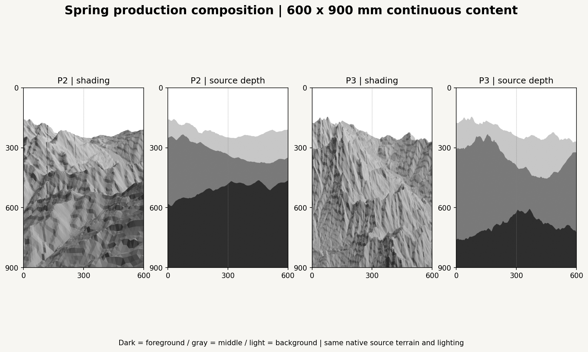
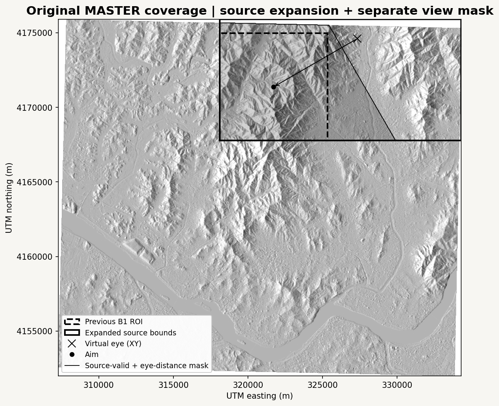
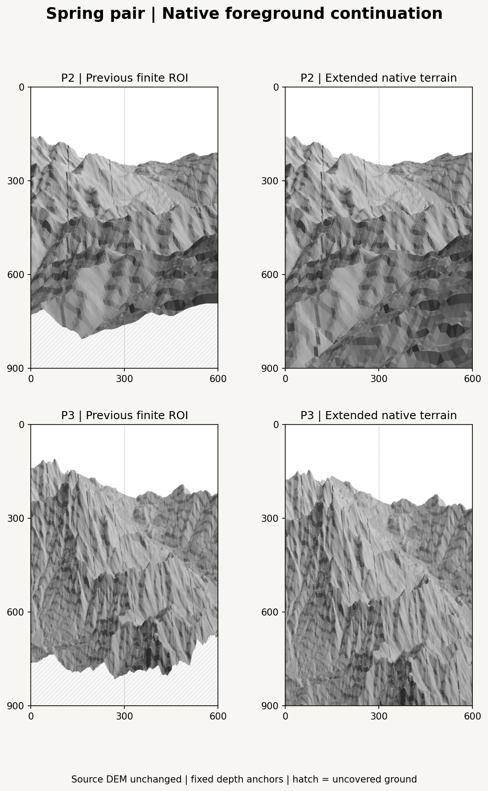
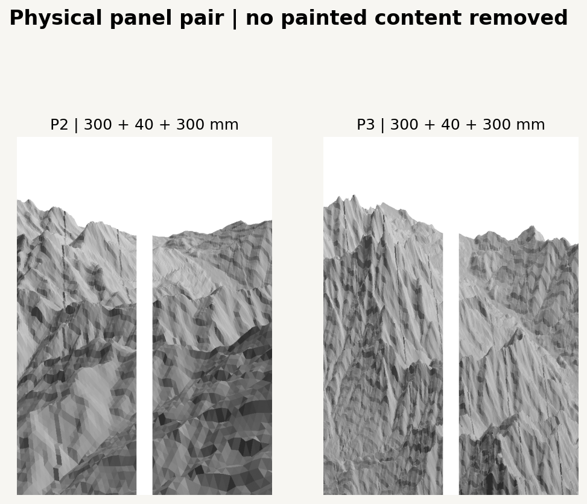

# Spring Pair Production Study v0.1

P2 now connects measured foreground to the middle valley and distant mountain without a missing lower strip. P3 retains a stronger upward unfolding as the comparison. This PR prepares the **space for a spring stroke experiment**; it does not generate finished brush paths or machine commands.

Starting main: `95f1c17e28486bdedad00e7020d3f9d3fb05344c` (PR #5 merged). The [previous P0-P3 study](../projection_composition_v01/README.md) and its implementation remain unchanged.



## Foreground from the Original Data

| Item | Previous B1 | Expanded source window |
| --- | --- | --- |
| EPSG:32652 bounds W/S/E/N (m) | 318120 / 4167770 / 325320 / 4174970 | 318120 / 4167770 / 334290 / 4175900 |
| Size | 7.2 x 7.2 km | 16.17 x 8.13 km |
| Sampling | Native 30 m | Native 30 m |

Extend east by 8970 m and north by 930 m, reaching the original MASTER bounds in the foreground direction. Retain the old west/south limits so the main mountain/valley source remains the same. Source NoData is respected; 138191 of 146069 samples in the expanded rectangle are valid (94.61%). Missing data is never filled with invented elevations.

Keep source validity separate from the view mask. Exclude positions behind or less than **1200 m horizontally from the virtual eye along its look direction**. This leaves 82682 valid native vertices and 164056 terrain triangles. The expanded bounding rectangle is not entirely visible or entirely in front of the eye. Rasterization then clips projected triangles to the narrow canvas; viewport clipping does not replace source data.



Source MASTER SHA256: `837f4b6b2e01e3b97b05db3e62fbd0869ce052ba4c18cc47a99d97873317f0fb`. Raw metric elevation values, the TIFF, and the input hash stay unchanged. The source loader reuses the existing finite-value mask helper. Only MASTER DEM and its Hillshade are read; VEG is not needed for this monochrome composition.

## Space and Layout

- Continuous painted content: **600 x 900 mm**, previewed at 600 x 900 px. Split into two 300 x 900 mm panels. Insert a 40 mm physical gap afterward; every content pixel is retained. Fold angles are not simulated.
- Look bearing 240 degrees clockwise from north; base depression 10 degrees; horizontal eye distance 6480 m; vertical FOV 38 degrees; base display exaggeration 1.8. Target remains (321720, 4171370, 252.822509765625) raw meters.
- Keep the previous source-depth anchors **-4897.2011 / +4897.2011 m** around the target. Enlarging the source window does not reassign existing terrain to different depth bands. Foreground/middle/background remain the anchored depth thirds; new nearer terrain belongs to the foreground.
- Raw-world face shading remains fixed across P2/P3: northwest light at 45 degrees plus the same small source-depth tone. Triangle facets are a diagnostic mesh, not a proposed brush texture or evidence of exposed rock.

| Mapping | Retained controls | Current addition/change |
| --- | --- | --- |
| P2 primary | 8 / 12 / 16-degree views; Y offsets +0.10 / -0.01 / -0.12 times frame height; cubic smoothstep width 0.12 of depth extent. | Existing screen XY is unchanged for the same source vertices. Add available foreground and blend virtual camera depth with the same weights as XY. |
| P3 comparison | Lateral width scale 5200 m; raw relief displacement 0.45 frame height per km; depth exponent 0.85. | Use a finite-slope depth continuation beyond the old ROI. Adjust bottom fraction 1.04 -> **1.18** and depth rise 0.95 -> **1.08** to cover the lower-right frame with measured terrain. |

For P3, with unbounded anchored depth `d`, `p=0.85`, `e=0.05`, define `f(d) = ((d+e)^p-e^p)/((1+e)^p-e^p)` when `d>=0`. For `d<0`, use `f(d)=d*p*e^(p-1)/((1+e)^p-e^p)`. The value and first derivative join continuously at zero, with f(0)=0 and f(1)=1. This softening modifies depth projection, not source DEM heights. The final rule is `y/H = 1.18 - 1.08*f(d) - 0.45*(raw_z-target_z)/1000`.

P3 trials at bottom/rise 1.14/0.95 and 1.16/1.05 left 93 and 58 uncovered pixels respectively. The selected 1.18/1.08 configuration leaves zero. This is a recorded framing adjustment, not a fill operation or an automatic composition optimum.



The previous side is re-rendered with the **original scene parameters** at native 30 m; the previous published contact sheet used 60 m sampling. The new side also uses native 30 m. P2 changes source coverage and visibility handling; P3 additionally changes the recorded depth/framing controls. Do not interpret the P3 comparison as source extension alone.

## Foreground and Depth Results

| Mapping | Previous missing lower ground: frame share | Current uncovered ground: frame share | Current bottom-edge coverage | Visible terrain share: F / M / B |
| --- | --- | --- | --- | --- |
| P2 | 17.27% | 0.00% | 100% | 57.5% / 27.2% / 15.3% |
| P3 | 14.73% | 0.00% | 100% | 30.9% / 49.3% / 19.9% |

Both versions cover every pixel in the bottom 100 mm and have no interior uncovered pixels. No artificial lower patch or hatching is needed in the selected renders. The upper reserve remains open, and the central valley continues between foreground and the higher mountain mass.

**Use P2 for the first black-ink comparison.** Its near terrain gives the bottom a foothold while the central valley and left principal mass remain readable. P3 lifts the middle terrain and creates a stronger vertical journey, but its middle mass still reads more like a wall. Keep it as the secondary experiment; use line density and openings to assess this later, rather than removing measured terrain now.

## Visibility and Local Fold Checks

The previous study ordered artistic views by P0 source-camera depth. This extension gives the final mapped triangles their own explicit virtual depth:

- P2: blend the three forward camera depths using the same depth-band weights as screen position.
- P3: positive horizontal distance from the base eye along the look axis.
- Interpolate depth **affinely in final screen triangles**, keep the nearest triangle, and return its owner/depth buffer. This defines a consistent mapped surface for future line visibility. It is an artistic virtual surface, not a claimed single physical camera.

With the same final XY and affine interpolator, switching back to P0 source depth changes **zero owned terrain pixels** in either current composition. Coverage is also identical. This checks the selected scene's ordering stability; it does not establish general equivalence and does not compare against the previous reciprocal-depth interpolator.

| Check, per mapping | Samples | P2 | P3 |
| --- | --- | --- | --- |
| Finite-difference 3D mapping Jacobian at native valid terrain vertices | 82682, step 1 m | 0 nonfinite / 0 nonpositive determinants | 0 nonfinite / 0 nonpositive determinants |
| Native terrain triangles extruded into 1 m vertical prisms, split into three tetrahedra | 492168 tetrahedra | 0 nonfinite / 0 orientation inversions | 0 nonfinite / 0 orientation inversions |
| Constant-height 3D mapping checks, 0/200/400/600/850 m | 20671 per height | 0 volume inversions | 0 volume inversions |
| Mesh triangles with nonfinite mapped coordinates or near-depth rejection | 164056 | 0 | 0 |

The Jacobian tests the **3D mapping** into screen XY plus virtual depth. The thin prisms also check the actual native triangulation. A terrain face reversing its 2D screen normal can be ordinary silhouette occlusion; it is not by itself a warped-volume fold.

The synthetic flat 850 m plane reverses 2D orientation at some P2 foreground samples because it sits above the low 8-degree virtual eye. Its 3D orientation remains positive; actual source foreground is at most 709.90 m. This synthetic plane result is recorded, not misreported as a terrain fold. P3 constant-height planes retain their 2D orientation at all tested heights.

These are strong **local, sampled** checks at the selected native mesh and altitude slices. They do not prove global injectivity or validate curves that will be added later. Re-evaluate visibility after spline generation and clipping. The JSON exposes all counts, determinants, coverage, scene settings and the `spatial_checks_pass` result.

## Two Physical Panels



P2 and P3 each include a continuous render and two separate panel PNGs. The pair of halves reconstructs the continuous image exactly. The center gap is a physical interruption of the valley passage; it does not remove an additional 40 mm strip of terrain. These PNGs are composition previews, not plotter files or calibrated pigment simulations.

## Next Stroke and Color Design

The separate [design note](stroke_and_color_design.md) prepares three machine-oriented line languages: 0815 Taebaek horizontal curves, structural terrain lines, and continuous direction-field curves. Preserve long curves, repetition, density/direction changes and layer rhythm; no named traditional texture stroke is treated as a required imitation.

Finalize one vector record per chosen mapping. Both the digital stroke renderer and later G-code backend read that same record, with exact panel clipping and post-spline visibility. Store geometric/source identity, expressive intensity, layer order, optional A1-D5 slots and stable seed keys separately from hardware coordinates/Z.

The unchanged 20-slot palette remains available across all four seasons. Proposed seasonal biases combine source terrain/Macro DEM, valid seasonal NDVI, regional density, seeded spatial variation and explicit overlap order. Actual paper/pigment behavior requires separate swatch/overlap calibration; display hex/alpha is not a measured pigment model. None of this color/stroke system is implemented here.

## Reproduce and Validate

```bash
python -m pip install -e ".[research,dev]"
python -m datascape.rendering.spring_production --master /path/to/SeoulNorth_v02_MASTER_30m.tif --source-scene configs/scenes/seoul_projection_composition_v01.json --config configs/scenes/seoul_spring_production_v01.json --output outputs/spring_production_v01
python -m pytest tests -q
```

Open [04_spring_production.ipynb](../../../notebooks/04_spring_production.ipynb), set `DATASCAPE_DATA_DIR`, and select the installed environment in VSCode/Jupyter. `DATASCAPE_SPRING_OUTPUT` controls the output directory. Configuration, input SHA256, software versions, deterministic no-randomness status, source preservation, masks, coverage and mapping checks are recorded for each run.

Twenty-eight tests pass, including eight new checks for continuation, unchanged P2 screen mapping, source preservation, NoData/view-mask separation, affine overlap ordering and the distinction between above-eye plane orientation and mapping inversion. Notebook schema validation and sequential code-cell execution in a shared Python namespace reproduce CLI JSON and PNG bytes. Interactive VSCode/Jupyter kernel startup is not verified here.

## Change Scope

Add only: `projection/production.py`, `rendering/spring_production.py`, the production scene JSON, eight tests, notebook 04, and this experiment directory. Existing modules and experiments, historical artwork originals, TIFFs, root README, 20-color palette and hardware settings stay unchanged. No original source is executed and no stroke, color layer or machine command is generated.
