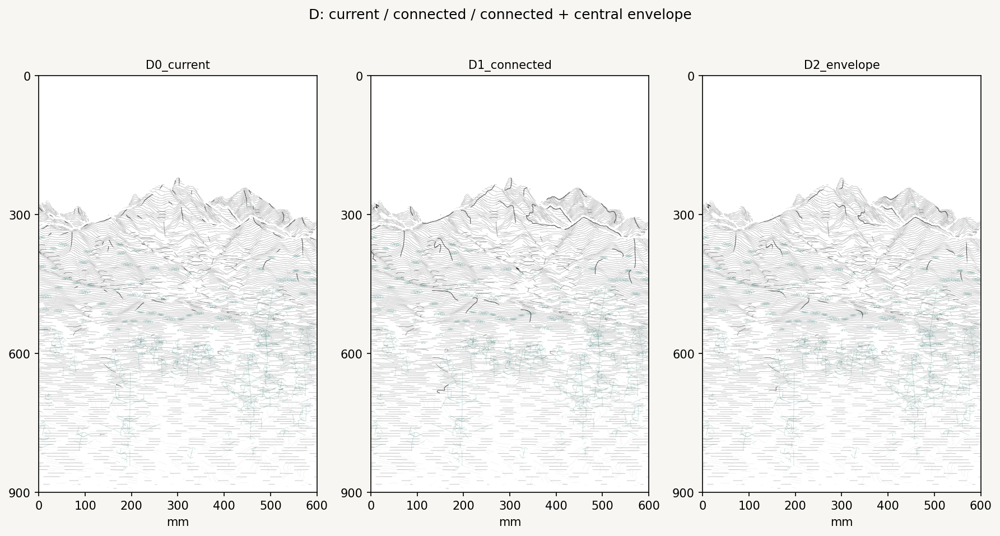
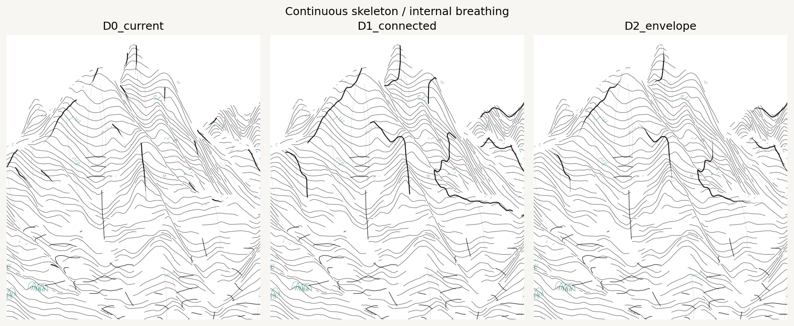
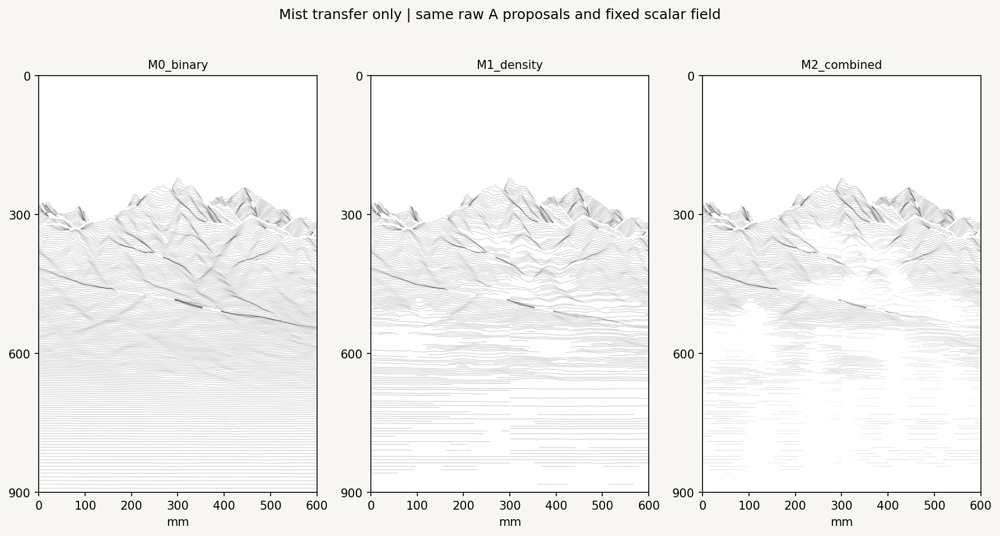
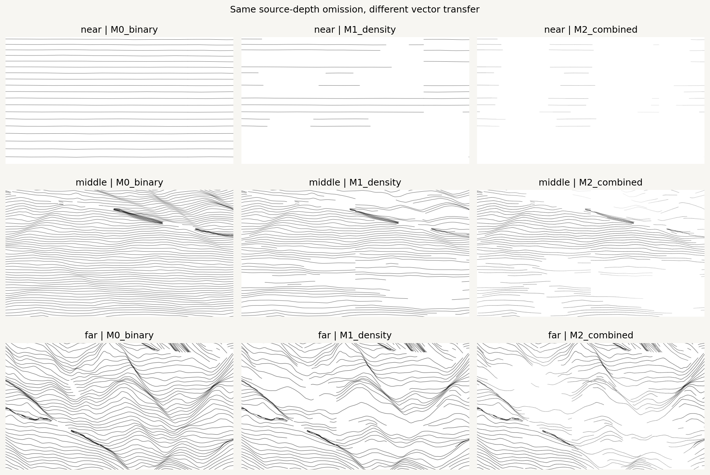
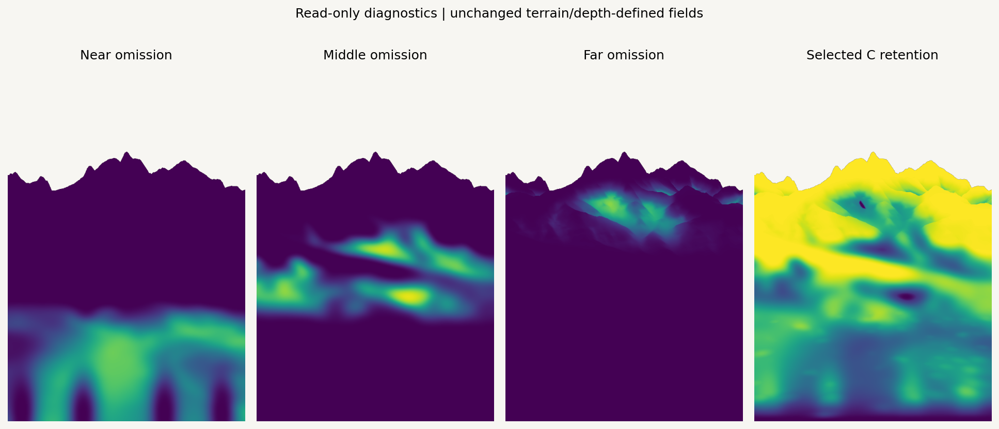
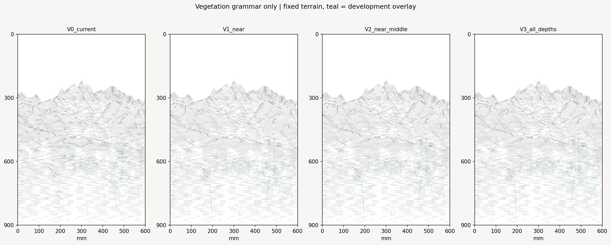
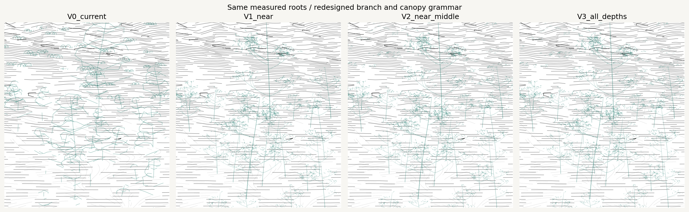
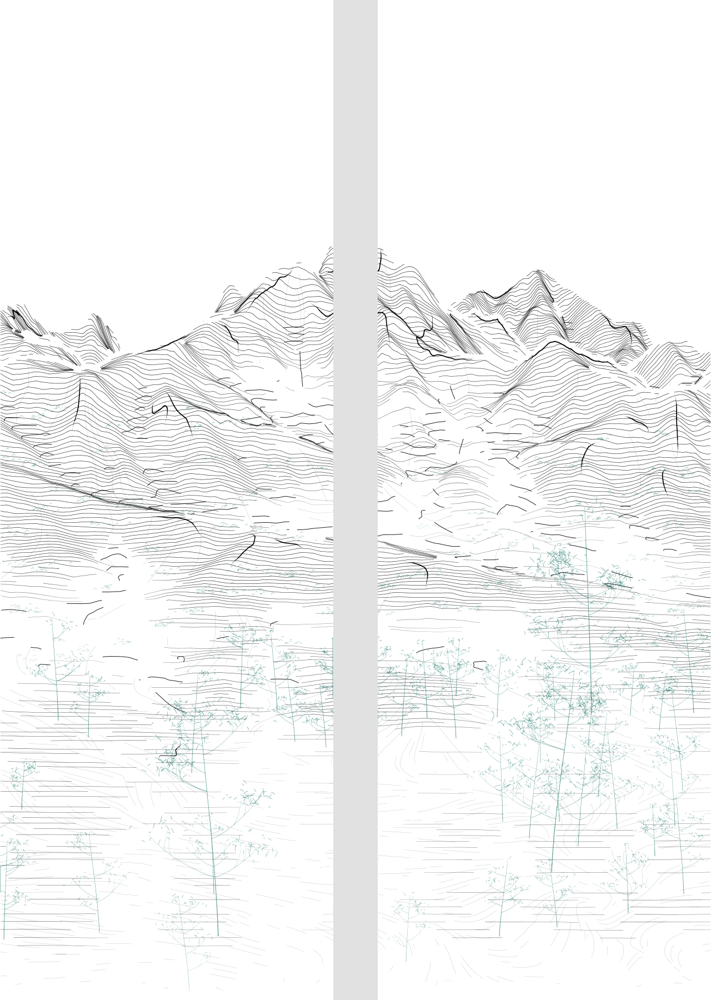

# Spring stroke grammar v0.3

Refine three stroke rules on the locked F2-C spring pair. The camera, nonlinear projection, original DEM/NDVI, 70% existing + 30% selective foreground, top reserve, irregular bottom transition and depth-defined omission fields are unchanged. The continuous drawing remains 600 × 900 mm; two 300 × 900 mm panels are shown with a physical 40 mm gap.

This additive study builds on commit `f98e7d8b9946216737894fb89164a59e0f0fd57a`. Previous studies, original artwork code/notebooks, palette and FluidNC settings remain untouched. No G-code is produced or executed.

## D: longer paths with internal breathing




| Variant | Panel paths | Total length | Median panel-path length |
| --- | ---: | ---: | ---: |
| Current D | 63 | 1.290 m | 15.67 mm |
| Connected D | 32 | 1.542 m | 41.22 mm |
| Connected + filtered + envelope | 25 | 1.369 m | 44.78 mm |

Raw ridge, occlusion, cliff-break and foothold supports are traced before soft attenuation. Selection stays near previously accepted D support locations. Compatible endpoint connections require the same support type, a gap below 12 mm, tangent change below 30°, source-depth change below 180 m and source XY separation below 250 m. A connection cannot cross a fixed zero core. Of 192 raw supports, 23 endpoint joins are accepted; 30 continuous parents are selected and 23 survive filtering/release. The 25 output paths include exact panel-seam splits.

Connected parents must be at least 20 mm long; final enveloped parents must be at least 30 mm. A small seam fragment is allowed when it belongs to a valid continuous parent. Maximum parent window is 150 mm. Six-millimeter non-maximum spacing, same-chain limits and a 3.5% maximum length budget prevent a full outline. Actual D occupies **1.38% of the proposed drawing length**, including vegetation; the budget is a ceiling, not a target to fill.

For normalized parent arclength `t`, strength rises smoothly from 0.06 to 1 over the first 26%, sustains a central section, then falls toward 0.02 after 62%. Fixed retention also attenuates the strength. The path is oriented from higher source elevation toward lower elevation and terminates early when distant-foot/retention support falls. Width, opacity and dimensionless intensity samples travel with the same parent through the panel split. Soft mist does not repeatedly chop D into small dashes; hard omission still clips its geometry.

**Reading:** connection alone produces a more insistent contour. The central envelope retains that continuity while releasing the ends, making D less like a uniform graphic outline. It anchors selected A crests without tracing every A endpoint or every mountain edge.

## Mist: one field, three vector transfers





This comparison starts with the **same unattenuated transverse A proposals**. B/C/D/vegetation are hidden. It does not apply a second fade to already shortened legacy A paths. The binary reference is a controlled baseline, not a claim that the previous full drawing contained no soft omission.

| Transfer | Panel paths | Actual path length | Change from binary |
| --- | ---: | ---: | ---: |
| Hard-core omission only | 758 | 105.879 m | — |
| Density fade | 761 | 72.255 m | −31.76% |
| Density + length + opacity/width | 949 | 59.402 m | −43.90% |

A continuous field can create more output pieces while reducing total length; path count alone is not density. A seeded per-source threshold controls survival against `R ** gamma`. The combined mode additionally shortens arclength windows according to retention `R`, then stores vertex opacity `base_opacity * R ** depth_exponent` and width `base_width * (0.25 + 0.75 * R ** 0.4)`. High-retention runs remain continuous. Fixed zero cores contain no terrain path; white paper is revealed through omitted geometry, not a white layer.

The existing near/middle/far weights interpolate transfer exponents without horizontal bands:

| Role | Density exponent | Opacity exponent | Existing spatial function |
| --- | ---: | ---: | --- |
| Near | 0.95 | 0.70 | Separate footholds from the bottom paper margin |
| Middle | 1.15 | 0.90 | Open valleys and transitions between terrain masses |
| Far | 0.85 | 0.65 | Release distant mountain feet while retaining upper forms |

**Reading:** density alone removes some horizontal continuity but retains equal-strength survivors. The combined mode gives a clearer gradual release in valleys and at distant feet. It can become too faint in low-retention near ground; this is visible in the crop and should be assessed at print size. The scalar 70/30 foreground rule has not changed. In the proposed combination, only A uses this newly tested transfer; B and C retain their previous paths/styles to avoid unrelated changes or double attenuation.

## Vegetation: a separate grammar at each depth




[Vegetation alone](vegetation_only.png) · [Old hero detail](vegetation_hero_old.png) · [New hero detail](vegetation_hero_new.png)

Terrain A/B/C/D is identical across these four panels. Teal is a development overlay, not an additional palette color. The monochrome proposal is provided separately.

| Depth | Grammar | Root sites with visible paths | Paths |
| --- | --- | ---: | ---: |
| Near | Curved trunk, staggered asymmetric branches, twigs, open foliage gestures | 42 | 4,034 |
| Middle | Irregular clustered short curves; no full-tree icons | 105 | 1,068 |
| Far | One or two tiny touches at ridge-supported archived sites | 55 | 98 |

All source roots and heights come from archived data-supported marks. Three small glyphs sharing hero roots are consolidated into those same hero trees. No new root positions or tree heights are introduced. NDVI/observation evidence is retained with each root; it is not interpreted as a tree inventory or species label. The far rule rejects ten archived sites with insufficient ridge/silhouette support.

Near crowns use seeded clusters of open gestures rather than stacked closed loops. Hero crowns receive more/longer foliage touches, while ordinary trees retain smaller clusters. Branches and trunks taper; middle masses and far touches have different rules rather than scaled copies. Object-root depth controls visibility against the existing terrain: a front branch can remain visible against deeper mist, while nearer terrain can occlude it. The unconditional bottom rule applies to all objects.

**Reading:** the new near grammar has a clearer branching hierarchy and less of the old polygonal canopy icon. Middle groups create a different mark scale; sparse far touches contribute little at whole-screen size, as intended. These are developmental botanical gestures, not final pine or species drawings. Near foliage adds many pen lifts; later production simplification should preserve its clusters and root connections rather than restore closed icons.

## Proposed review combination



[Monochrome](proposed_monochrome.png) · [Continuous development preview](proposed.png) · [Continuous SVG](proposed.svg) · [Panel 1](proposed_panel_1.svg) · [Panel 2](proposed_panel_2.svg) · [Canonical stroke data](proposed_strokes.json.gz)

Recommend **enveloped D + combined A mist transfer + all three vegetation depths**, with A as the main terrain language, unchanged B as structural accent and unchanged lighter C as directional grain. D remains the strongest, sparsest selected skeleton. The drawing contains 6,866 panel paths totaling 99.222 m. The final two millimeters are empty even after nominal stroke footprints; the physical gap does not remove or rescale painting content.

The JSON is the canonical drawing: paths, panel assignment, source lineage, widths, vertex opacity and intensity samples are shared by PNG/SVG rendering. SVG encodes profile intervals as line pieces for display; a future machine backend should consume the continuous JSON parents, not treat every SVG segment as a pen lift. Intensity is dimensionless and **not calibrated pressure or machine Z**. Future color layers must inherit the same hard boundary/omission rules and use the unchanged palette. This study makes no machine-output or pigment calibration claim.

## Reproduce

From the repository root:

```bash
python -m pip install -e ".[research,dev]"
python -m datascape.rendering.grammar_study \
  /path/to/SeoulNorth_v02_MASTER_30m.tif \
  /path/to/SeoulNorth_v02_VEG_10m.tif \
  --config configs/scenes/seoul_spring_stroke_grammar_v03.json \
  --output outputs/spring_stroke_grammar_v03
python -m pytest tests -q
```

Open [the notebook](../../../notebooks/spring_stroke_grammar_v03.ipynb) in VSCode/Jupyter with `DATASCAPE_DATA_DIR` pointing to the original inputs. [Configuration](../../../configs/scenes/seoul_spring_stroke_grammar_v03.json), [record](record.json), and [validation](validation.json) record the seed, hashes, numerical results and checks. Isolated D/M/V vector archives accompany the figures for exact re-rendering.
