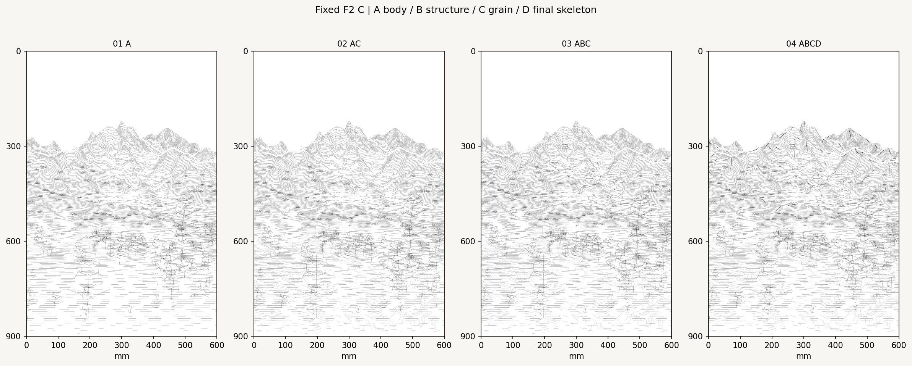
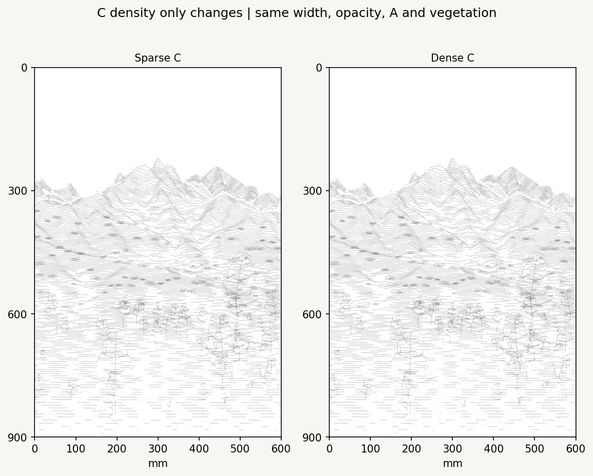
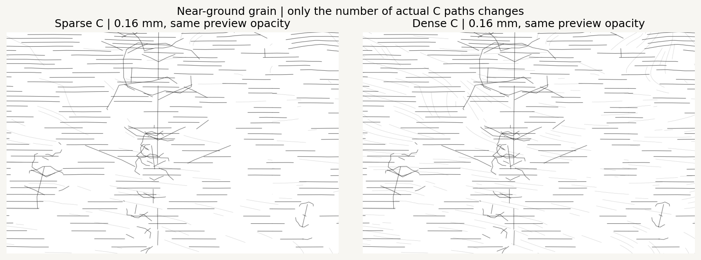
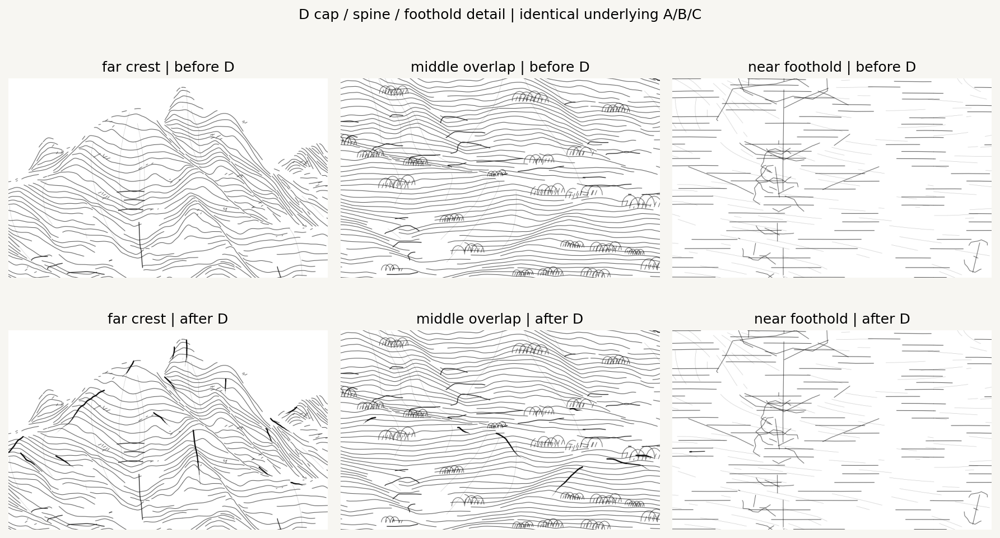
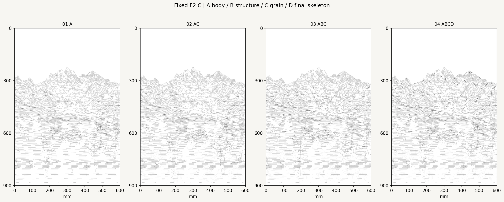
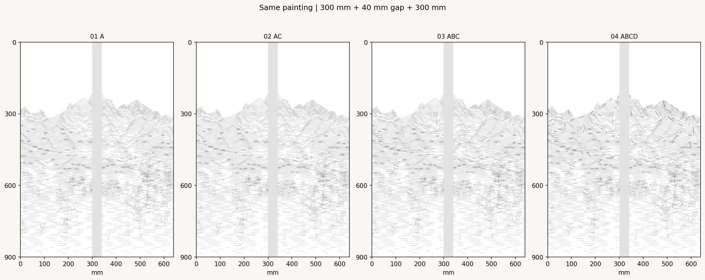
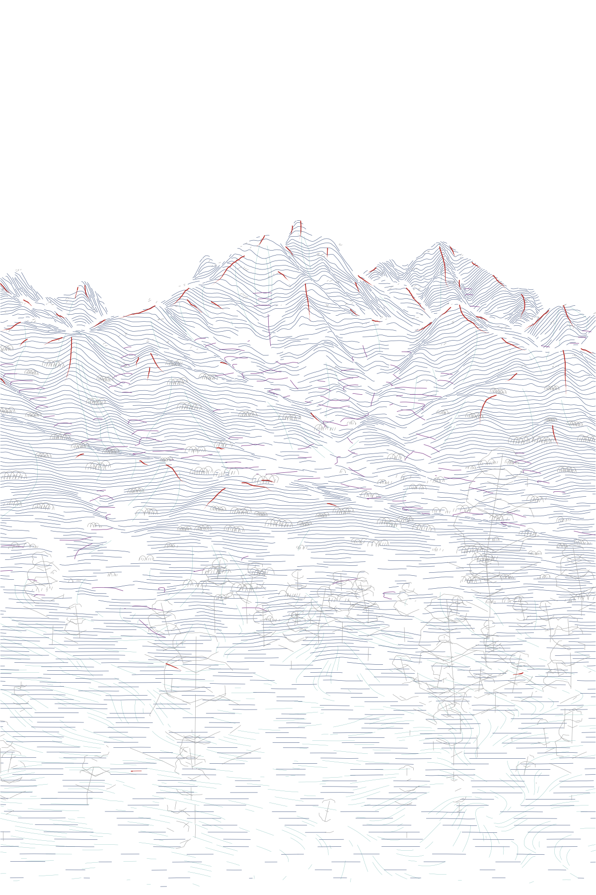
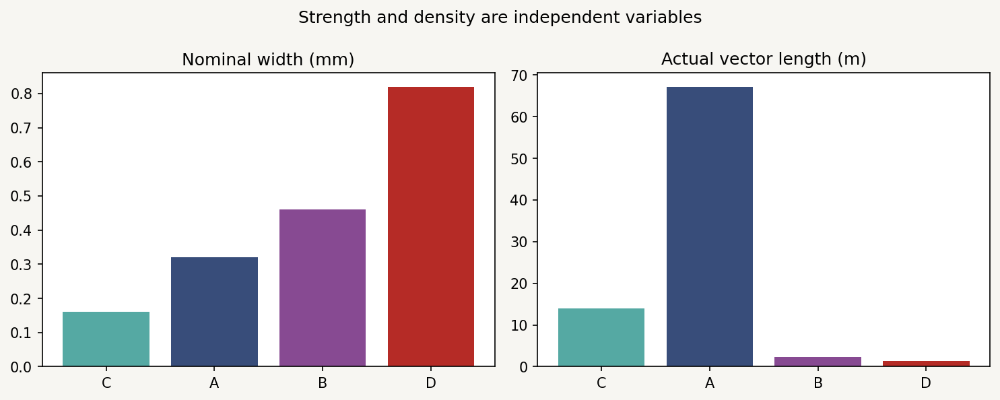

# Spring stroke hierarchy v0.2

**Production-language recommendation: A body + fine, dense near C + selective B + sparse final D.** This is a stroke-system decision on frozen F2 composition C, not another camera, projection or whitespace study. No additional composition sweep is proposed before physical stroke calibration.



All four views preserve the same original DEM/NDVI, F2 mapping, 70/30 near retention, source-depth omission, top opening, irregular lower transition and absolute 2 mm bottom guard. The same 2,012 archived vegetation fragments provide context. A is identical in every combination; adding B/C/D does not move or regenerate its geometry.

## Layer rules and hierarchy

The hierarchy is **D > B > A > C** in nominal maximum width and dimensionless expressive intensity. Path frequency and length are separate controls. The black preview uses opacity 1 throughout. The density preview uses the declared profile below on exactly the same paths; this is a relative ink study, not calibrated pigment or machine pressure.

| Layer | Role | Nominal width (mm) | Density-preview opacity | Expression intensity | Final vectors | Length (m) |
| --- | --- | ---: | ---: | ---: | ---: | ---: |
| C | Fine directional grain | 0.16 | 0.32 | 0.25 | 559 | 13.983 |
| A | Transverse body | 0.32 | 0.82 | 0.60 | 1,657 | 67.168 |
| B | Local structure accent | 0.46 | 0.94 | 0.80 | 133 | 2.350 |
| D | Final sparse skeleton | 0.82 → 0 | 1.00 | 1.00 | 63 | 1.290 |

Vegetation uses the unchanged 0.32 mm geometry, with the same preview profile in all comparisons. Widths are nominal vector footprints, not measured wet-brush widths.

### A: the body

Reuse all 1,657 finalized Taebaek-style transverse curves from v0.1. Their source-depth pitch and fixed F2 projection already create different paper-space density in near/middle/far terrain. The 70/30 omission remains present in the actual shortened paths. Independent depth keep multipliers are implemented and recorded at 1/1/1 for this comparison; lowering a multiplier removes paths without changing their width/intensity. This is subsampling of the existing proposal set, not a promise of new denser paths above that baseline.

A supplies 35.46 m in middle terrain and 8.61 m in far terrain, against 23.09 m near terrain. Keep it as the stable middle/far body and as the continuing ground under C.

### B: local structure, not another body layer

Sample native-meter DEM curvature plus the existing valley and depth-overlap features along the archived structure paths. Retain only local salience above 0.58. Use real 7 mm breaths, a 32 mm maximum run, 5 mm proposal spacing and a total ceiling of 6.5% of A length. Actual B length is 2.350 m, mostly middle terrain. These are valley/overlap and structural-change proxies, not verified hydrologic confluences.

### C: fine grain, independently dense

Prefer the existing source near-depth role; retain a small additional contribution on selected steep side slopes. C is 0.16 mm at preview opacity 0.32 and intensity 0.25 in both density experiments. A recorded ID/seed gate selects whole surviving paths: low coefficient 0.32 versus dense 0.88. The low set is an exact subset of the dense set; common paths keep their complete geometry and style.

- Low C: 219 vectors / 5.477 m.
- Dense C: 559 vectors / 13.983 m, about 2.55 times the actual line length.
- 11.54 m of dense C is near terrain. Thus approximately 82.5% of its length serves the foreground, without making the whole image a flow-field texture.

Use dense C as the proposed production baseline. It supports the direction of near ground between A's transverse rhythms while remaining subordinate in width/intensity. The apparent change is deliberately restrained at whole-pair scale; inspect the crop below. No extra opacity reduction is used to fake a density difference.





### D: final selected skeleton

D is **not every mountain outline**. Its candidate sources are:

| Source | Explicit selection | Limit of the evidence |
| --- | --- | --- |
| Skyline / occlusion | Visible skyline and actual adjacent source-depth jumps >180 m; choose the nearer side, with a 3 mm terrain-side inset | Selected visible separation, not all contours or an altered silhouette |
| Major crest / spine | Zero cross-view slope, negative cross curvature ≥0.0001 per m, existing ridge support ≥0.15 | Scale-dependent convex axis, one line rather than two flanks |
| Slope-break rim | Upper 40% of 28°/38° slope-boundary arcs | DEM slope shoulder; not verified granite or a mapped rock edge |
| Near foothold rim | Existing mound signal plus existing positive/root-support evidence; keep only the higher shoulder | Supported low-ground emphasis, not an invented boulder |

All candidates inherit the exact existing omission/global rules. Source-height reversals and projected turns interrupt runs. Limit a run to 48 mm, leave 9 mm breaths and allow at most two pieces from the same support event. Rank supported candidates, then apply **6 mm non-maximum suppression** between selected D parents, including across candidate types. This prevents nearby parallel accents and two-sided flanking.

Start from the higher source shoulder. A vertex profile keeps the head strong, then reduces nominal width and dimensionless intensity to zero over the final part. The complete profile is stored with the polyline; it is not a renderer-only fade. A final panel split samples the original parent profile rather than restarting a strong head at the seam. D is drawn last.

The selection has a 4% target against all path length, with a hard 6% ceiling also checked against **terrain-only** length. These are ceilings, not quotas. Supported selection/NMS yields **63 D vectors / 1.290 m**, or **1.26% of all paths / 1.52% of terrain paths**. The measured minimum other-parent distance is **6.41 mm** at 0.5 mm sampling. Remaining budget is not filled with weaker outlines.

D length by support is approximately 0.662 m crest, 0.220 m occlusion, 0.053 m skyline, 0.317 m slope-break proxy and 0.038 m foothold proxy. Most final skeleton length belongs to crests and separation boundaries. Near-ground D is modest because the selected DEM foreground is gentle; A+C carries its continuity. No near rocks are inserted to fill a visual quota.



The far crop shows a local cap/anchor effect at selected peaks and shoulders. In an auxiliary proximity check, 207 of 700 eligible upper A endpoints lie within 4 mm of D. This is only an anchoring opportunity, not proof that all those ends meet the same ridge. D does not close every A endpoint; doing so would convert the selective skeleton to an outline system.

## Four combinations and production decision

| Combination | Reading | Decision |
| --- | --- | --- |
| A only | Most coherent baseline body, with repeated horizontal ground rhythm | Preserve as the body control |
| A + C | Near ground gains a second direction without losing A continuity | Keep fine dense C as support |
| A + B + C | Important middle-ground changes become more legible | Keep B short and selective |
| A + B + C + D | Selected peaks, spines and overlaps gain a clear final hierarchy | **Recommended production-language baseline** |





The continuous painting remains 600 × 900 mm. The physical preview splits it into two 300 × 900 mm panels and inserts a separate 40 mm gray installation gap. No painted strip is removed. All comparisons use the same context, fields and 70/30 near rule.



Diagnostic colors: A blue; B purple; C teal; D red; archived vegetation gray. These colors are not a palette proposal. [D only](D_only.png), [B only](B_only.png) and [C only](C_only.png) isolate the actual geometry.



## Shared vectors and handoff rules

The renderer reloads [`layer_pool.json.gz`](layer_pool.json.gz), then selects the declared combinations. [`final_strokes.json.gz`](final_strokes.json.gz) is the proposed final A+B+dense C+D set, with exact panel splits, identifiers, parent support, draw order, nominal width, preview profile and dimensionless intensity. D includes per-vertex width/intensity profiles and source XYZ endpoints. This is the authoritative vector input for later rendering and plotter work.

Continuous black SVGs: [A](01_A.svg), [A+C](02_AC.svg), [A+B+C](03_ABC.svg), [A+B+C+D](04_ABCD.svg). Final panel SVGs: [1](final_panel_1.svg), [2](final_panel_2.svg). SVG and raster use the same stored coordinates; D segment widths are the same averages of stored vertex widths. No white-paint layer or renderer-only omission mask is added.

Maintain these rules for the next steps:

1. Freeze this F2/70–30/whitespace selection and the chosen vector-set identity. Do not regenerate different lines in the G-code backend.
2. Preserve C → A → B → context vegetation → D draw order. D remains the final sparse finish; retain its support labels, spacing and measured length ceiling.
3. Map dimensionless intensity and width profiles through measured brush/paper/feed calibrations. Preview opacity is not a Z command, and nominal width is not a wet-width calibration. Existing FluidNC and palette YAML remain unchanged.
4. Preserve source-depth object visibility and actual path omission/splitting. Keep zero terrain cores and the unconditional bottom 2 mm guard; check the calibrated physical stroke footprint again before machine output.
5. Add seasonal colors as independent earlier layers on the same scene/coordinates, with the same global boundary and appropriate omission. Keep all seed, order and palette references. No color or G-code implementation is included here.

## Reproduce and validate

```bash
python -m pip install -e ".[research,dev]"
python -m datascape.rendering.hierarchy_study \
  /path/to/SeoulNorth_v02_MASTER_30m.tif \
  /path/to/SeoulNorth_v02_VEG_10m.tif \
  --config configs/scenes/seoul_spring_stroke_hierarchy_v02.json \
  --output outputs/spring_stroke_hierarchy_v02
python -m pytest tests -q
```

[Notebook 11](../../../notebooks/11_spring_stroke_hierarchy.ipynb) reads `DATASCAPE_DATA_DIR` and optional `DATASCAPE_HIERARCHY_OUTPUT`. The [study config](../../../configs/scenes/seoul_spring_stroke_hierarchy_v02.json) records all layer rules and hashes of the original vector inputs; the existing [selected C lock](../../../configs/scenes/seoul_spring_selected_C.json) remains unchanged. [record.json](record.json) contains metrics, D support selections, source/config hashes and invariants.

Validation: **75 tests passed**. Three notebook code cells are validated and replayed in one Python namespace; all **41 generated artifacts match the CLI byte for byte**. This is not reported as a launched Jupyter kernel. All PNGs, gzip/JSON, SVG widths/coordinates, actual path footprints and original-file hashes are checked before publication. The selected C grayscale image and retention archive reproduce exactly. Terrain core violations: 0. All terrain/context nominal footprints are absent from the final 2 mm.

This branch builds on the still-open vector-study PR #7 and targets its branch for a focused stacked review. No merge is performed. Original artwork code/notebooks, TIFFs, palette/hardware YAML, all earlier experiments and the existing vector modules are preserved.
