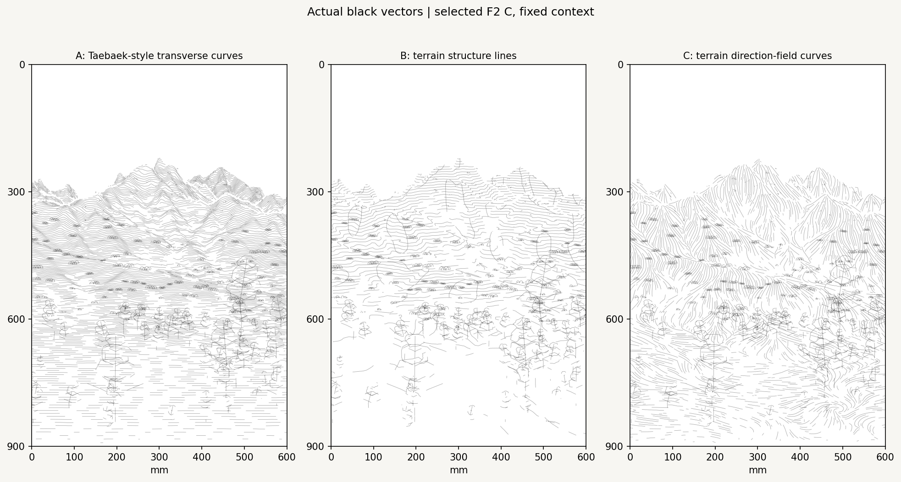
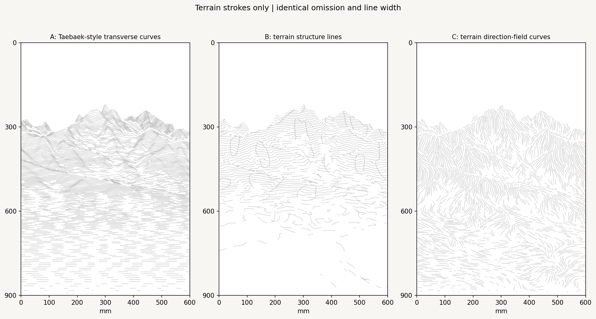
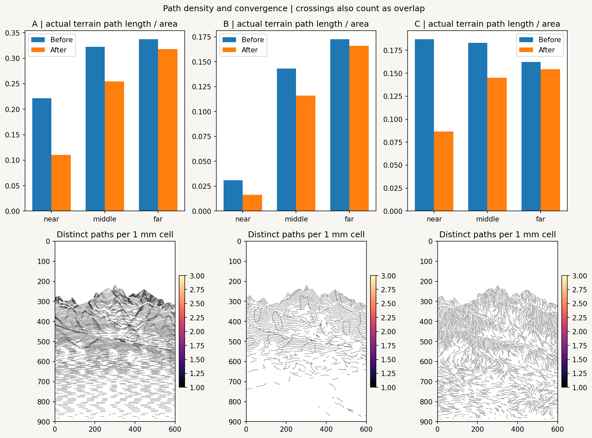
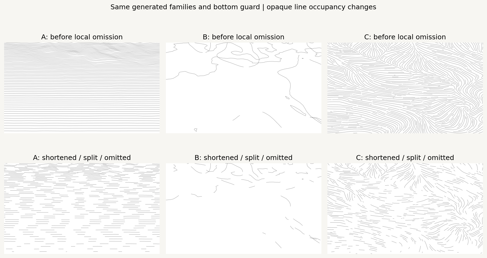
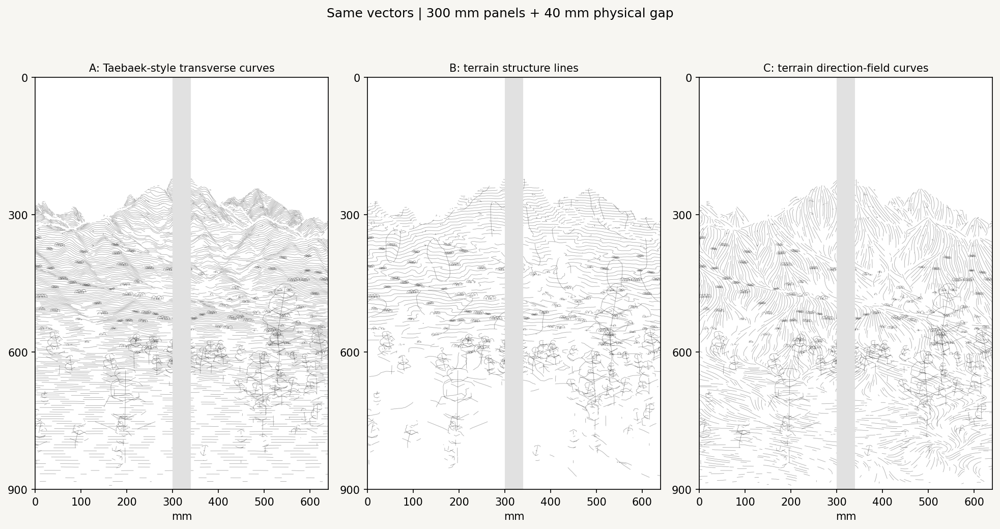
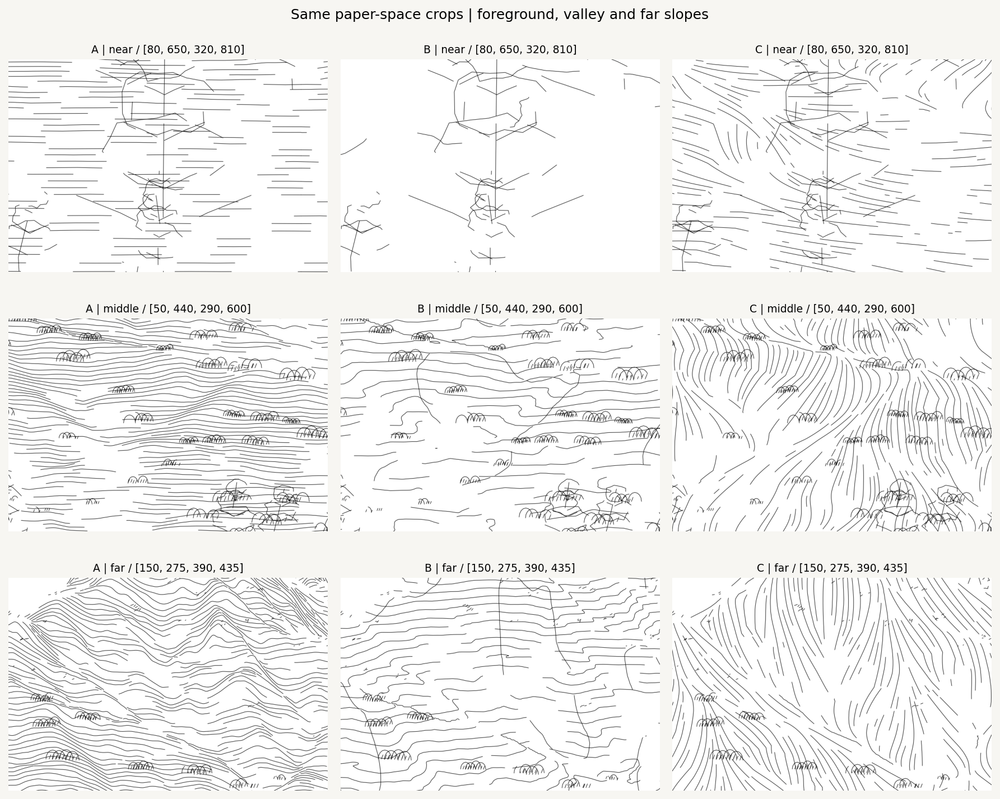

# Spring vector stroke study v0.1

Three separate opaque-black terrain path families on the selected **F2 composition C (70% existing near + 30% selective)**. Here, **stroke C** means the direction-field family, not another composition. Camera, nonlinear projection, raw DEM/NDVI, all omission fields and archived vegetation geometry remain fixed.



## Read the comparison

| Method | Construction | Strength | Current limitation |
| --- | --- | --- | --- |
| A: Taebaek-style transverse curves | Constant camera-forward-depth surface sections, with chord-length cubic splines | Repetition reveals mountain overlap and connects low ground across the pair | Lower ground becomes horizontal broken rhythms; more total drawing length |
| B: terrain structure lines | Signed cross-view curvature axes plus slope-supported elevation contours | Makes major slope/valley structure readable with fewer paths | The near ground has few elevation crossings, so roots can feel insufficiently grounded |
| C: direction-field curves | Projected DEM aspect/Hessian tangent integration | Best expresses slope direction and vertical rise; gradual low-ground turns | Fairly even slope texture; flow changes can look mechanical and some paths are short |

**A and C are the strongest candidates for the next stroke refinement.** A is the continuity/control language; C adds a substantially different terrain-following language. B is useful for structural diagnosis or a later selective role. No family is mixed with another in this study. These are first vector comparisons, not finished brushwork.

The common scene, nominal **0.32 mm** black line, omission policy, seed **20261015**, panel clipping and context vegetation are identical. Family-specific proposal pitches differ; the measured drawing amounts below are intentionally visible rather than being described as equal density. Gray pixels in PNGs are edge antialiasing; every actual stroke has opacity 1. The background represents white paper, with no gray DEM underlay or white paint layer.



## Actual vector quantities

Terrain paths only; counts include exact panel splits. Each final view also contains the same **2,012 context vegetation fragments**. Roots, canopies and depth grammar come from the unchanged archived marks; vector omission translates those marks without replanting or generating new trees.

| Method | Terrain vectors | Length (m) | Median stroke (mm) | Other-path spacing p10 / p50 / p90 (mm) | Total length retained | Near length retained |
| --- | ---: | ---: | ---: | ---: | ---: | ---: |
| A | 1,657 | 67.17 | 34.14 | 1.70 / 3.17 / 5.75 | 66.8% | 49.7% |
| B | 505 | 24.11 | 35.67 | 1.82 / 6.37 / 10.33 | 77.4% | 52.9% |
| C | 1,509 | 42.54 | 23.68 | 3.28 / 4.40 / 6.96 | 61.6% | 46.3% |

Spacing is a sampled nearest-other-parent centerline distance, not a calibrated brush clearance. Depth summaries use source forward distance: near <1,600 m; middle 1,600–3,400 m; far ≥3,400 m. The same source-depth masks define the denominator areas. Before/after controls share visibility, the hard bottom guard and geometric parallel-path thinning.

In half-mm sampled cells, the maximum number of distinct terrain parents is **2 / 2 / 1** for A/B/C. Cells with multiple parents are approximately **0.0023% / 0.5293% / 0%** of occupied line cells; transverse crossings also count. No repeated-pass layer is added. This removes the dense near-parallel convergence initially found at occlusion transitions. These sampled checks cannot predict the wet width or pooling of an actual brush.



## Translate omission into actual paths

1. Reconstruct selected C retention in float64 from the locked old configurations. Check both the selected grayscale image, pixel for pixel, and the float16 diagnostic archive before creating any line.
2. Generate a separate candidate family on the existing visible surface. Use raw source-meter XYZ/depth to reject discontinuity bridges. A 120 m source-neighbor jump guard and one-pixel collar prevent interpolated depth contours from drawing false seams; they do not warp terrain or alter omission fields.
3. Translate retained coverage to deterministic path occupancy: `p = R + 0.25 priority R (1-R)`. Priority uses the existing ridge, silhouette, near mound and root-support signals. It cannot override R=0. An ID/seed-based, low-frequency threshold changes surviving run length and local line density rather than line transparency.
4. Intersect continuous zero crossings, shorten/split paths and discard terrain fragments below 2.4 mm. A 1.4 mm raster safety collar accounts for mask-cell diagonal, sampling and line footprint. No spline is fitted after omission, which would risk reconnecting a gap.
5. Apply a common parallel-retracing rule: long curves claim neighboring half-mm cells first; paths within 30 degrees of an existing tangent are split/omitted there. Transverse crossings remain possible. It is a vector spacing rule, not a new composition field.
6. Simplify finalized storage with a 0.025 mm error tolerance, round coordinates to 0.001 mm and recheck paths densely. Clip at x=300 mm using exact segment intersections, including outside-to-outside crossings.
7. Keep the unchanged 2 mm bottom guard and smooth C transition. All terrain and vegetation centerlines plus their nominal half-width end **above y=898 mm**, so the last 2 mm contain no stroke footprint. Both field/guard and exported geometry are checked.

The terrain zero cores contain **no terrain paths**, even after smoothing, rounding and clipping. Near vegetation can cross a deeper background omission using the existing object-depth rule; it cannot cross the global bottom guard. This preserves the intended branch-against-middle-whitespace relationship. The 70/30 baseline is a retention combination, not a requirement to keep exactly 70% of lines.



## Parameters and historical Taebaek relationship

A proposes transverse sections every 20 source meters and uses 3 mm chord-length spline knots. B computes gradient and Hessian features from a mask-aware Gaussian at sigma=60 m; raw elevations and F2 geometry are never replaced by the smoothed feature surface. B uses 18 m elevation steps and a 0.00012 per-meter cross-curvature threshold. Its ridges/valleys are scale-dependent geometric proxies, not observed streams or rocks.

C proposes seeds on a 7 mm grid with recorded jitter, integrates a midpoint step of 1 mm in both directions, caps each half at 85 mm and reserves 2 mm neighboring cells when accepting a path. The tangent combines downslope direction with at most 22% of an aligned Hessian frame; gentle ground blends toward the contour tangent. Actual projected spacing is measured above. No random state from the archived Taebaek code is executed.

The attached 0815 notebook's code AST matches the unchanged artwork `original/source.py`. This study reuses the principle of horizontal rows → visibility runs → spline curves. The old height exponent, row-wise sway/stretch, two Horizon Mask resets, negative machine Z and station coordinates are not copied into fixed F2. Existing mapped-surface visibility replaces that historical horizon approximation; chord-length parameterization and post-spline checks prevent unreviewed overshoot. See the preserved [source analysis](../seoul_viewpoints_v01/taebaek_analysis.md).

## Full pair and details



One 600 × 900 mm drawing is split into two 300 × 900 mm panels. The installation PNG inserts a gray **40 mm physical gap**, giving 640 × 900 mm overall. It is not missing painted content and does not alter vector coordinates.



The crop bounds are recorded in the config in continuous canvas mm. The full-resolution individual PNGs/SVGs remain the best way to inspect thin lines.

## Shared vector contract

`src/datascape/strokes/` handles locked scene reconstruction, terrain generation, omission, clipping and finalized records. `src/datascape/rendering/vector_study.py` renders those records. The existing G-code package and hardware files are untouched.

Each `*_strokes.json.gz` contains deterministic, machine-independent millimeter polylines, IDs/parent IDs, panel ID, draw order, nominal width, black ink, dimensionless expression intensity, reversal permission and input/scene/config/seed provenance. Terrain records include source XYZ bounds and forward-depth ranges. Physical pressure is explicitly uncalibrated. No legacy machine Z is intrinsic terrain data.

The renderer **reloads the exported records** before producing the final full image. SVGs use the exact stored polylines, with no renderer-only mask, opacity gradient or coordinate warp. Panel 2 subtracts 300 mm only for its local SVG coordinates. A later plotter backend should consume this same finalized record set; do not re-generate lines separately in the G-code backend. The SVG white background rectangle is paper visualization, not a plotted path.

| Family | Continuous vector | Panel vectors | Authoritative stroke data |
| --- | --- | --- | --- |
| A | [SVG](A_continuous.svg) | [1](A_panel_1.svg), [2](A_panel_2.svg) | [JSON.gz](A_strokes.json.gz) |
| B | [SVG](B_continuous.svg) | [1](B_panel_1.svg), [2](B_panel_2.svg) | [JSON.gz](B_strokes.json.gz) |
| C | [SVG](C_continuous.svg) | [1](C_panel_1.svg), [2](C_panel_2.svg) | [JSON.gz](C_strokes.json.gz) |

## Reproduce and verify

```bash
python -m pip install -e ".[research,dev]"
python -m datascape.rendering.vector_study \
  /path/to/SeoulNorth_v02_MASTER_30m.tif \
  /path/to/SeoulNorth_v02_VEG_10m.tif \
  --config configs/scenes/seoul_spring_vector_study_v01.json \
  --output outputs/spring_vector_study_v01
python -m pytest tests -q
```

[Notebook 10](../../../notebooks/10_spring_vector_study.ipynb) reads `DATASCAPE_DATA_DIR` and optionally `DATASCAPE_VECTOR_OUTPUT`. Select the installed project environment in VSCode/Jupyter. [Selected C lock](../../../configs/scenes/seoul_spring_selected_C.json) records source/config/archive SHA-256 values. [Study config](../../../configs/scenes/seoul_spring_vector_study_v01.json) records all generation settings. [Run record](record.json) records metrics, versions, invariants and provenance. [Baseline review](baseline_review.md) records PR #6 and preservation checks.

Validation: **68 tests passed**. All PNGs, JSON/gzip payloads, SVG geometry and previous-file hashes are checked. Three notebook code cells are validated and replayed in one Python namespace, with all **46 generated artifacts identical byte for byte to the CLI**. A Jupyter kernel could not bind TCP/IPC sockets in this execution environment, so this is not reported as a launched-kernel test. Source TIFFs, old outputs, original artwork code/notebooks, palette and hardware YAML are preserved. No color engine, G-code, plotter motion or calibrated brush-pressure mapping is added.
