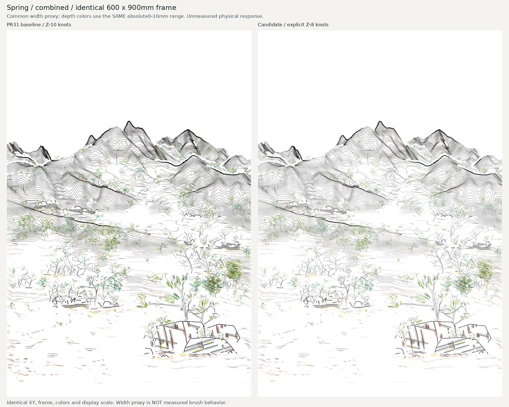
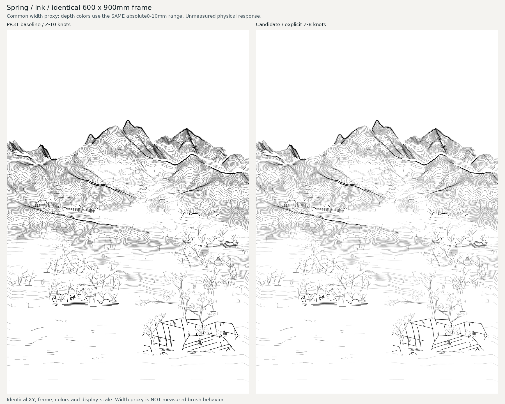
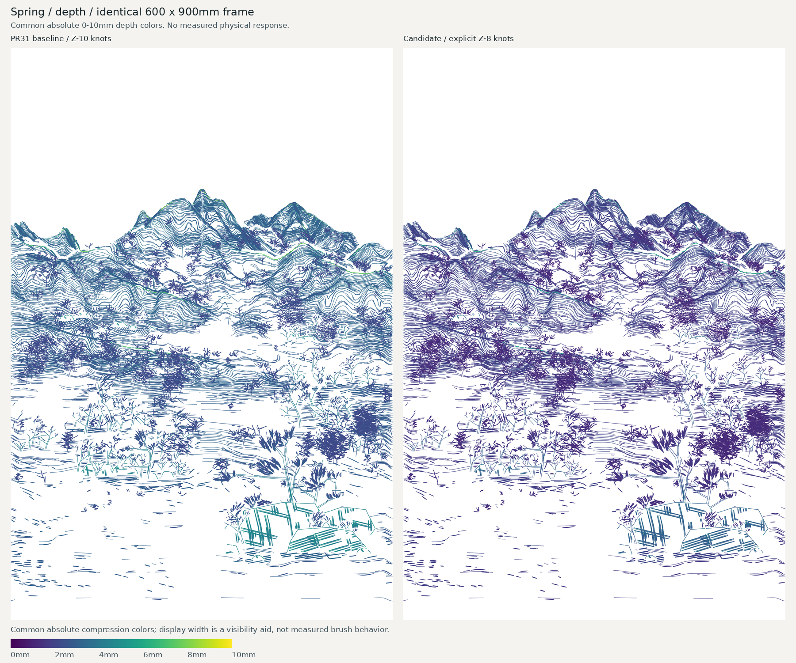
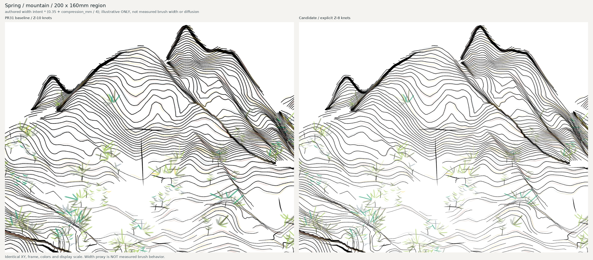
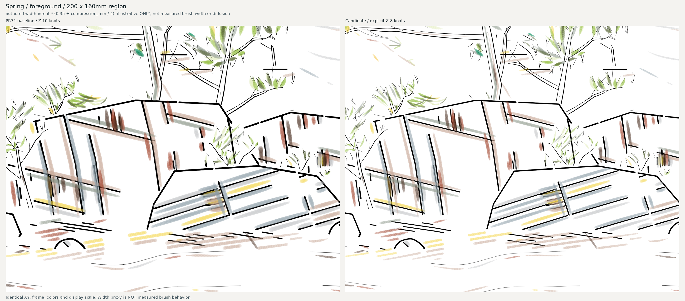
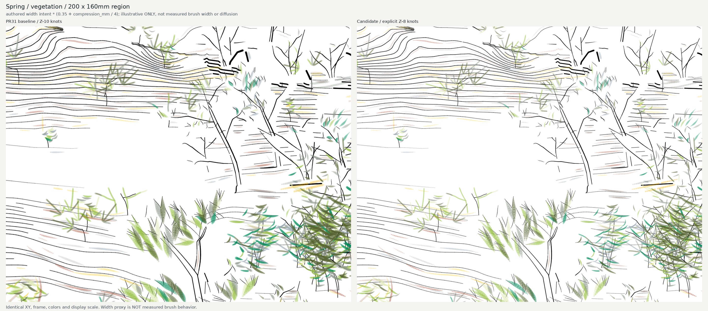
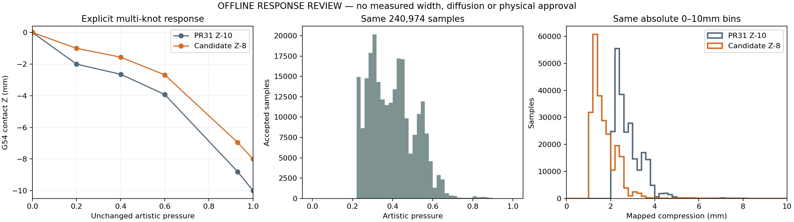

# Spring explicit Z-8 response candidate

Reversible visual integration review from pinned PR31. Original baseline file,
canonical source, XY, accepted pressure, S3a, palette and motion/station settings
are unchanged. Explicit knots:0/0,.2/-1,.4/-1.56,.6/-2.68,.93/-6.95,1/-8.
Ink/color remain independent profiles, initially identical. Benchmark contact
envelope stays -10..0 and its deliberate -10 lines are not changed.

Open Spring_Z8_Review.html (self-contained, no network): combined/ink/depth
slider, three enlarged same-scale crops, curve/distributions and hashes.
The page embeds lossless WebP displays at compact resolution; original PNGs
remain available for detailed inspection. Both views have identical scale.
comparison_combined.png / comparison_ink.png show ILLUSTRATIVE DEPTH-WIDTH
PROXIES, not measured physical prints. Formula: authored per-sample width intent
times (0.35 + compression_mm/4). Same formula, scale, canonical opacity and color
for both versions. No pigment diffusion, brush recovery or substrate physics is
simulated. canonical_control.png shows unmodified authored widths: the pressure
mapping alone cannot change canonical XY. Depth images share absolute0..10mm
viridis scale, not independently normalized. Palette hex values are existing
display references, not measured dry pigment. All layers retain S3a order.

Each original pressure is checked against an independent linear interpolation
oracle; full production renderer/axis-limited trajectories validate lineage,
Z15 links/no unexpected35, station/parking/M0 and trajectory hashes. Offline
envelope-only sink never asserts physical collision clearance. No production
G-code or passed calibration/authorization evidence is created. The explicit
1.0 anchor is -8; actual Spring max approximately.93 maps near-6.95, not-8.

Physical adoption waits for the final small-brush test: actual width, continuity,
loading, paper response and recovery. X860 installation/readback and existing
formal physical gates remain unchanged. No artistic/grammar/sequence study.

Reproduce from PR31 pinned19d01e1cdb631ab7f526b95d1272da0a96710a0f
plus this focused module (Python, numpy, matplotlib, Pillow):

```bash
PYTHONPATH=src:. python -m benchmarks.integrated_330_v01.spring_z8_preview \
  --machine "$BOUND/spring.machine.json" --provenance "$BOUND/spring.provenance.json" \
  --rich "$FROZEN/artworks/spring_v13" \
  --palette "$FROZEN/artworks/spring_v13/palette.json" \
  --sidecar "$FROZEN/artworks/spring_v13_pressure_intent_v01/spring_v13.pressure_intent_v01.json.gz" \
  --output "$NEW_REVIEW_DIRECTORY"
```

BOUND is the previously recovered canonical bound input directory; FROZEN is
the byte-verified original PR25 resources. See the existing Spring recovery
handoff for their exact hashes. No terrain regeneration is involved.

## Published visual comparisons

Left is pinned PR31 Z-10 baseline; right is the separate explicit Z-8 candidate.

### Complete ink + color



### Complete ink only



### Common absolute depth scale



### Mountain crop



### Foreground crop



### Vegetation crop



### Curve / distributions



The full delivery package includes original individual2400x3600 PNGs, authored-width control, interactive self-contained HTML and all enlarged views. This repository retains the paired visual evidence and exact profiles; the module reproduces the entire package.
