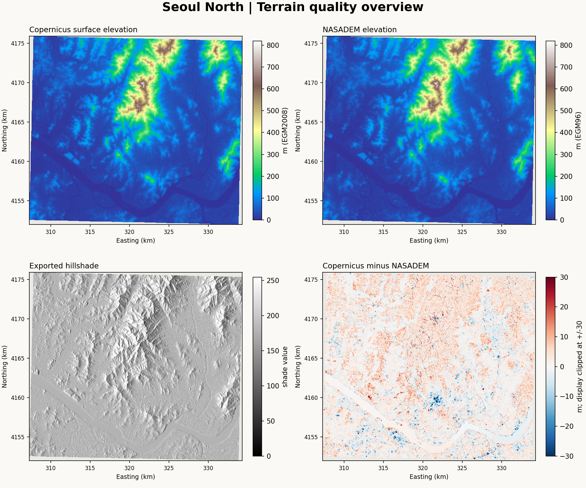
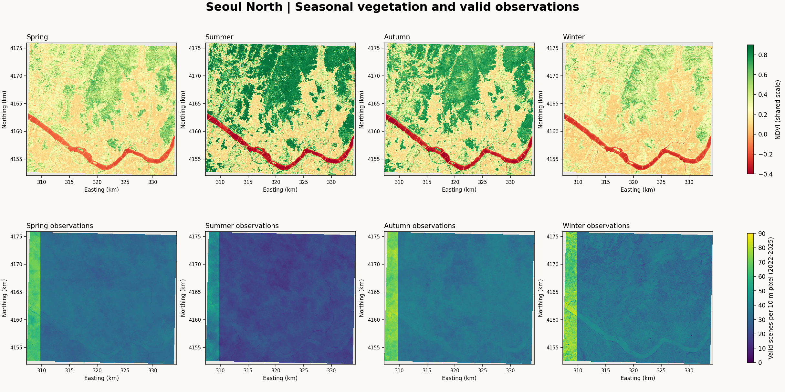
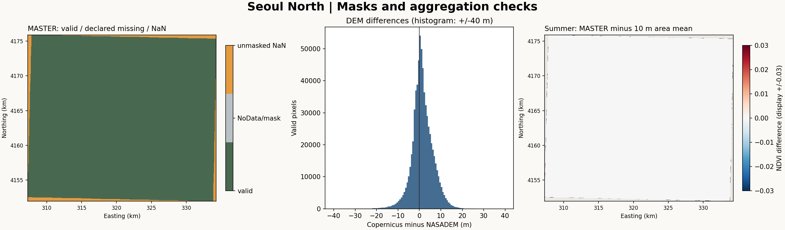

# Seoul North v0.2 — Measured Data Quality

Validation date: 2026-10-14 (Asia/Seoul). Scope: input quality and basic visualization only. No terrain strokes, seasonal color engine, or G-code were generated.

## Result

The exports are usable for terrain exploration **after explicitly masking nonfinite values**. Metadata, band order, and nested grid alignment match the v0.2 specification. All bands within each file have the same finite footprint. There are no enclosed internal gaps or tested band-range violations; invalid pixels lie at the cropped perimeter. These checks establish file usability, not survey accuracy or artistic rendering quality.

## File Metadata

| Property | MASTER | VEG |
| --- | --- | --- |
| CRS | EPSG:32652 | EPSG:32652 |
| Pixel size | 30 × 30 m | 10 × 10 m |
| Width × height | 900 × 797 | 2700 × 2388 |
| Bands / dtype | 13 / float32 | 8 / float32 |
| Bounds (west, south, east, north; meters) | 307290, 4151990, 334290, 4175900 | 307290, 4152000, 334290, 4175880 |
| Declared NoData | -9999 | -9999 |
| Actual missing values per band | 29,708 unmasked NaNs (4.1416%) | 268,643 unmasked NaNs (4.1666%) |
| Valid coverage of rectangular raster | 95.8584% | 95.8334% |

MASTER bands: `DEM`, `SLOPE`, `ASPECT`, `HILLSHADE`, `DEM_NASA`, four seasonal NDVI bands, and four seasonal valid-count bands. VEG contains the same four seasonal NDVI and count bands at 10 m. Full names and per-band statistics are in [quality_report.json](quality_report.json).

No -9999 pixels or infinities were found. GDAL's mask marks every pixel valid, including NaNs. Use `read_valid_band()` rather than relying on `read(masked=True)` alone. Keep valid negative NDVI and NASADEM values; do not turn all negatives into zero.

## Grid Alignment

The 30 m grid nests in the 10 m grid (3:1). The left origins agree; MASTER's top is 20 m north of VEG's top, and its bottom extends 10 m farther south. Both follow the prescribed global grid anchors. This is differing export cropping, not an inferred geographic shift.

Do not reshape the 10 m array into 3 × 3 blocks without accounting for offsets. Georeferenced area-average reprojection reproduces the interior MASTER NDVI within float32 rounding (RMSE below 4 × 10⁻⁹); interior mean-count differences are zero. Here, interior excludes one 30 m pixel around the jointly valid footprint. Edge differences can be much larger (summer NDVI up to 0.438): GEE aggregates before clipping, while this comparison has only the already-clipped 10 m export. The full-footprint summer NDVI RMSE is 0.00261.



## Elevation and Hillshade

- Copernicus elevation: 0.55 to 801.77 m.
- NASADEM elevation: -32 to 801 m. The negative minimum is retained for investigation, not silently clipped.
- Exported slope: 0–66 degrees; aspect: 0–359 degrees; hillshade: 23–255. These ranges are consistent with the documented units. Slope/aspect values in this export are integer-valued despite float32 storage; do not assume sub-degree precision.
- The overview reveals continuous large-scale relief. It does not yet assess viewpoint-dependent Inwangsan/Bugaksan silhouettes or the suitability of texture strokes.

Copernicus minus NASADEM, over 687,592 jointly valid pixels:

| Metric | Value |
| --- | --- |
| Mean difference | +1.364 m |
| Median difference | +1.002 m |
| Mean absolute difference | 3.848 m |
| RMS difference | 5.331 m |
| 5th–95th percentile | -6.367 to 9.762 m |
| Minimum / maximum | -90.630 / 61.550 m |
| Absolute difference >20 m | 0.389% |

This is a **raw inter-dataset comparison, not an accuracy estimate**. Copernicus is a surface model that includes buildings and vegetation, with EGM2008 heights. The selected NASADEM elevation band uses EGM96. Acquisition, processing, grid sampling, and vertical datum differ. No geoid correction or reference-survey validation was performed; neither raster is treated as ground truth. The largest local differences need inspection within the eventual scene region before blending or replacement.

## Seasonal Vegetation

Statistics below use all finite 10 m pixels, including urban land and water, not a forest-only region.

| Season | NDVI range | Median NDVI | Valid-count range | Median count | Pixels with count <10 |
| --- | --- | --- | --- | --- | --- |
| Spring | -0.286 to 0.830 | 0.241 | 15–75 | 32 | 0.00000% |
| Summer | -0.557 to 0.920 | 0.428 | 9–60 | 20 | 0.00006% |
| Autumn | -0.498 to 0.897 | 0.377 | 4–84 | 36 | 0.00057% |
| Winter | -0.468 to 0.840 | 0.192 | 4–87 | 35 | 0.00324% |

Summer has the strongest vegetation signal but fewer clear observations. Winter retains valid coverage across the interior; only a very small fraction has fewer than ten observations. Counts span the four-year seasonal composite, not one year. MASTER counts are means over underlying 10 m cells, so fractional counts are expected; VEG counts are integer-valued.



An abrupt western boundary is visible in observation counts. A scene/tile coverage boundary is a plausible explanation, **not confirmed from these rasters alone**. It is not a missing-data seam, and the two resolutions agree in the interior. Treat counts as a confidence diagnostic rather than vegetation density. NDVI is not a direct measurement of species, tree counts, or autumn leaf colors.



## Reproduce in VSCode / Jupyter

Install the existing research environment from the repository root:

```bash
python -m pip install -e ".[research,dev]"
python -m datascape.data.quality --master /path/to/SeoulNorth_v02_MASTER_30m.tif --vegetation /path/to/SeoulNorth_v02_VEG_10m.tif --output outputs/seoul_north_quality --base-revision 832d7b5639598d0ca1bdf7d51e50ec4c3f85ffaa
```

Alternatively, select that environment as the VSCode kernel and open [01_data_quality.ipynb](../../../notebooks/01_data_quality.ipynb). Set `DATASCAPE_DATA_DIR` or edit the notebook's data directory. Keep raw TIFFs outside tracked files.

Reusable checks: [quality.py](../../../src/datascape/data/quality.py). Tests cover NaN/Inf/NoData masking, valid negatives, cropped grid alignment, fractional offsets, NaN-safe area averaging, and jointly valid comparisons.

Validation performed for this snapshot: six tests passed; the notebook schema and every Python code cell were checked and executed in a shared namespace against both supplied rasters. Native Jupyter kernel startup was blocked by the execution host's socket permissions, so a full kernel session was not verified here.

All numerical statistics use native-resolution values, one band at a time. Display previews may use nearest-neighbor samples; all seasonal maps share color limits. The analysis uses no randomness (`random_seed: null`). The report records the base repository revision, exact module SHA-256, environment versions, input hashes, and display settings. Both input hashes were unchanged after the run. The base revision identifies the starting repository, not the newly added module; the module hash identifies its implementation.

### Input SHA-256

- MASTER: `837f4b6b2e01e3b97b05db3e62fbd0869ce052ba4c18cc47a99d97873317f0fb`
- VEG: `ac7f2d96af327f7b1ab07da14e379d0466500799420066484b29b45fbd5b47d5`
- Quality module: `3211266b3d88fea1267970a2e78318378cd6458cb6050e19df6ffcfebc5d68cb`

## Next Review

Review these maps before selecting a smaller scene region and comparing the three monochrome terrain approaches. Keep the historical Taebaek sources unchanged. No shared projection/horizon/spline renderer is implemented by this validation PR.

## Sources and Data Attribution

- [Copernicus GLO-30 2024_1 catalog](https://developers.google.com/earth-engine/datasets/catalog/COPERNICUS_DEM_GLO30_2024_1)
- [NASADEM catalog](https://developers.google.com/earth-engine/datasets/catalog/NASA_NASADEM_HGT_001)
- [Earth Engine terrain products](https://developers.google.com/earth-engine/apidocs/ee-terrain-products)
- Seasonal vegetation: Sentinel-2 SR Harmonized, with Cloud Score+ and SCL masking as recorded in [the supplied GEE script](../../../gee/seoul_north_v02.js).

Figures produced using Copernicus WorldDEM-30 © DLR e.V. 2010-2014 and © Airbus Defence and Space GmbH 2014-2018 provided under COPERNICUS by the European Union and ESA; all rights reserved.

The organisations in charge of the Copernicus programme by law or by delegation do not incur any liability for any use of the Copernicus WorldDEM-30.
