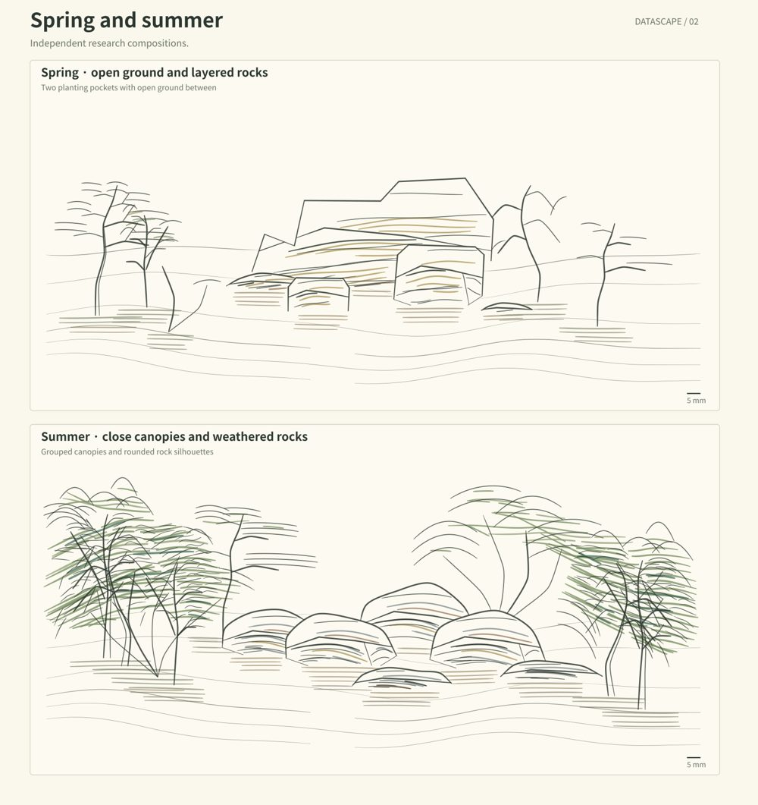
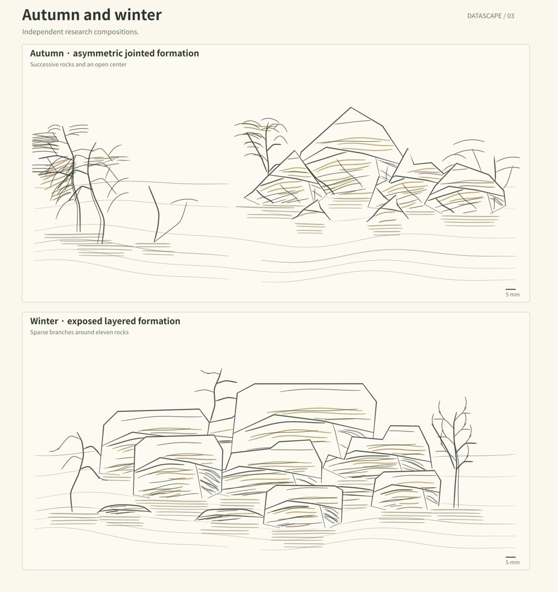
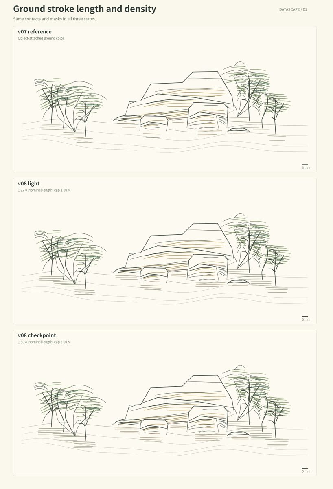

# Datascape Procedural Vegetation & Rock Catalog v08

This catalog collects reusable research grammars for plotter-vector vegetation, rock and local ground color. It uses independent specimens and compositions. The preset names Spring, Summer, Autumn and Winter describe research studies. The v08 checkpoint is provisional pending physical plot tests and later artwork integration.

## Ground patch decision

The matched-site study uses the released v07 contact coordinates, terrain frame, visible rock footprints and original object paths. v08 widens each eligible stroke around its original contact, adds lighter interleaved passes, then clips against the existing rock mask. New passes stay close to horizontal. The v07 palette and pressure envelopes are inherited.

| Preset | Input length multiplier | Stroke-count cap | Observed strokes | Mean stroke length |
| --- | ---: | ---: | ---: | ---: |
| v07 reference | 1.00 | 1.00× | 23 | 15.29 mm |
| v08 light | 1.22 | 1.50× | 34 | 18.39 mm |
| v08 checkpoint | 1.30 | 2.00× | 44 | 19.00 mm |

The checkpoint preset is the default for the four compositions. The light preset remains available for finer scales, high contact density or materials with stronger wet accumulation. Observed counts and lengths can vary with the visibility of individual contacts and with local clipping. A geometric count cap is independent of dry-time and color strength.

## Contents

| Path | Contents |
| --- | --- |
| `catalog/` | Reproducible Python modules for v01–v08. The v08 entry points build the catalog, the historical atlas and the verification report. |
| `config/catalog_v08.json` | Both patch candidates and four composition presets with seeds, placements and scale. |
| `config/atlas_v08.json` | The selection of 23 comparison sheets from v01–v07. |
| `baseline/` | Frozen input manifests, two v06 vector fixtures and the inherited settings. |
| `audit/verification.json` | Counts, lengths, masking checks, and repeat-build measurements. |
| `previews/` | Selected raster previews in the repository distribution. |

The complete output contains 26 review sheets. The atlas covers isolated P/B/U/W plants, variation within each family, near/middle/far detail, gentler B/W paths, X/Y clustering and shared canopy areas. Rock studies cover silhouette variation, geometry-relative surface strokes, related rock families, group massing and front/back clipping. COLOR sheets cover plant regions, rock surfaces, object contacts and mask details. The seasonal atlas shows both the same site across all four seasons and composition changes among different communities.

| Study | Rock grammar | Vegetation and space |
| --- | --- | --- |
| Spring | Layered family with a dominant rock | Two loose planting pockets divided by open ground |
| Summer | Rounded weathered group of medium rocks | Shared canopies in a denser near/far arrangement |
| Autumn | Successive jointed rocks | Asymmetrical planting and an open center |
| Winter | Large layered formation | Exposed rock and sparse branching |

## Reproduction

Use Python 3.11 or newer with the pinned versions in `requirements.txt`. For PNG previews, make Inkscape available on PATH. SVG and mm-coordinate exports can be built with `--no-png`. For previews containing Korean labels, install a Korean-compatible font such as Noto Sans CJK KR.

```sh
python -m pip install -r requirements.txt
python -m catalog.catalog_v08
python -m catalog.atlas_v08
python -m catalog.verify_v08
```

The three v08 plates write to `review/`. Each of the seven studied states exports a vector SVG and compressed JSON with millimeter coordinates, role, material, phase, pressure intent and per-stroke provenance. Four separate INK, COLOR and combined SVG sets in `compositions/` use a common viewBox for each scene. A combined preview places color beneath the ink for reading. Preview order does not define physical staging.

The atlas writes an SVG and a PNG per selected historical plate. For old version-specific outputs beyond the selected atlas, use the preserved v01–v07 archives. To experiment with different presets, start with a copy of `config/catalog_v08.json` and record the changed seed and placement alongside the output.

The verifier checks the preserved v07 inputs, the matched site's unchanged non-ground paths and contacts, horizontal patch slope and rock masking, the aligned layer exports, and identical bytes across repeated v08 builds in the pinned environment. The SVG raster preview does not model brush spread, pigment dilution, paper absorption or repeated wet contact. Review those conditions on a small independent test before adding this grammar to an artwork.

## Preview







The Korean artistic review and the complete vector and preview bundle accompany the checkpoint.
