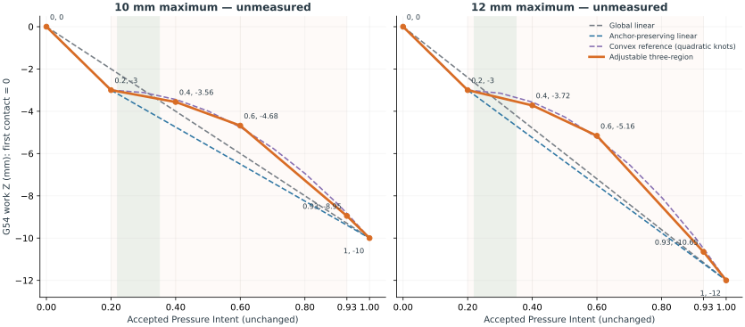
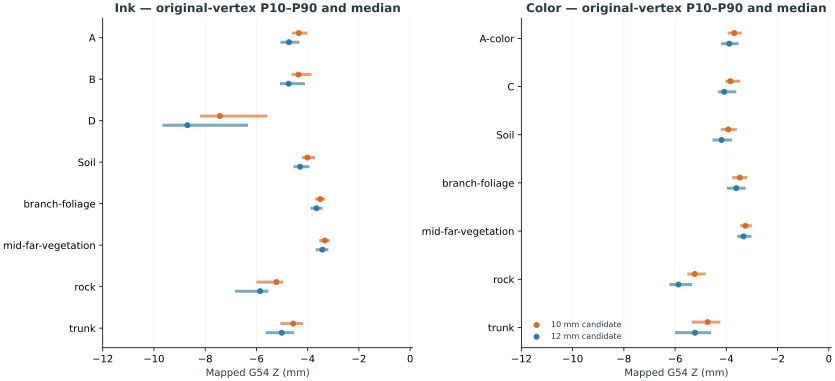
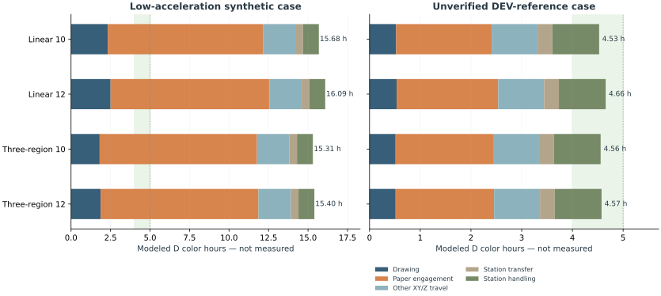

# Three-region brush pressure calibration and runtime study v01

Independent study based on **PR #27 `12b28bd5b7ad575b1438ed5af61618746c7effe9`**.
The PR #27 branch, backend source, artwork, accepted Pressure Intent and S3a order
are unchanged. No merge, hardware motion or executable production G-code.

- [Standalone illustrated review](Datascape_Three_Region_Pressure_v01.html)
- [Editable candidate knot coordinates](candidate_curves.json)
- [Full family distributions and A/D category times](results/full_study.json)
- [Non-executable physical benchmark design](benchmark_plan.json)
- [Blank observations](observations.template.json) and [historical source review](historical_source_review.json)

## Recommended response hypothesis

Start with **A, 10-mm maximum**, after a shallow physical-depth ladder. It has
six knots, five intervals: the lower calibration domain, three principal artistic
regions, and an upper reserve. It is not a three-knot mapping.

| Intent | A work Z (10-mm maximum) | B work Z (12-mm maximum) |
| --- | ---: | ---: |
| 0.00 | 0.000 mm | 0.000 mm |
| 0.20 | -3.000 mm | -3.000 mm |
| 0.40 | -3.560 mm | -3.720 mm |
| 0.60 | -4.680 mm | -5.160 mm |
| 0.93 | -8.950 mm | -10.650 mm |
| 1.00 | -10.000 mm | -12.000 mm |



After p=.20 / C=3 mm, .40/.60/.93 use 8%/24%/85% of the remaining
compression budget. Principal slopes are A 2.8/5.6/12.94 and B 3.6/7.2/16.64
mm compression per intent unit. These fractions are adjustable design choices,
not measurements or a fitted physical law. .93 does not reach maximum depth.
All mappings are monotonic, continuous piecewise linear and reject extrapolation.
The 0–.20 and .93–1.0 domains are explicit. Original G1 vertices are not
resampled to insert calibration knots; XYZ interpolates between mapped endpoints.

Global linear (C=Mp) does not satisfy .20→3 mm: it gives 2.0/2.4 mm. Therefore
each maximum also has an anchor-preserving linear control and an eleven-knot
quadratic-shaped convex reference. All eight mappings and exact coordinates
are in the JSON/illustrated review. No spline or new interpolation is introduced.

Only ink D has samples above .8 (902). A collinear .8 knot at Z−7.268/−8.487
would add no behavior. Add/move it only if physical .75/.85/.93 tests identify
a needed distinction in strong marks. Six knots are the initial minimum.

## Actual Spring implications

- 14,951 original strokes / 240,974 accepted samples; 15 accepted medium/family groups.
- Ink: 3,345 strokes / 69,101 samples. Color: 11,606 / 171,873.
- The .22–.35 range contains 96,988 samples (40.25%): A maps it to
  Z−3.056…−3.420, B to Z−3.072…−3.540. Narrow variation does **not** establish
  a thin mark: approximately 3-mm initial compression can already be broad.
- The region response independently controls low/middle/strong variation. It is
  not proven artistically better, and global-linear A is slightly faster for D
  color. Use the anchor-preserving control to separate preload from curve shape.
- Every family has original-vertex P10/P25/median/P75/P90 and extrema for all
  eight mappings, plus stroke counts and original XY lengths. These are not
  width, force, pigment or recovery predictions.



## Execution times — unmeasured models, hours

The four main columns use unverified DEV-reference acceleration. Low columns
show the synthetic low-acceleration alternative for preferred A/B. All commanded-
feed and motion-category values for all eight curves/six jobs are in the HTML
selectors and JSON.

| Job | Linear 10 DEV | Linear 12 DEV | Region 10 DEV | Region 12 DEV | Region 10 low | Region 12 low |
| --- | ---: | ---: | ---: | ---: | ---: | ---: |
| SHARED_COLOR | 4.527 | 4.656 | 4.557 | 4.575 | 15.307 | 15.402 |
| SHARED_INK | 2.457 | 2.510 | 2.420 | 2.436 | 6.190 | 6.234 |
| P1_COLOR | 2.402 | 2.466 | 2.415 | 2.424 | 7.703 | 7.748 |
| P1_INK | 1.129 | 1.153 | 1.111 | 1.119 | 2.814 | 2.834 |
| P2_COLOR | 2.523 | 2.589 | 2.539 | 2.549 | 8.101 | 8.151 |
| P2_INK | 1.301 | 1.330 | 1.282 | 1.290 | 3.344 | 3.368 |

D color category breakdown for the preferred candidates:

| Category | A feed h | A DEV model h | B feed h | B DEV model h |
| --- | ---: | ---: | ---: | ---: |
| drawing | 0.322 | 0.514 | 0.323 | 0.514 |
| paper engagement | 1.477 | 1.924 | 1.496 | 1.942 |
| non drawing travel | 0.789 | 0.905 | 0.789 | 0.905 |
| station transfer | 0.278 | 0.291 | 0.278 | 0.291 |
| station handling | 0.918 | 0.923 | 0.918 | 0.923 |



The 4–5-hour D color target is **conditionally plausible**, with only about
27 minutes between A’s DEV model and five hours. It is not a verified duration.
Paper entry/compression/release dominates; B costs only about 1.1 additional
minutes for color. Depth selection must follow mark quality and recovery, not
an assumed speed win. Drawing rate caps affect few segments in this workload,
while deeper entry/release happens at every original stroke.

Both models retain draw 5,000, ordinary XY 12,000, general Z 6,000, approach
5,000, contact/release and pressure Z up to 2,000, wet travel 3,000/9,000/3,000
mm/min. Station operations remain independently calibrated and unchanged here.
Low XYZ acceleration is 100/100/20 mm/s²; DEV is 1,200/1,200/1,000.
XYZ rate caps are 15,000/15,000/6,000 and 15,000/15,000/8,000 respectively.
Junction deviation .01 mm is synthetic, absent from the unverified DEV file.
The high DEV accelerations exceed current fixture brush limits; comparison is
not export approval. Full lookahead/continuous streaming is assumed; finite
buffer, step rounding, serial/CPU stalls and physical brush recovery are omitted.
Stop-each-segment sensitivities are retained, without claiming physical bounds.

## Physical benchmark and first test

1. Establish measured machine/frame/air/clearance/contact-envelope evidence and
   separate calibration authorization. Confirm G54 paper first-contact Z0, free
   bristle length, wet holder clearance and a recovered no-contact boundary.
2. Begin with separate smaller direct-depth trials (.25/.5/1/2/3 mm candidates),
   observing each before proposing the next. The supplied
   [first_depth.request.json](first_depth.request.json) contains only a single
   unapproved −.25-mm, 20-mm line in the existing constant-Z request schema.
   Initial draw 500/contact-release 100 mm/min are test conditions, not approved.
3. Compare A at .20/.28/.35 first. If the 3-mm preload is already too broad or
   unstable, revise that physical anchor without changing Pressure Intent.
4. Clear intermediate depths before A’s full 18-pattern coupon: nine constants,
   three short, three long and three continuous rise/fall patterns. Repeat .28/
   .50/.85; test ink and diluted gouache/glue separately with matched loading.
5. Test B only if A shows a physical reason to increase compression. At p=.93
   A requests 8.95 mm, B 10.65 mm. The 10/12-mm p=1 endpoints are separate
   deepest-anchor tests, not required by Spring’s actual pressure maximum.
6. Record start/mid/end and dry width, continuity, pigment distribution, paper
   response, recovery time/clearance, all depth/feed/dynamic settings, mounting,
   loading/dilution and scaled photos. No observations or passes are prefilled.

The benchmark JSON is a design, not direct CLI input. Existing calibration CLI
handles isolated constant-Z lines. Continuous-pressure coupons can use the
existing source-planning/export API only after measured profiles, current
evidence and separate authorization; no such program is generated here.
Keeping the full 0–1 measured profile requires observations at every retained
knot including 1.0. Otherwise keep it unverified or separately review a measured
domain ending at .93 with the same mapped depth; never extrapolate or silently
reassign .93 to maximum compression.

## Historical context

The three original source files are read only. Geumgang’s drawing input clamp
[-8,0], Taebaek Yang’s ink clamp [-10.5,0] and older hover/contact thresholds
do not establish current compression; cubic interpolation also prevents treating
input clamps as verified final extrema. Taebaek Eum draws at −5.3 with ±1-mm
panel tilt, with a source comment intending .3-mm compression relative to
central contact −5.0. Its pigment dip −12 is a station coordinate, not paper
compression. Full details, SHA256s and source paths are in the history JSON.

## Reproduce

Analysis uses the pinned backend and Python 3.10+ standard library. Plot/report
generation additionally uses Matplotlib (executed with 3.10.8). From this study
branch, retain the accepted bound payload/provenance and pressure sidecar from
PR #25; see [backend binding instructions](../../docs/plotter_backend_v03/REPRODUCE.md).

```sh
PYTHONPATH=src:. python -m studies.brush_pressure_three_region_v01.run \
  --machine /absolute/offline/spring.machine.json \
  --provenance /absolute/offline/spring.provenance.json \
  --sidecar /absolute/Pressure/artworks/spring_v13_pressure_intent_v01/spring_v13.pressure_intent_v01.json.gz \
  --curves studies/brush_pressure_three_region_v01/candidate_curves.json \
  --output /absolute/offline/three-region-run
```

Output must be new. It contains serialized source plans and a report, no
G-code or physical trajectory files. Edit the candidate JSON knots to make a
new unmeasured comparison; domain/anchor/monotonic validation remains active.
Copy the resulting results.json to this study’s results/full_study.json before
regenerating figures/report:

```sh
PYTHONPATH=src:. python -m studies.brush_pressure_three_region_v01.report
PYTHONPATH=src:. python -m unittest discover -s tests -p "test_brush_pressure_study.py" -v
PYTHONPATH=src:. python -m unittest discover -s tests -p "test_gcode*.py" -v
```

Executed: **8 study tests + 74 backend tests passed; 1 legacy conditional test
skipped**. Full source/trajectory work was separately executed: 48 rebuilt jobs,
all eight mappings, all original pressure vertices, exact A/D plan read-back,
continuous D seam, no routine M0, unchanged reload/wash/station-transfer counts,
and exact final park. Final M2 serialization remains covered by unchanged
backend regressions. The full offline run took 335.77 s, not physical testing.
No backend v0.4 design is introduced.
